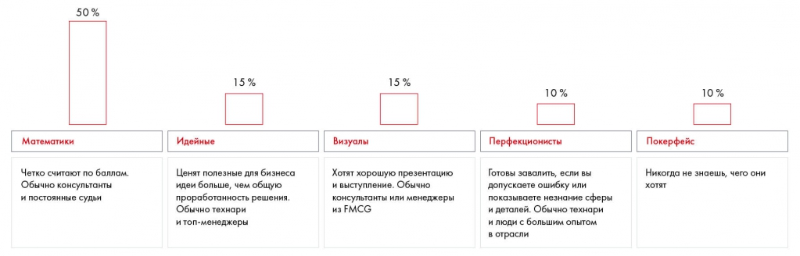

# Определение целевой аудитории презентации

Разбираются ожидания аудитории и четыре типа судей. Практическое задание 11.1 предлагает подготовить выступление с учётом этих различий.

**Источник:** физические страницы PDF 192–195. Печатные номера не установлены.

**Для последовательного чтения:** [Презентация решения: общий процесс](01-process.md).

**Навигация:** [Индекс главы](INDEX.md) · [Маршрутизатор](../../ROUTER.md) · [Проблемы источника](../../meta/issues.md).

---

## Источник: [PDF 192](../../SOURCE.md#pdf-192)

### ОПРЕДЕЛЕНИЕ ЦЕЛЕВОЙ АУДИТОРИИ

### ПРЕЗЕНТАЦИИ

Когда речь заходит о создании презентации, многие в первую очередь думают об оформлении слайдов. Какой цвет лучше использовать? Как расположить информацию? Какие фишки применить? Генерация идей, как выделиться из десятка похожих решений, может затянуться надолго. А все может кончиться тем, что презентация не произвела ожидаемого эффекта. Почему так происходит?

Ошибка в том, что начинать работу над презентацией следует не с оформления, а с определения целевой аудитории. Задайте себе вопросы: кто наш заказчик, что его интересует? почему он готов вас слушать и что хочет услышать? какое решение он должен принять после выступления? Сформулируйте ответы и сделайте так, чтобы слушатели потратили свое время максимально полезно.

Чтобы лучше понять, на чем акцентировать внимание в презентации, постарайтесь заранее узнать, кто будет сидеть в жюри. Это будут консультанты, HR-специалисты, топ-менеджеры? Представители ИТ-сферы, тяжелой промышленности или FMCG? Иностранцы или русские? Разные судьи будут концентрироваться на разных аспектах решения.

**Мы выделяем четыре типа судей:**

Математиков большинство. Они руководствуются исключительно инструкцией с критериями и правилами выставления баллов за них, которые есть на большинстве мероприятий и по которым оценивают ваше выступление[1]. Им нравятся презентации, в которых много фактов и есть конкретные выводы. Они рациональны, организованны, но бывают слишком дотошны и могут с легкостью увлечься какими-то незначительными деталями,

**Ссылки на этой странице исходника:** [Ссылка url-221](../../meta/source-links.md#url-221).

## Источник: [PDF 193](../../SOURCE.md#pdf-193)

забыв о главной теме. Такие люди избегают конфронтации, поэтому, несмотря на свою дотошность, вряд ли будут спорить с утверждениями остальных членов жюри.

Идейные ищут идею в решении. Классическое решение кейс-чемпионата в консалтинговом формате, где все разложено по полочкам, но нет возможности выделить яркую идею (так как их много и они неглубоко проработаны), им не понравится. И наоборот, им может понравиться решение, где есть одна очень интересная идея, и неважно, что команды не рассмотрели всю широту задачи и не объяснили, как они выбрали эту идею. Проблема с этими судьями в том, что предугадать, что их зацепит, а что нет, практически невозможно. Для этого, если есть такая возможность, нужно очень глубоко общаться с клиентом короткими спринтами: придумали идею — представили клиенту — получили обратную связь — переделали идею — и так далее.

Для визуалов главное, чтобы все было красиво — от презентации до самого выступления. Они предпочитают эмоции от выступления всему основному. Если такие судьи преобладают, побеждает та команда, что лучше всего сделала презентацию и лучше всего продала свою идею, а не та, что сделала лучший анализ. Технически этих людей не обязательно цепляет визуальная составляющая, но чаще по своему психотипу они визуалы, поэтому мы их так называем.

Те, кого стоит опасаться больше всего, — перфекционисты. Именно эти люди могут вас завалить, если вы допустите ошибку или продемонстрируете некомпетентность в каком-либо вопросе. Они действительно готовы придираться ко всему, что только можно. Обычно это технические специалисты или люди «от сохи», то есть те, кто прошел в индустрии путь от самой низшей должности и понимает каждый винтик процесса. По окончании презентации они хотят видеть готовый план действий и то, как вы к нему пришли. Много внимания они уделяют вопросам эффективности, особенно финансовой. Важно не допустить неточностей в знании темы. Например, если в ходе презентации перед перфекционистом-финансистом выступающий спутает доходы компании с чистой прибылью[2], пиши пропало: этот человек уже ни за что не поставит высокие баллы. Перфекционисты независимы, очень упорны и могут быть конфликтными. Практика показывает, что таких людей меньшинство, но все же будьте аккуратны.

Наконец, существует еще такой тип судей, как покерфейс. Это люди, по которым невозможно понять, чего они хотят. Они могут сочетать в себе все три типа выше или вообще молчать все выступление, а потом неожиданно

**Ссылки на этой странице исходника:** [Ссылка url-004](../../meta/source-links.md#url-004); [Ссылка url-222](../../meta/source-links.md#url-222).

## Источник: [PDF 194](../../SOURCE.md#pdf-194)

завалить каким-нибудь вопросом. Таких судей мало, но они встречаются. Просто будьте к этому морально готовы.

На рисунке пять типов судей: математики (50 %), идейные (15 %), визуалы (15 %), перфекционисты (10 %), покерфейс (10 %). В основном тексте перед перечислением сказано «четыре»; это несогласованность источника, см. TXT-02.

[Подробная текстовая расшифровка рисунка](../../assets/transcripts/pdf-194-img-01.md).

Разные типы судей

Возникает логичный вопрос: как понять, кто есть кто? Если есть возможность, постарайтесь заранее узнать, кто будет присутствовать на вашем выступлении. Часто тип личности можно прогнозировать по должности человека. Так, к идейным обычно относятся топ-менеджеры, математиками чаще всего бывают консультанты, визуалов много среди менеджеров из FMCG, а к перфекционистам относятся технари и люди с большим опытом в отрасли. Если у вас нет информации о судьях, попробуйте прикинуть, кто это может быть, исходя из тематики кейса, отрасли компании и партнеров чемпионата. В день выступления внимательно следите за вопросами, которые судьи задают другим.

Впрочем, эта типология, как и любая другая, имеет свои ограничения. Люди всегда совмещают несколько типов личности, один из которых преобладает. В стрессовых ситуациях судьи могут перемещаться к дальним углам спектра. Так, математик может с легкостью стать придирчивым как перфекционист. Поэтому структурируйте свою презентацию, ориентируясь на визуала, но при этом оставьте в приложении несколько детализированных слайдов, посвященных аналитике, которые помогут ответить на вопросы математика. Если вы не можете проработать все и сразу, то ориентируйтесь на ожидания математиков: их обычно большинство.

Важно помнить, что у каждого человека есть тема, в которой он эксперт. Это может относиться к его непосредственной специальности, проекту, над которым он недавно работал, его интересам. Назовем это горячими точками.

**Ссылки на этой странице исходника:** [Ссылка url-223](../../meta/source-links.md#url-223).

## Источник: [PDF 195](../../SOURCE.md#pdf-195)

Их нужно знать. Изучите интересы экспертов, их репутацию, темы, на которые они часто высказываются, и не забывайте внимательно их слушать. Горячая точка поможет вам привлечь эксперта на свою сторону, например, если ваши мнения совпадут. Но она же может и подорвать ваше выступление, сместив фокус с основной задачи.

### Практическое задание №11.1

Посмотрите видео выступления (возможный пример видео –

– https://www.youtube.com/watch?v=Y21xzVH8NGY). Обратите внимание на судей. Кто из них к какому типу относится?

В жюри сидят люди. Только судьи из отрасли, которая затронута в кейсе, могут подвергнуть сомнению чисто техническую сторону вашего решения. Остальным остается руководствоваться здравым смыслом, опытом из своей профессиональной сферы и вашей презентацией.

**Николай Агеев, 1-е место на Changellenge ≫ Cup Moscow**

[1] Более подробно о критериях оценки решений кейсов см. в Неделе 1.

[2] Чистая прибыль = доходы – расходы.

**Ссылки на этой странице исходника:** [Ссылка url-224](../../meta/source-links.md#url-224); [Ссылка url-012](../../meta/source-links.md#url-012); [Ссылка url-225](../../meta/source-links.md#url-225); [Ссылка url-226](../../meta/source-links.md#url-226).

## Связанные разделы

- [Все темы главы](INDEX.md)
- [Термины и сокращения](../../GLOSSARY.md)
- [Предыдущая тема: Презентация решения: общий процесс](01-process.md)
- [Следующая тема: Линия повествования презентации. Часть 1](03-storyline.md)
- [Авторские ответы по этой неделе](../13-answers/10-week-11.md)
