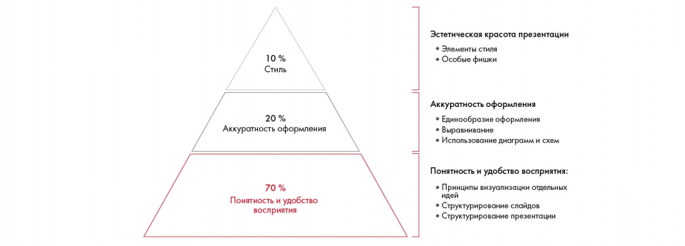
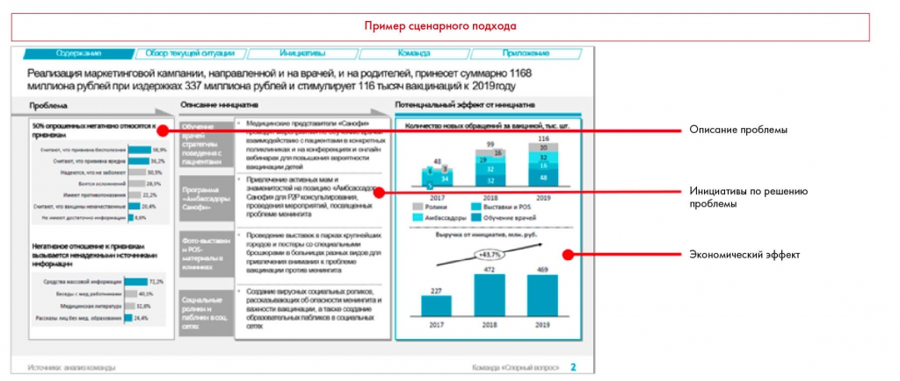
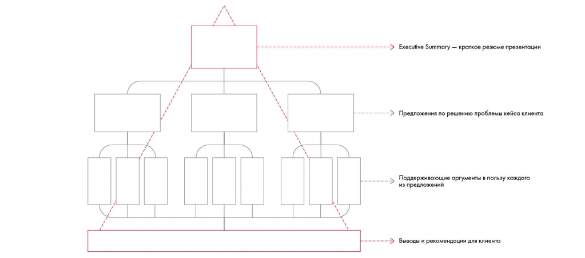
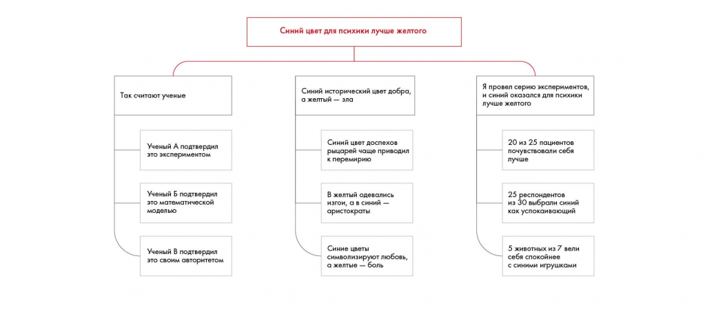
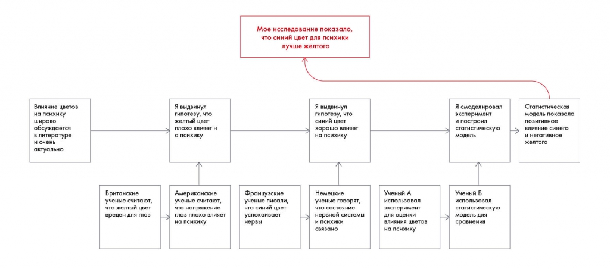
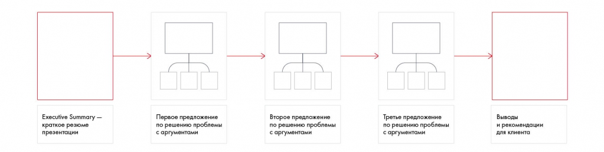

# Линия повествования презентации. Часть 1

Сопоставлены сценарный подход и построение рассказа через пирамиду Минто. Сохранены индуктивная и дедуктивная логика, задания 11.2–11.3.

**Источник:** физические страницы PDF 195–205. Печатные номера не установлены.

**Для последовательного чтения:** [Определение целевой аудитории презентации](02-audience.md).

**Навигация:** [Индекс главы](INDEX.md) · [Маршрутизатор](../../ROUTER.md) · [Проблемы источника](../../meta/issues.md).

---

## Источник: [PDF 195](../../SOURCE.md#pdf-195)

### Неделя 11. Презентация решения

### ЛИНИЯ ПОВЕСТВОВАНИЯ

### ПРЕЗЕНТАЦИИ. ЧАСТЬ 1

Согласитесь, бывали такие лекции, с которых вы выходили и не помнили, о чем говорил лектор. Хотя спикером он был харизматичным, а слайды — красивыми и хорошо проработанными с точки зрения визуализации. Можно сослаться на плохую память, но, скорее всего, проблема в том, что выступление не было структурировано.

**Ссылки на этой странице исходника:** [Ссылка url-224](../../meta/source-links.md#url-224); [Ссылка url-012](../../meta/source-links.md#url-012); [Ссылка url-225](../../meta/source-links.md#url-225); [Ссылка url-226](../../meta/source-links.md#url-226).

## Источник: [PDF 196](../../SOURCE.md#pdf-196)

Мозгу тяжело воспринимать информацию. Вместо запоминания он тратит время на структурирование, проведение параллелей в материале и домысливание недостающих данных.

При создании презентации существуют определенные критерии успеха.

Оказывается, 70 % успеха презентации обеспечивают понятность и удобство восприятия информации. И только 30 % приходятся на визуализацию: 20 % — на аккуратность оформления, 10 % — на эстетичность презентации.

Понятность и удобство восприятия презентации зависят прежде всего от логики слайдов, их структуры и отдельных идей. Сначала нужно сделать железобетонную логику во всей презентации и отдельно в каждом слайде, а уже потом добиваться того, чтобы содержимое слайдов было понятно и удобно представлено.

Аккуратность оформления — это соблюдение единых принципов во всей презентации, использование уместных цветов и шрифтов, выравнивание элементов слайда.

Эстетическая красота презентации — это ее стиль, особые визуальные фишки, интересная графика и прочие параметры.

На рисунке приведены элементы: 10 %; Стиль; 20 %; Аккуратность оформления; 70 %. Полная текстовая расшифровка приведена отдельно; геометрия и цветовые обозначения сохранены на изображении.

[Подробная текстовая расшифровка рисунка](../../assets/transcripts/pdf-196-img-01.md).

Ключевые аспекты презентации

Выбрать необычный шрифт и броские цвета — не залог успешной презентации. Поэтому, прежде чем начинать оформление, подумайте о структуре и содержании.

**Принцип пирамиды Минто в структурировании презентации**

## Источник: [PDF 197](../../SOURCE.md#pdf-197)

Прежде чем браться за отрисовку слайдов, соберитесь вместе с командой и составьте Storyline[1] презентации. Это история, которую вы расскажете при помощи слайдов.

Для бизнес-презентаций идеальной будет структура, построенная по принципу пирамиды Минто. Как вы помните, это универсальный инструмент для структурирования идей. А презентация и есть изложение ваших мыслей. По сути, у вас есть наброски, ведь вы использовали пирамиду, чтобы структурировать свое решение. А значит, у вас уже построено дерево, которое соответствует правилам МЕСЕ, соразмерности и однородности элементов.

Давайте разберемся, почему для создания презентации нам тоже пригодится пирамида Минто. Она выстраивает логику, которая удобна для восприятия новой информации,

— от общего к частному. Сначала озвучивается главная мысль всей презентации с кратким обзором предложений по решению проблемы. Затем идет постепенное погружение в детали каждого из названных предложений с раскрытием частностей. Автор последовательно описывает, как именно добьется желаемого результата, и обосновывает эти действия. При такой логике аудитория с первого слайда в курсе предлагаемых идей, ей легче ориентироваться в ваших мыслях. Если вы будете долго подводить к финальным выводам, то к концу презентации все забудут, о чем шла речь и почему вы получили такой вывод.

На вершине пирамиды находится слайд с резюме (т. е. основными выводами) вашего решения. Его называют Executive Summary[2]. Советуем уделить этому слайду особое внимание, поскольку он:

- Вводит аудиторию в курс дела.

- Задает в голове слушателей структуру последующего повествования.

- Дает общее представление о вашем решении без углубления в детали.

Третий пункт крайне важен. Топ-менеджеры ценят свое время. Зачастую они могут посмотреть только этот слайд, чтобы понять, заслуживает ваша презентация внимания или нет. Если слайд окажется плохим, вас просто не станут слушать.

Executive Summary должно включать в себя три обязательных пункта, чтобы дать аудитории правильное представление о вашем решении:

- Краткое описание проблемы, с которой столкнулась компания. Тут учтите, что не надо просто копировать информацию из кейса или постановку задачи. Здесь нужно дать ключевую задачу и пояснить основные проблемы или особенности задачи.

**Ссылки на этой странице исходника:** [Ссылка url-227](../../meta/source-links.md#url-227); [Ссылка url-228](../../meta/source-links.md#url-228).

## Источник: [PDF 198](../../SOURCE.md#pdf-198)

- Предлагаемые меры по решению этой проблемы.

- Эффект, который получит компания от внедрения этих мер.

Иллюстрация исходника: «Пример Executive Summary. Источник: Sanofi Health Guardians, решение команды». Подписи и числовые значения вынесены в расшифровку; порядок и связи элементов проверяются по сохранённому изображению.

[Подробная текстовая расшифровка рисунка](../../assets/transcripts/pdf-198-img-01.md).

Пример Executive Summary. Источник: Sanofi Health Guardians, решение команды «Спорный вопрос»

Для лучшего закрепления информации в голове у слушателя повторите основные выводы и рекомендации в самом конце презентации. Информация запомнится, если услышать о ней минимум три раза: в Executive Summary, в теле презентации и выводах.

Структура доказательного рассказа: Executive Summary → предложения → поддерживающие аргументы → выводы и рекомендации. Она переносит главный ответ к началу презентации.

[Подробная текстовая расшифровка рисунка](../../assets/transcripts/pdf-198-img-02.md).

Структура презентации по принципу от общего к частному

## Источник: [PDF 199](../../SOURCE.md#pdf-199)

Чтобы пирамида превратилась в единый рассказ, нужно построить связи между ветвями дерева. Вы можете сделать это с помощью двух типов логики: индукции и дедукции.

Блоки пирамиды, основанной на дедукции, представляют собой взаимосвязанную последовательность суждений. Более высокий уровень — следствие из нижних блоков, и так далее. Пример дедуктивного суждения: «Все государства Латинской Америки — республики. Эквадор находится в Латинской Америке. Следовательно, Эквадор — республика». Третье утверждение следует из первых двух. Минус подхода в том, что, если усомниться хотя бы в одной фразе, связь между ними нарушится. Будьте осторожны, вы должны быть на 100 % уверены в качестве взаимосвязей внутри логической цепочки.

В индуктивной логике выводы делаются из ряда фактов одного и того же рода на основе их сходства. Пример индуктивного суждения: «Эквадор республика по трем причинам: 1) государственная власть Эквадора избирается на определенный срок; 2) государственная власть Эквадора состоит из нескольких органов; 3) граждане Эквадора обладают личными и политическими правами». Первое утверждение — это вывод, который объединяет предыдущие суждения. Плюс этой логики в том, что, даже если опровергнуть один из поддерживающих аргументов, структура останется устойчивой.

Посмотрите на пример дерева. По какой логике оно выстроено — индуктивной или дедуктивной?

На рисунке приведены элементы: Синий цвет для психики лучше желтого; Так считают ученые; Синий исторический цвет добра,; а желтый - зла; Я провел серию экспериментов,. Полная текстовая расшифровка приведена отдельно; геометрия и цветовые обозначения сохранены на изображении.

[Подробная текстовая расшифровка рисунка](../../assets/transcripts/pdf-199-img-01.md).

## Источник: [PDF 200](../../SOURCE.md#pdf-200)

Утверждение по Минто: индуктивная логика

Это дерево выстроено с использованием индукции: вы доказываете основную мысль несколькими равнозначными утверждениями.

А вот пример того же рассказа об исследовании, который выстроен по дедуктивной логике:

На рисунке приведены элементы: Мое исследование показало,; что синий цвет для психики; лучше желтого; Влияние цветов; на психику. Полная текстовая расшифровка приведена отдельно; геометрия и цветовые обозначения сохранены на изображении.

[Подробная текстовая расшифровка рисунка](../../assets/transcripts/pdf-200-img-01.md).

Утверждение по Минто: дедуктивная логика

Здесь ваши утверждения идут в строгой последовательности, каждый следующий уровень отвечает на вопрос «что из этого следует?».

Вы можете использовать любой подход, главное — не смешивать эти виды логики на одном уровне. При этом будьте внимательны с дедуктивным подходом. Он хорош в двух случаях: вы действительно крайне профессиональный спикер либо это презентация на широкую аудиторию (хороший пример — презентации в формате TED, где есть и то и другое). В бизнесе все-таки лучше применять индукцию.

Пример из реальной практики консалтингового проекта. Команда выбрала дедуктивный подход. На первом же слайде генеральный директор компании-заказчика сказал: «Я вижу, что вы хотите мне рассказать детали, но позвольте сначала узнать, а в чем суть ваших рекомендаций и какова их архитектура?». Слово заказчика — закон.

## Источник: [PDF 201](../../SOURCE.md#pdf-201)

Консультанты быстро перелистнули презентацию на последний слайд, затем оттуда пошли с конца к началу.

**Практическое задание № 11.2**

Рассмотрите группы утверждений. По какой логике они выстроены — индуктивной или дедуктивной?

1. В Китай в этом году хлынет поток инвестиций. Русские, американские и японские бизнесмены планируют проникнуть на китайский рынок.

2. Я работал в креативном агентстве много лет и привык к гибкому графику, который предоставлял мне работодатель. Поэтому, когда я перешел на работу в госструктуру с режимом работы с 9:00 до 18:00, мне там не понравилось.

3. Я думал, что жену можно найти в университете. Искал на старших курсах, на младших и на своем курсе. Когда не нашел, стал искать на работе. Потом стал искать в интернете.

4. Рынок подгузников в Австралии вырос в 2017 году на 5 %. Это обусловлено новой демографической политикой и, как следствие, ростом рождаемости.

5. У компании падает прибыль. Это можно объяснить двумя факторами: падением выручки и увеличением расходов. Выручка, в свою очередь, может падать из-за снижения цены или уменьшения количества проданного продукта. Расходы могут расти из-за увеличения переменных либо постоянных расходов.

Когда определены взаимосвязи между блоками пирамиды, можно превращать их в единый рассказ. С этого момента логика пирамиды трансформируется в линейную последовательность. Повествование начинается с Executive Summary, а затем по очереди освещается каждое из ваших предложений со своими поддерживающими аргументами.

## Источник: [PDF 202](../../SOURCE.md#pdf-202)

На рисунке приведены элементы: Executive Summary -; краткое резюме; презентации; Первое предложение; по решению проблемы. Полная текстовая расшифровка приведена отдельно; геометрия и цветовые обозначения сохранены на изображении.

[Подробная текстовая расшифровка рисунка](../../assets/transcripts/pdf-202-img-01.md).

Трансформация пирамиды в линейную последовательность слайдов

Обратите внимание на очень полезное правило трех. Чтобы быть убедительным, старайтесь во время презентации использовать ровно три аргумента для обоснования любой идеи. В идеале каждый из трех аргументов также должен делиться на три.

Почему надо поступать именно так? Давайте рассмотрим три причины:

1. Каждый аргумент получает свою порцию внимания и запоминается.

2. Вам приходится выбирать три самые важные причины.

3. Ваш ответ звучит структурированно, уверенно и взвешенно.

Даже не спрашивайте, откуда взялась цифра три, — по всей видимости, это эмпирический опыт. Оглядитесь и поймете, как много в мире троек: в древности люди считали, что мир стоит на трех китах, Святая Троица в христианстве и так далее.

Если трех аргументов никак не хватает, можно увеличить их число до пяти-семи. Но семь — это максимум: больше люди просто не смогут удержать в голове.

**Практическое задание № 11.3**

Приведите по три аргумента в пользу идей, приведенных ниже, и по три аргумента против:

## Источник: [PDF 203](../../SOURCE.md#pdf-203)

1. MacBook лучше, чем Lenovo, или наоборот.

2. Чтобы привлечь молодую аудиторию, нужно использовать digital-каналы.

3. Работа в маркетинге не подходит интровертам.

4. Чтобы много зарабатывать, нужно работать больше, чем 40 часов в неделю, а иногда и по выходным.

В итоге вы получите Storyline, из которого будет ясна логика повествования презентации. Давайте вернемся к кейсу Besh и рассмотрим пример из него.

Продажи и промо по четырем основным каналах позволят увеличить продажи на 1 млн долларов.

1. Через крупный ритейл необходимо реализовывать товары с потенциально наивысшим спросом:

Шампуни и бальзамы опережают другие типы средств по продажам.

На рынке наиболее популярны средства для сухих и поврежденных волос.

Широкая аудитория плохо знакома с прочими средствами по уходу за волосами.

2. Через аптеки необходимо реализовывать средства для кожи головы:

- В аптеках наиболее востребованы средства по уходу с лекарственными компонентами.

- Низкая представленность в аптеках региона лечебных шампуней и бальзамов означает высокий потенциал.

- Наши конкуренты успешно реализовали проект с сетью аптек.

3. Салоны красоты — важный канал для распространения всей линейки:

Это приоритетный канал для профессиональной продукции.

В салонах красоты есть незанятая ниша.

Сотрудничество с мастерами — это главный драйвер роста для профессиональной продукции.

## Источник: [PDF 204](../../SOURCE.md#pdf-204)

4. Онлайн-магазин должен предлагать широкий ассортимент:

Популярность онлайн-каналов в регионе растет.

Наиболее важный фактор для покупателей онлайн — возможность выбора.

Покупатели онлайн лучше осведомлены о различных типах средств.

5. Маркетинговые инициативы для каждого из каналов позволят увеличить продажи на 100 %:

Специализированные стенды увеличивают продажи новых товаров на 25 %.

Торговые представители в аптеках позволяют увеличить выручку на 10 %.

Обучающие мероприятия для мастеров увеличат выручку на 15 %.

Сезонные промоакции, сотрудничество с блогерами и programmatic-реклама увеличат выручку на 50 %.

6. План действий по внедрению наших инициатив на год:

- календарный и организационный;

- стоимостный и бюджетный.

7. Мы рассмотрели возможные риски и способы их нивелирования.

Первое предложение примера обобщает все, что будет сказано далее. Уже по первому предложению читателю понятно, чему посвящена презентация. Далее автор раскрывает подробности по каналам продаж и маркетинговым инициативам, которые последовательно приведут к увеличению выручки. Презентация завершается планом внедрения заявленных инициатив и предупреждением о возможных рисках.

**Задание по кейсу**

Создайте Storyline для презентации по решению кейса Coca-Cola HBC Россия.

## Источник: [PDF 205](../../SOURCE.md#pdf-205)

[1] Фабула, сюжет (англ.). Изначально слово использовалось только для обозначения сюжета книги или фильма, но подходит к любому продукту, который о чем-то рассказывает.

[2] Краткое содержание, резюме (англ.).

**Ссылки на этой странице исходника:** [Ссылка url-229](../../meta/source-links.md#url-229); [Ссылка url-230](../../meta/source-links.md#url-230); [Ссылка url-231](../../meta/source-links.md#url-231).

## Связанные разделы

- [Все темы главы](INDEX.md)
- [Термины и сокращения](../../GLOSSARY.md)
- [Предыдущая тема: Определение целевой аудитории презентации](02-audience.md)
- [Следующая тема: Линия повествования презентации. Часть 2: раскадровка](04-storyboard.md)
- [Авторские ответы по этой неделе](../13-answers/10-week-11.md)

> Редакторское примечание SRC-02: здесь сохранено сквозное задание, но полное условие кейса Coca-Cola из приложения 1 отсутствует в предоставленном PDF. См. [реестр проблем](../../meta/issues.md).
