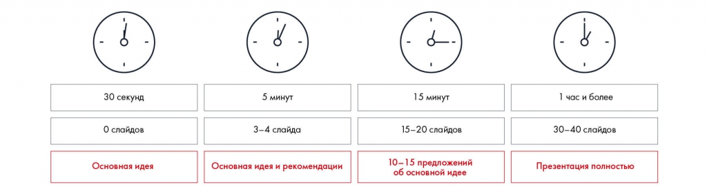
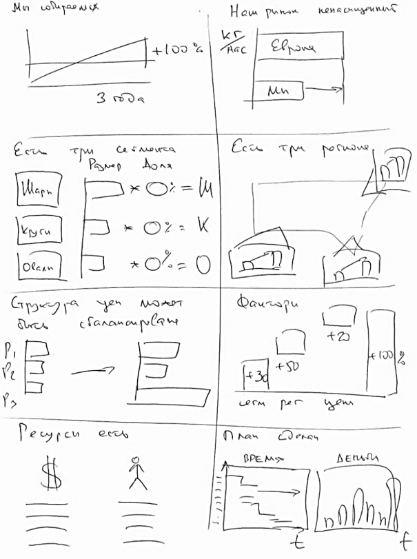
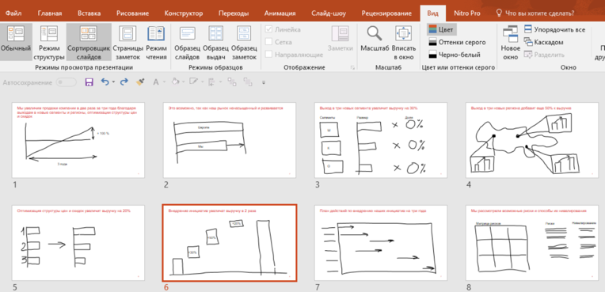

# Линия повествования презентации. Часть 2: раскадровка

Показано, как превратить линию повествования в последовательность слайдов. Рассматриваются объём презентации, бумажные макеты и сортировщик слайдов.

**Источник:** физические страницы PDF 205–208. Печатные номера не установлены.

**Для последовательного чтения:** [Линия повествования презентации. Часть 1](03-storyline.md).

**Навигация:** [Индекс главы](INDEX.md) · [Маршрутизатор](../../ROUTER.md) · [Проблемы источника](../../meta/issues.md).

---

## Источник: [PDF 205](../../SOURCE.md#pdf-205)

### Неделя 11. Презентация решения

### ЛИНИЯ ПОВЕСТВОВАНИЯ

### ПРЕЗЕНТАЦИИ. ЧАСТЬ 2

**Раскадровка**

Следующий этап создания презентации — раскадровка (Storyboard). На этом этапе история начинает конвертироваться в слайды. Для начала определитесь, сколько слайдов будет включать ваша презентация, — зачастую формат предполагает ограничения по их количеству. Если у вас нет ограничения, исходите из количества времени: в среднем на один слайд приходится одна минута выступления.

Учтите, переключать слайды чаще, чем раз в минуту, не советуем. От быстрой смены картинок у зрителей может начать рябить в глазах.

Объём рассказа зависит от времени: 30 секунд без слайдов, 5 минут на основной ответ и рекомендации, 15 минут на более подробное обоснование. Все значения объёма перенесены в расшифровку.

[Подробная текстовая расшифровка рисунка](../../assets/transcripts/pdf-205-img-01.md).

Рекомендации по количеству слайдов в зависимости от времени выступления

**Ссылки на этой странице исходника:** [Ссылка url-229](../../meta/source-links.md#url-229); [Ссылка url-230](../../meta/source-links.md#url-230); [Ссылка url-231](../../meta/source-links.md#url-231).

## Источник: [PDF 206](../../SOURCE.md#pdf-206)

Определив объем презентации, приступайте к раскадровке. Возьмите стикеры и набросайте макеты всех слайдов с формулировками заголовков в той последовательности, которую выстроили до этого в линии повествования. Представьте, какие графики можно вставить на слайд, какие визуалы добавить и как распределить элементы. Возможно, когда вы увидите макеты вживую, появятся идеи, как улучшить Storyline. Стикеры хорошо подходят для этой работы — вы можете поменять их местами, убрать или добавить новые.

## Источник: [PDF 207](../../SOURCE.md#pdf-207)

Иллюстрация исходника: «Примерно так выглядит раскадровка презентации». Подписи и числовые значения вынесены в расшифровку; порядок и связи элементов проверяются по сохранённому изображению.

[Подробная текстовая расшифровка рисунка](../../assets/transcripts/pdf-207-img-01.md).

Примерно так выглядит раскадровка презентации

## Источник: [PDF 208](../../SOURCE.md#pdf-208)

Вы можете составлять структуру презентации в PowerPoint, в режиме «Сортировщик слайдов». Благодаря вкладке «Рисование» можно схематично отразить мысли по наполнению каждого слайда. Это похоже на работу в Paint –

– быстро и удобно для редактирования.

Такой способ создания Storyboard имеет два минуса, связанных с командной работой:

Рисовать макет может только один человек.

Если у вас маленький экран, не всем членам команды будет видна раскадровка.

На рисунке приведены элементы: Файл; Главная; Вставка; Рисование; Конструктор. Полная текстовая расшифровка приведена отдельно; геометрия и цветовые обозначения сохранены на изображении.

[Подробная текстовая расшифровка рисунка](../../assets/transcripts/pdf-208-img-01.md).

Сортировщик слайдов в PowerPoint

**Ссылки на этой странице исходника:** [Ссылка url-232](../../meta/source-links.md#url-232).

## Связанные разделы

- [Все темы главы](INDEX.md)
- [Термины и сокращения](../../GLOSSARY.md)
- [Предыдущая тема: Линия повествования презентации. Часть 1](03-storyline.md)
- [Следующая тема: Месседжи и принцип One message per slide](05-messages.md)
- [Авторские ответы по этой неделе](../13-answers/10-week-11.md)
