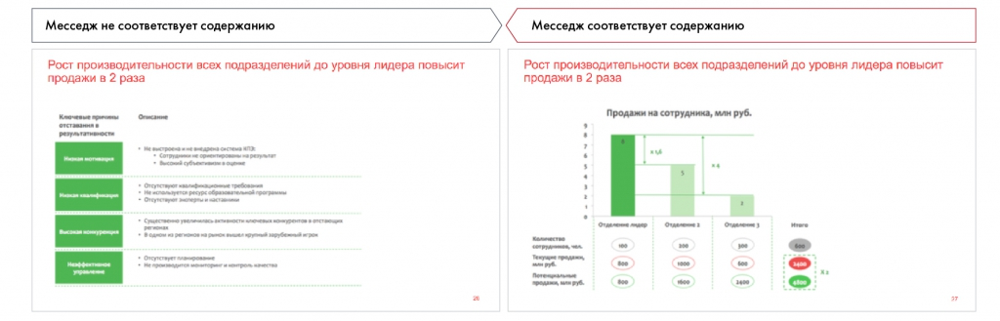
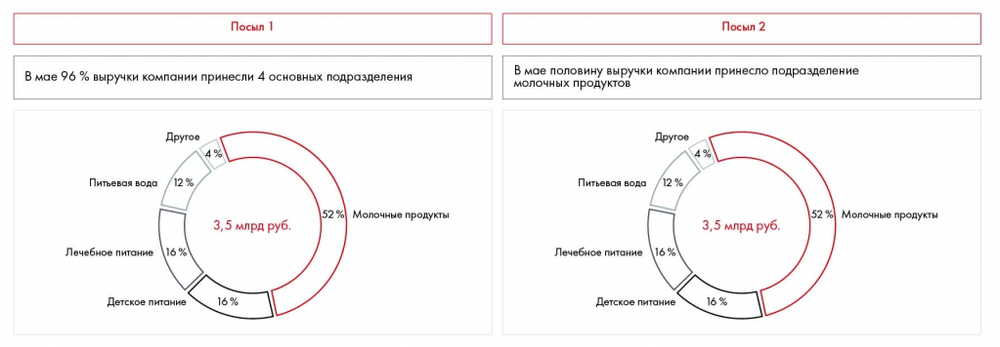
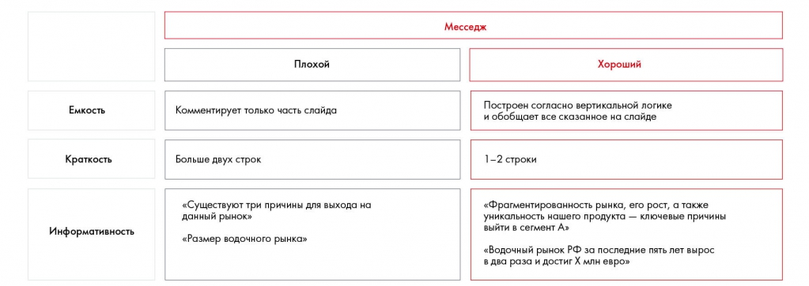
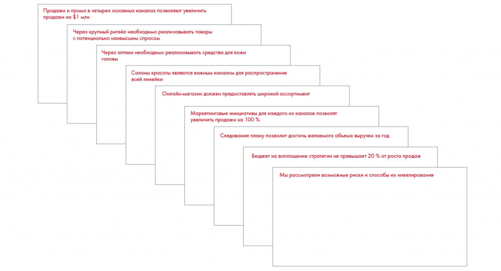
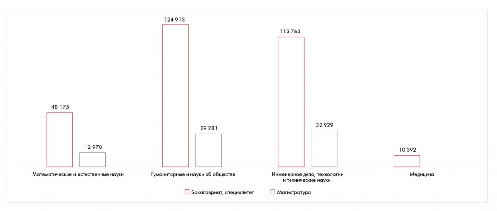
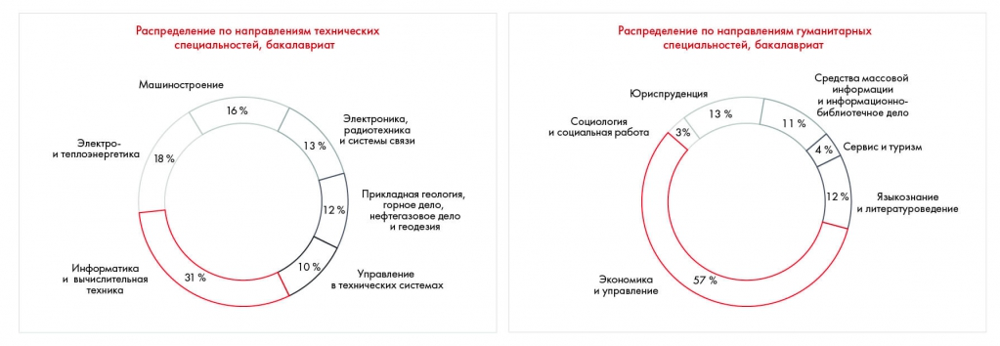
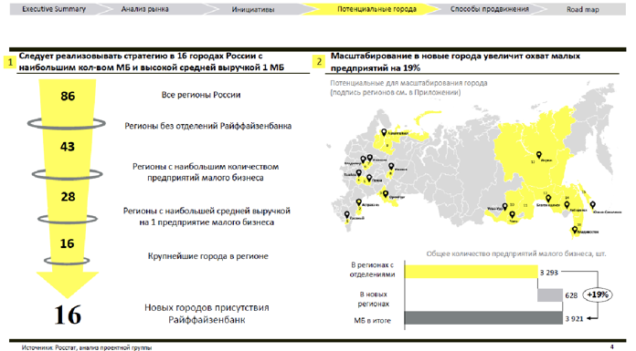
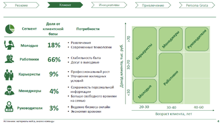
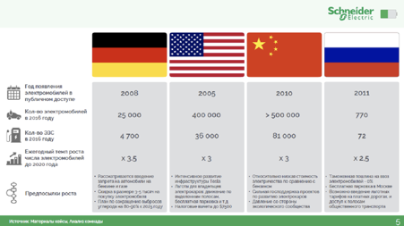

# Месседжи и принцип One message per slide

Разбираются содержательные заголовки и соответствие месседжа данным слайда. Примеры и задание 11.4 показывают, когда следует разделять перегруженный слайд.

**Источник:** физические страницы PDF 208–215. Печатные номера не установлены.

**Для последовательного чтения:** [Линия повествования презентации. Часть 2: раскадровка](04-storyboard.md).

**Навигация:** [Индекс главы](INDEX.md) · [Маршрутизатор](../../ROUTER.md) · [Проблемы источника](../../meta/issues.md).

---

## Источник: [PDF 208](../../SOURCE.md#pdf-208)

**Месседжи[1] и принцип One message per slide**

Следующий этап — формулировка месседжа слайда. Месседж — это, по сути, заголовок, отражающий его главную мысль. Главное отличие месседжа от обычного заголовка в том, что это всегда законченная фраза, характеризующая суть слайда. Например, вместо статичного заголовка «Распределение государственных расходов в 2017 году» гораздо лучше написать «2017 год характеризовался снижением доли расходов на здравоохранение в пользу расходов на образование». С таким месседжем, даже не глядя на слайд, можно представить его содержание.

К формулировке месседжа нужно отнестись очень внимательно. Во-первых, он действительно должен соответствовать содержанию слайда. Иногда бывает,

**Ссылки на этой странице исходника:** [Ссылка url-232](../../meta/source-links.md#url-232).

## Источник: [PDF 209](../../SOURCE.md#pdf-209)

что в месседже заявлено одно, а содержание слайда совсем другое. В таком случае стоит пересмотреть само содержание — возможно, вы отобразили совсем не то, о чем хотели сказать. Также месседж может в корне изменить посыл слайда, даже если вы не меняли его содержание.

На рисунке приведены элементы: Месседж не соответствует содержанию; Рост производительности всех подразделений до уровня лидера повысит; продажи в 2 раза; Месседж соответствует содержанию; Рост производительности всех подразделений до уровня лидера повысит. Полная текстовая расшифровка приведена отдельно; геометрия и цветовые обозначения сохранены на изображении.

[Подробная текстовая расшифровка рисунка](../../assets/transcripts/pdf-209-img-01.md).

Соответствие и несоответствие месседжа содержанию

На рисунке приведены элементы: Посыл 1; В мае 96 % выручки компании принесли 4 основных подразделения; Другов; 4%; Питьевая вода. Полная текстовая расшифровка приведена отдельно; геометрия и цветовые обозначения сохранены на изображении.

[Подробная текстовая расшифровка рисунка](../../assets/transcripts/pdf-209-img-02.md).

Как месседж меняет суть слайда

Другая распространенная ошибка — добавление «месседжа ради месседжа». Например, на наших чемпионатах большинство команд используют месседжи, но далеко не всегда они действительно информативны. Например, нет смысла писать «Сегментация выявила потребности разных типов потребителей» — эта информация не дает ничего, кроме факта, что вы молодцы и использовали сегментацию. С тем же успехом вы могли бы назвать слайд «Сегментация потребителей». Напротив, если написать более конкретно, например «Наиболее перспективными сегментами являются городские жители 20–25

**Ссылки на этой странице исходника:** [Ссылка url-233](../../meta/source-links.md#url-233).

## Источник: [PDF 210](../../SOURCE.md#pdf-210)

лет», вы сразу емко донесете суть слайда. Это сложно, зато гораздо лучше донесет вашу мысль до клиента.

На рисунке приведены элементы: Емкость; Краткость; Информативность; Месседж; Плохой. Полная текстовая расшифровка приведена отдельно; геометрия и цветовые обозначения сохранены на изображении.

[Подробная текстовая расшифровка рисунка](../../assets/transcripts/pdf-210-img-01.md).

Хороший и плохой месседж

В идеале каждый месседж должен быть сформулирован по SMART и не занимать больше 1–2 строчек.

Когда линия повествования выстроена правильно, заголовки складываются в настоящую историю. Прочитав их друг за другом и не вдаваясь в контент, можно понять смысл презентации и ее основные выводы.

Иллюстрация исходника: «Пример выстроенной последовательности месседжей в презентации». Подписи и числовые значения вынесены в расшифровку; порядок и связи элементов проверяются по сохранённому изображению.

[Подробная текстовая расшифровка рисунка](../../assets/transcripts/pdf-210-img-02.md).

Пример выстроенной последовательности месседжей в презентации

**Ссылки на этой странице исходника:** [Ссылка url-234](../../meta/source-links.md#url-234).

## Источник: [PDF 211](../../SOURCE.md#pdf-211)

**Принцип one message per slide**

При создании презентации обязательно нужно соблюдать принцип «один слайд

— одна мысль». Почему это важно? Наш мозг не может воспринимать слишком много информации сразу. Если вы покажете людям слайд с несколькими важными мыслями, их внимание расфокусируется, каждый читатель или слушатель сосредоточится на своем, и главного посыла никто не уловит. Разделяя идеи по разным слайдам, вы преподносите аудитории информацию фрагментарно, чтобы усвоить ее своевременно и в нужном порядке.

Давайте убедимся, почему это важно. Посмотрите на следующий слайд:

Здесь сразу два месседжа в одном слайде: во-первых, основная масса мест в лучших российских вузах отведена техническим и гуманитарным специальностям, а естественные, математические науки и медицина отстают. Во-вторых, большая часть мест отведена IT-специалистам и экономистам. Понятно ли с первого раза, куда нужно смотреть? Слайд оказывается перегружен, взгляд расфокусируется, и даже не хочется вникать во все эти диаграммы.

Попробуем разделить слайд на два:

На рисунке приведены элементы: 124913; 113763; 48 175; 29 281; 32929. Полная текстовая расшифровка приведена отдельно; геометрия и цветовые обозначения сохранены на изображении.

[Подробная текстовая расшифровка рисунка](../../assets/transcripts/pdf-211-img-01.md).

**Ссылки на этой странице исходника:** [Ссылка url-235](../../meta/source-links.md#url-235).

## Источник: [PDF 212](../../SOURCE.md#pdf-212)

Иллюстрация исходника: «Теперь нам стало понятнее, какие диаграммы к каким утверждениям относятся.». Подписи и числовые значения вынесены в расшифровку; порядок и связи элементов проверяются по сохранённому изображению.

[Подробная текстовая расшифровка рисунка](../../assets/transcripts/pdf-212-img-01.md).

Теперь нам стало понятнее, какие диаграммы к каким утверждениям относятся. Месседжи стали короче, а слайды — легче. При этом мы также детализировали второй месседж, и наличие двух диаграмм теперь стало понятнее.

Часто количество слайдов в презентации ограниченно. Например, на кейс-чемпионатахрешение часто решение должно уместиться в восемь слайдов. В этом случае при оформлении презентации решения рекомендуем придерживаться следующей структуры:

Слайд 1: краткая вводная информация, проблема кейса и основной вопрос. Основные конечные выводы вашего решения (Executive Summary).

Слайд 2: контекст, анализ проблемной ситуации. Важно не просто описать факты, но и сделать по ним выводы, показать, что они значат для решения.

Слайд 3: ваш подход к решению задачи. Здесь нужно описать либо ваше Issue Tree, либо план работы, что вы делали для того, чтобы прийти к решению.

Слайды 4–6: инициативы, которые вы предлагаете для решения проблемы, их обоснование.

Слайды 7–8: план внедрения, финансы и риски.

Приложение 1: представление вашей команды.

Приложения- 2–10: все, что, по вашему мнению, нужно добавить.

**Практическое задание № 11.4**

**Ссылки на этой странице исходника:** [Ссылка url-004](../../meta/source-links.md#url-004).

## Источник: [PDF 213](../../SOURCE.md#pdf-213)

Предложите удачные месседжи для данных слайдов.

Иллюстрация исходника: «Источник: Changellenge ≫ Cup Moscow, решение команды Tutto Bene». Подписи и числовые значения вынесены в расшифровку; порядок и связи элементов проверяются по сохранённому изображению.

[Подробная текстовая расшифровка рисунка](../../assets/transcripts/pdf-213-img-02.md).

Источник: Changellenge ≫ Cup Moscow, решение команды Tutto Bene

На рисунке приведены элементы: Сегмент; каменской; горотники; Карьеристы; 18%. Полная текстовая расшифровка приведена отдельно; геометрия и цветовые обозначения сохранены на изображении.

[Подробная текстовая расшифровка рисунка](../../assets/transcripts/pdf-213-img-03.md).

**Ссылки на этой странице исходника:** [Ссылка url-012](../../meta/source-links.md#url-012).

## Источник: [PDF 214](../../SOURCE.md#pdf-214)

Источник: Changellenge ≫ Cup Moscow, решение команды Persona Grata

Иллюстрация исходника: «Источник: Changellenge ≫ Cup Moscow, решение команды OldBold». Подписи и числовые значения вынесены в расшифровку; порядок и связи элементов проверяются по сохранённому изображению.

[Подробная текстовая расшифровка рисунка](../../assets/transcripts/pdf-214-img-01.md).

Источник: Changellenge ≫ Cup Moscow, решение команды OldBold

Как только вы определитесь с наполнением всех слайдов, а месседжи выстроятся в единую историю, можно начать сбор контента. Если вы работаете над презентацией в команде, каждому достанется по 2–4 слайда. Обратите внимание: на этом этапе задача участников — не оформлять слайды, а просто найти и разместить на них всю информацию. После этого ответственный за оформление нарисует всю презентацию.

**Задание по кейсу**

Создайте Storyboard для презентации по вашему решению кейсаCoca-Cola HBC Россия. Сформулируйте месседжи для каждого слайда.

**Ссылки на этой странице исходника:** [Ссылка url-012](../../meta/source-links.md#url-012).

## Источник: [PDF 215](../../SOURCE.md#pdf-215)

[1] От англ. message — «послание, сообщение».

**Ссылки на этой странице исходника:** [Ссылка url-236](../../meta/source-links.md#url-236).

## Связанные разделы

- [Все темы главы](INDEX.md)
- [Термины и сокращения](../../GLOSSARY.md)
- [Предыдущая тема: Линия повествования презентации. Часть 2: раскадровка](04-storyboard.md)
- [Следующая тема: Структура слайда. Часть 1](06-slide-structure.md)
- [Авторские ответы по этой неделе](../13-answers/10-week-11.md)

> Редакторское примечание SRC-02: здесь сохранено сквозное задание, но полное условие кейса Coca-Cola из приложения 1 отсутствует в предоставленном PDF. См. [реестр проблем](../../meta/issues.md).
