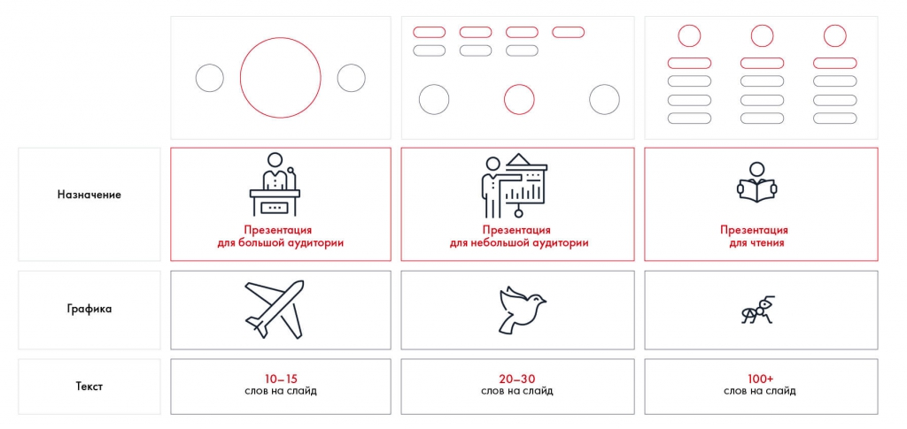
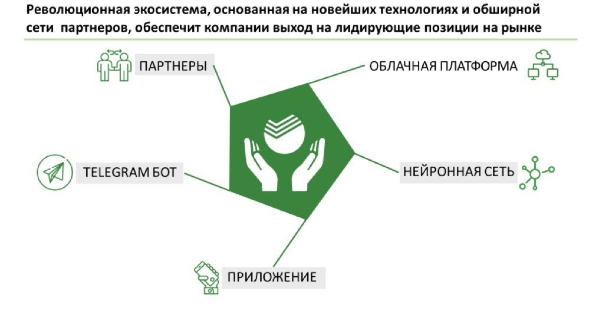
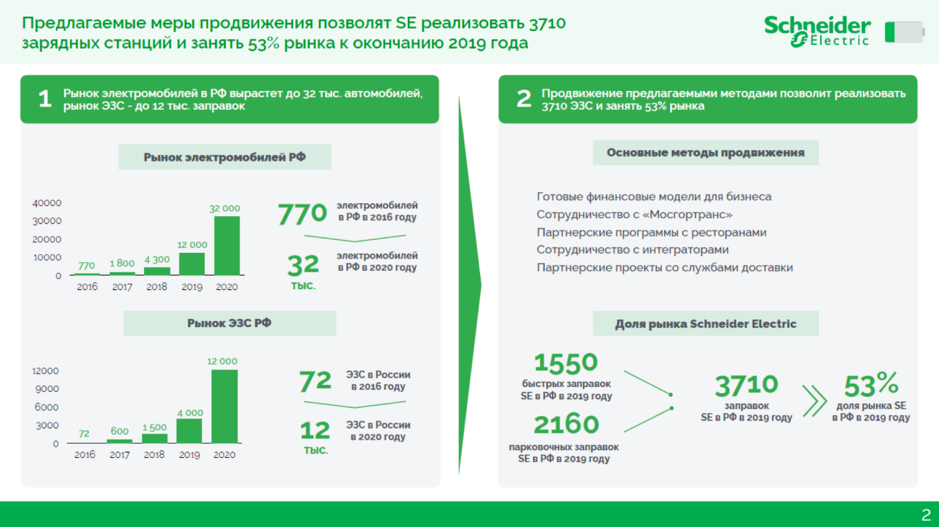
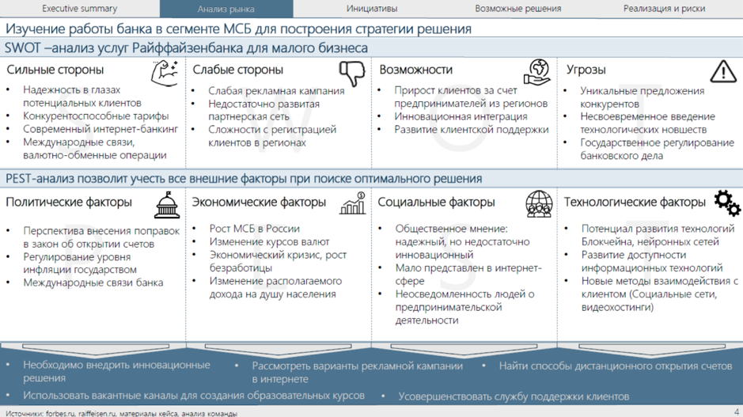
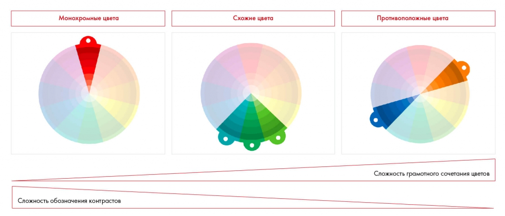
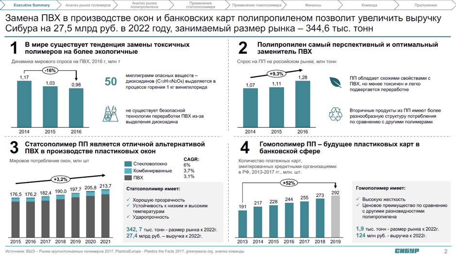
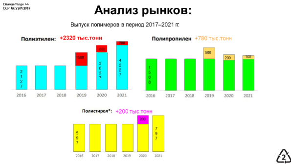
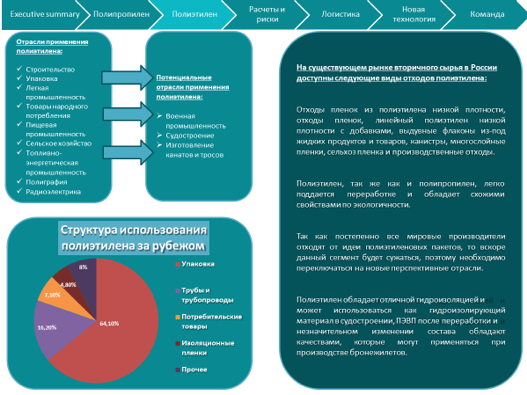
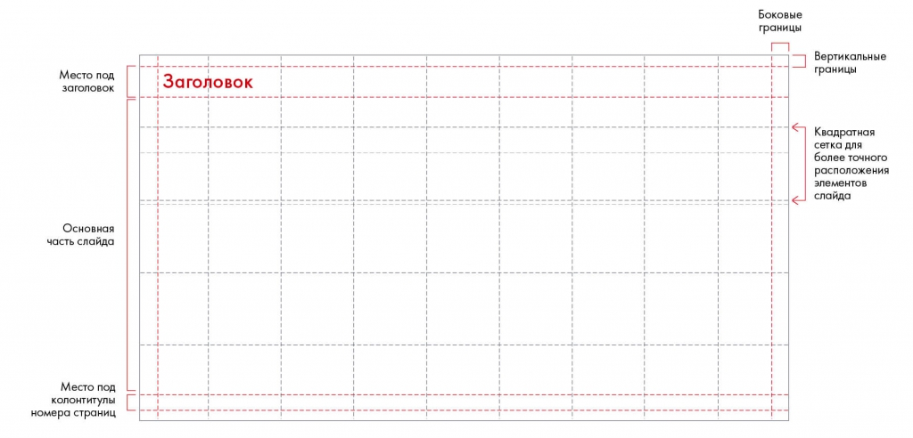
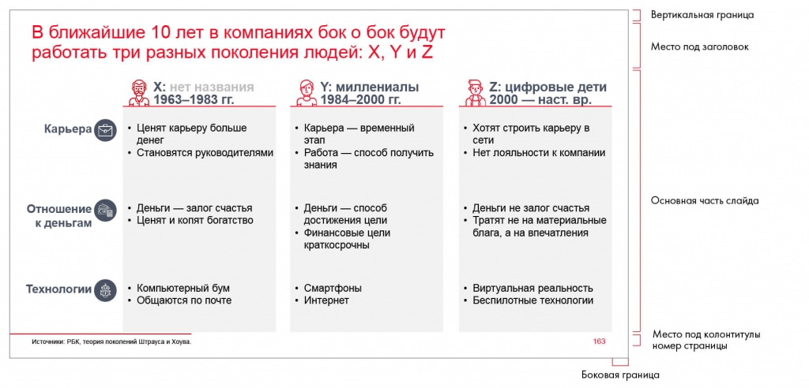

# Структура слайда. Часть 1

Сравниваются презентации для большой и небольшой аудитории. Объясняются рабочая область, цветовая схема, шрифт, шаблон и стандартные элементы.

**Источник:** физические страницы PDF 215–224. Печатные номера не установлены.

**Для последовательного чтения:** [Месседжи и принцип One message per slide](05-messages.md).

**Навигация:** [Индекс главы](INDEX.md) · [Маршрутизатор](../../ROUTER.md) · [Проблемы источника](../../meta/issues.md).

---

## Источник: [PDF 215](../../SOURCE.md#pdf-215)

### Неделя 11. Презентация решения

### Структура слайда. Часть 1

Итак, у вас есть понимание, как вы будете рассказывать историю и какой контент должен содержаться на каждом из слайдов. Теперь нужно подумать об их оформлении.

Для начала определитесь, какой у вас тип презентации. Он зависит от того, как и где вы будете ее показывать. В зависимости от аудитории и места выступления можно выделить три типа: для большой аудитории, для небольшой аудитории и для чтения.

На рисунке приведены элементы: Назначение; Графика; Текст; Презентация; для большой аудитории. Полная текстовая расшифровка приведена отдельно; геометрия и цветовые обозначения сохранены на изображении.

[Подробная текстовая расшифровка рисунка](../../assets/transcripts/pdf-215-img-01.md).

Три типа презентации

Рассмотрим их подробнее.

**Первый тип презентации — для большой аудитории. В них обычно**

минимум текста и броские иллюстрации. Этот вариант могут позволить себе профессиональные спикеры. Они делают упор на яркость выступления, а на слайде располагают только несколько картинок или очень простые схемы. Так, например, обычно выступал Стив Джобс.

**Ссылки на этой странице исходника:** [Ссылка url-236](../../meta/source-links.md#url-236).

## Источник: [PDF 216](../../SOURCE.md#pdf-216)

Иллюстрация исходника: «Источник: Changellenge ≫ Cup Moscow, решение». Подписи и числовые значения вынесены в расшифровку; порядок и связи элементов проверяются по сохранённому изображению.

[Подробная текстовая расшифровка рисунка](../../assets/transcripts/pdf-216-img-01.md).

Презентация для большой аудитории. Источник: Changellenge ≫ Cup Moscow, решение команды Achievement Catchers

**Второй тип презентации — для небольшой аудитории. Он используется на**

совещаниях, тренингах, выступлениях перед клиентами и коллегами. Такие презентации содержат 20–30 слов на слайде, 2–4 информативных графика, диаграммы или схемы. Мы рекомендуем использовать этот тип для выступления на учебе, работе и кейс-чемпионатах.

**Ссылки на этой странице исходника:** [Ссылка url-237](../../meta/source-links.md#url-237); [Ссылка url-012](../../meta/source-links.md#url-012); [Ссылка url-004](../../meta/source-links.md#url-004).

## Источник: [PDF 217](../../SOURCE.md#pdf-217)

Иллюстрация исходника: «Пример презентации для небольшой аудитории.». Подписи и числовые значения вынесены в расшифровку; порядок и связи элементов проверяются по сохранённому изображению.

[Подробная текстовая расшифровка рисунка](../../assets/transcripts/pdf-217-img-01.md).

Пример презентации для небольшой аудитории. Источник: Changellenge ≫ Cup Moscow, решение команды OldBold

Третий тип презентации — для чтения. Он не предполагает устное выступление перед слушателями, поэтому вся информация вносится на слайды. Это самый подробный тип презентации. Она включает много текста и иллюстраций: схем, графиков и таблиц. Такая презентация требуется, например, как отчет о проделанной работе или в заочных турах кейс-чемпионатов.

**Ссылки на этой странице исходника:** [Ссылка url-238](../../meta/source-links.md#url-238); [Ссылка url-012](../../meta/source-links.md#url-012); [Ссылка url-004](../../meta/source-links.md#url-004).

## Источник: [PDF 218](../../SOURCE.md#pdf-218)

Иллюстрация исходника: «Пример презентации для чтения. Источник: Changellenge ≫ Cup Moscow,». Подписи и числовые значения вынесены в расшифровку; порядок и связи элементов проверяются по сохранённому изображению.

[Подробная текстовая расшифровка рисунка](../../assets/transcripts/pdf-218-img-01.md).

Пример презентации для чтения. Источник: Changellenge ≫ Cup Moscow, решение команды Young, Wild & Free

После того как вы определились с типом презентации, за дело принимается слайдмейкер — человек, ответственный за оформление презентации. Он должен подготовить шаблон презентации в бизнес-стиле. Такой шаблон включает просторную рабочую зону и небольшой стильный дизайн-элемент.

«Когда я начинаю работать с новой командой в роли слайдмейкера, я всегда провожу воркшоп по работе с PowerPoint. Объясняю, как выравнивать текст, группировать объекты, делать ровные линии и почему писать надо в фигурах, а не создавать отдельные блоки текста поверх. Многие люди не задумываются о таких мелочах. Потом это выливается в панику и конфликты, когда дедлайн уже совсем скоро, а этот блок не двигается и все пункты стоят неровно. Поэтому я всем рекомендую создавать какую-то систему работы со слайдмейкером, чтобы не доставлять лишних проблем ни себе, ни другим.

**Анастасия Жогова, полуфиналист Changellenge >> Cup Moscow**

**Ссылки на этой странице исходника:** [Ссылка url-239](../../meta/source-links.md#url-239); [Ссылка url-012](../../meta/source-links.md#url-012).

## Источник: [PDF 219](../../SOURCE.md#pdf-219)

Чтобы создать шаблон в PowerPoint, выберите режим «Образец слайдов» во вкладке «Вид». Добавьте в шаблон наиболее часто используемые структуры слайдов (о них вы узнаете чуть ниже).

При создании шаблона придерживайтесь нескольких правил:

**— Все смысловые элементы располагайте слева направо и сверху вниз.**

Аудитория воспринимает информацию именно так. Если вы, конечно, не в арабском мире.

**— Придерживайтесь единой цветовой схемы. Чем больше цветов, тем**

сложнее добиться их сочетаемости между собой. Старайтесь использовать не более трех цветов. Убедитесь, что они одновременно гармонируют друг с другом и достаточно контрастны. При выборе гаммы лучше не полагаться на свой вкус, а подбирать окрас презентации по цветовой палитре. Для презентации с отчетом можно использовать корпоративные цвета компании. Возьмите их из брендбука или пипеткой[1] с официального сайта.

На рисунке приведены элементы: Монохромные цвета; Схожие цвета; Противоположные цвета; Сложность грамотного сочетания цветов; Сложность обозначения контрастов. Полная текстовая расшифровка приведена отдельно; геометрия и цветовые обозначения сохранены на изображении.

[Подробная текстовая расшифровка рисунка](../../assets/transcripts/pdf-219-img-01.md).

Грамотное сочетание цветов

На первых порах, пока вы не научились самостоятельно подбирать правильные цвета, руководствуйтесь следующими рекомендациями, которые никогда не подведут.

**1. Основной цвет текста — в 99 % случаев черный. Альтернатива —**

темно-серый. Другой цвет не советуем.

**Ссылки на этой странице исходника:** [Ссылка url-240](../../meta/source-links.md#url-240); [Ссылка url-241](../../meta/source-links.md#url-241).

## Источник: [PDF 220](../../SOURCE.md#pdf-220)

**2. Основной цвет фона — в 99 % случаев белый. Мы крайне не**

советуем заливать другим цветом, так как это хуже воспринимается, к тому же очень дорого печатать.

3. Яркий цвет выделения, например красный или зеленый (но не кислотный). Желтый и светло-голубой лучше не использовать, так как на слабых проекторах они будут плохо отображаться. Вы также можете использовать оттенки вашего цвета выделения, например чтобы отделить разные части круга друг от друга.

Иллюстрация исходника: «Пример грамотного цветового оформления презентации.». Подписи и числовые значения вынесены в расшифровку; порядок и связи элементов проверяются по сохранённому изображению.

[Подробная текстовая расшифровка рисунка](../../assets/transcripts/pdf-220-img-01.md).

Пример грамотного цветового оформления презентации. Источник: Changellenge ≫ Cup Russia, решение команды Peachy

**Ссылки на этой странице исходника:** [Ссылка url-014](../../meta/source-links.md#url-014).

## Источник: [PDF 221](../../SOURCE.md#pdf-221)

Иллюстрация исходника: «Примеры неудачного цветового оформления презентации.». Подписи и числовые значения вынесены в расшифровку; порядок и связи элементов проверяются по сохранённому изображению.

[Подробная текстовая расшифровка рисунка](../../assets/transcripts/pdf-221-img-01.md).

Иллюстрация исходника: «Примеры неудачного цветового оформления презентации.». Подписи и числовые значения вынесены в расшифровку; порядок и связи элементов проверяются по сохранённому изображению.

[Подробная текстовая расшифровка рисунка](../../assets/transcripts/pdf-221-img-02.md).

Примеры неудачного цветового оформления презентации.

**Ссылки на этой странице исходника:** [Ссылка url-242](../../meta/source-links.md#url-242); [Ссылка url-243](../../meta/source-links.md#url-243).

## Источник: [PDF 222](../../SOURCE.md#pdf-222)

— Выберите шрифты для презентации. Мы рекомендуем использовать стандартные шрифты без засечек. Используйте выбранный шрифт во всей презентации. На каждом слайде должно быть не более трех размеров шрифта: 24–28-й кегль для месседжа, 14–18-й кегль для основного текста, 10-й кегль для источников информации и примечаний. Исключение: можно выделить подзаголовок основного текста увеличением кегля. На важных мыслях делайте акцент жирным шрифтом или путем изменения цвета текста.

Редакторское представление двух колонок исходной таблицы; графические элементы приведены рядом.

| Левая колонка | Правая колонка |
| --- | --- |
| Arial Calibri Tahoma Helvetica Times New Roman Cambria Georgia Bookman Old Style Comic Sans MS Monotype Corsiva Century Gothic jjjkkj | Шрифты без засечек выглядят просто и понятно. Если в вашей презентации много текста, используйте только их: проверяющие скажут вам спасибо. Мы советуем Arial, так как он всегда и везде правильно отобразится Шрифты с засечками тяжело воспринимать на экране. Оставьте их для печатных документов. Если очень хотите их использовать (например, это корпоративный шрифт компании), сделайте это на титульном слайде или разделителях Может возникнуть соблазн использовать необычные шрифты, но они сложны для восприятия и неуместны в деловой презентации. Самые экзотические могут и вовсе не отобразиться на чужом компьютере — вместо вашего текста зрители увидят серию квадратиков, как слева |

Разные группы шрифтов — Добавьте в шаблон стандартные элементы: место под месседж, место для подписи источников информации внизу, номер слайда, место для названия или логотипа вашей компании. Многие кейсеры любят вставлять наверху слайда навигацию, то есть оглавление презентации с выделенным наверху элементом, к которому относится слайд. Это очень красивый и приятный элемент, который помогает отслеживать, на каком месте презентации находится

## Источник: [PDF 223](../../SOURCE.md#pdf-223)

выступающий. Тем не менее мы не рекомендуем ее использовать по одной простой причине: на практике навигация требует слишком много времени. Представьте, что в последние часы вы поняли, что структура презентации неверна и ее стоит поменять. Вместо работы над смысловыми частями вы потратите 15 минут (а то и больше) только на то, чтобы поменять элементы навигации. Навигацию стоит использовать только в следующих двух случаях: 1) если вы сделали какой-то очень крутой фреймворк решения задачи или если используете существующий (в этом случае вы почти гарантированно не будете менять структуру); 2) если у вас ну очень важная презентация, где важна каждая деталь.

**— Обозначьте границы рабочей области слайда и места расположения**

основных элементов. Для этого включите в PowerPoint инструмент «Направляющие» и сделайте разметку. Располагайте элементы слайда по разметке и не выезжайте за границу рабочей области слайда. Правильная геометрия слайда подчеркивает его содержание, облегчает восприятие для читателя.

Шаблон слайда выделяет место заголовка, рабочую область, подписи источников и колонтитулы. Постоянное расположение элементов снижает нагрузку на читателя.

[Подробная текстовая расшифровка рисунка](../../assets/transcripts/pdf-223-img-01.md).

Пример разметки с использованием направляющих

**Ссылки на этой странице исходника:** [Ссылка url-244](../../meta/source-links.md#url-244).

## Источник: [PDF 224](../../SOURCE.md#pdf-224)

Иллюстрация исходника: «Пример готового слайда по разметке с использованием направляющих». Подписи и числовые значения вынесены в расшифровку; порядок и связи элементов проверяются по сохранённому изображению.

[Подробная текстовая расшифровка рисунка](../../assets/transcripts/pdf-224-img-01.md).

Пример готового слайда по разметке с использованием направляющих

[1] Пипетка — инструмент, позволяющий скопировать цвет. Присутствует в том числе в Adobe Photoshop (Eyedropper), Paint (Инструменты — Палитра).

**Ссылки на этой странице исходника:** [Ссылка url-245](../../meta/source-links.md#url-245).

## Связанные разделы

- [Все темы главы](INDEX.md)
- [Термины и сокращения](../../GLOSSARY.md)
- [Предыдущая тема: Месседжи и принцип One message per slide](05-messages.md)
- [Следующая тема: Структура слайда. Часть 2](07-slide-layouts.md)
- [Авторские ответы по этой неделе](../13-answers/10-week-11.md)
