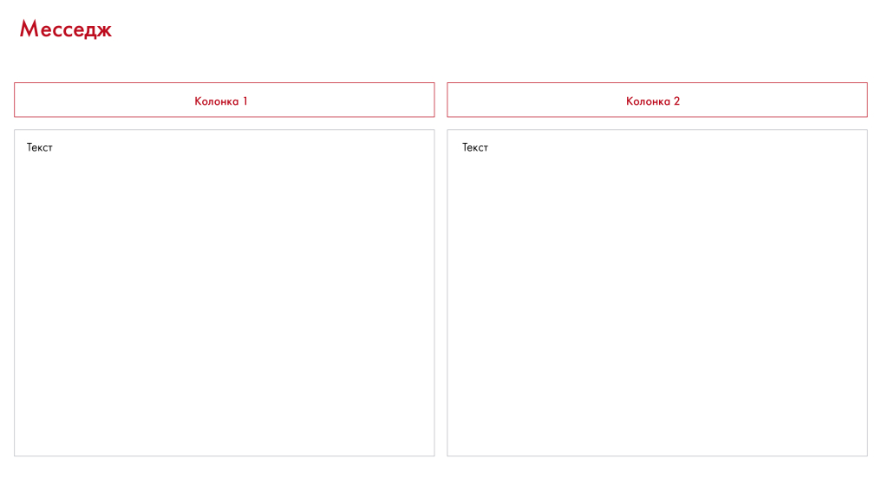
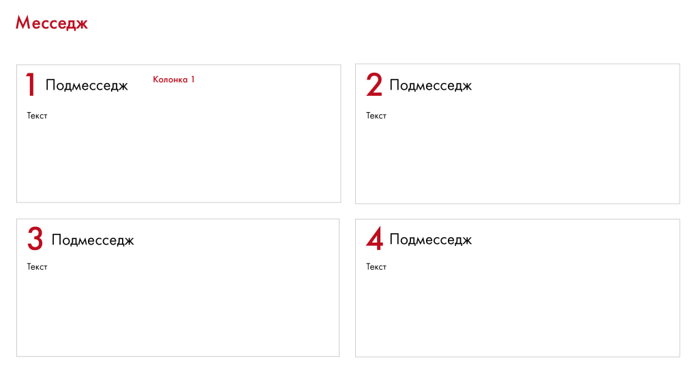
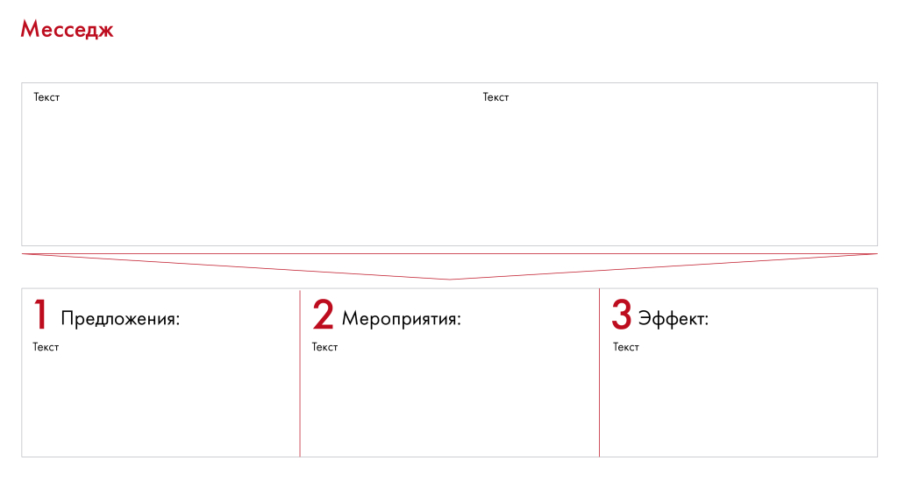
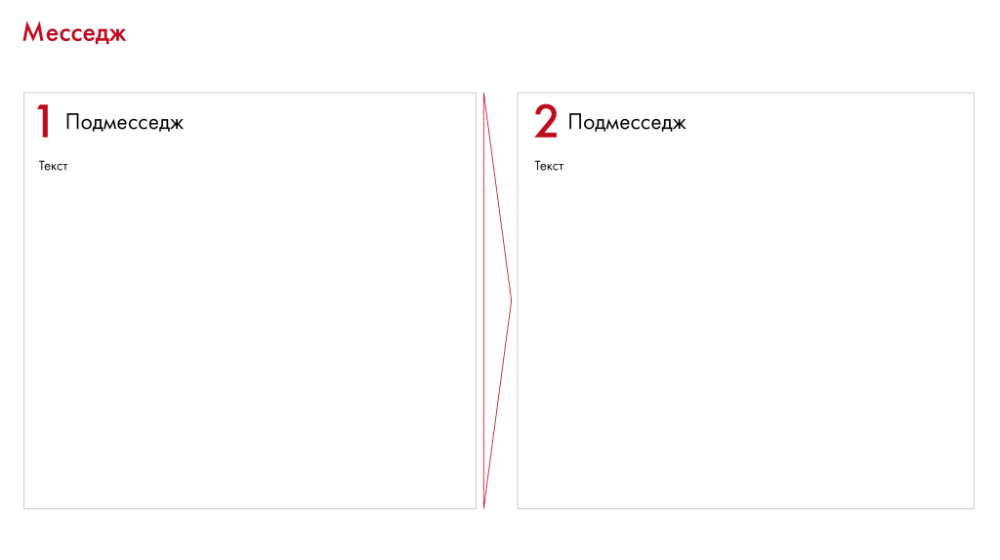
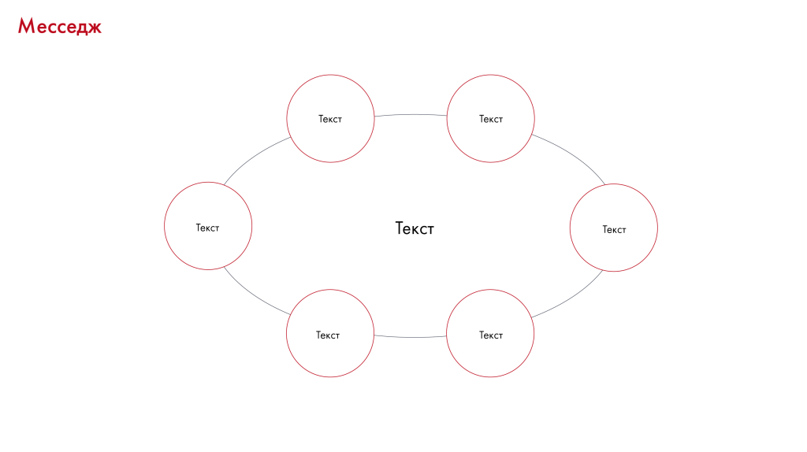
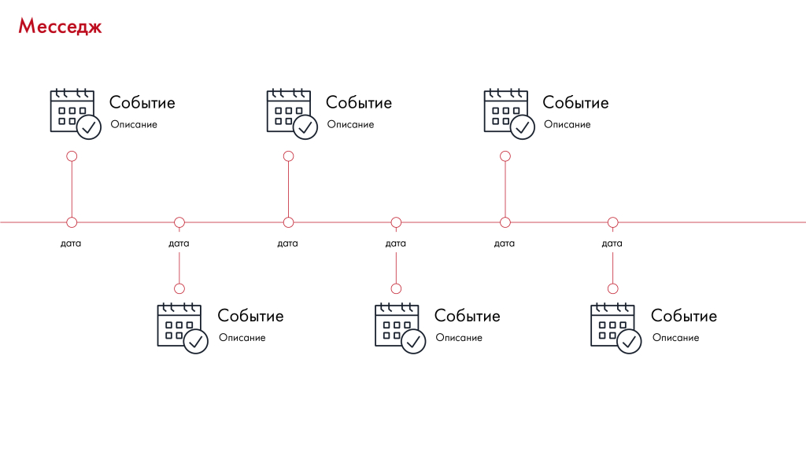
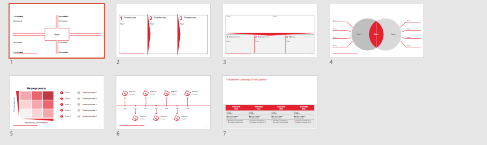
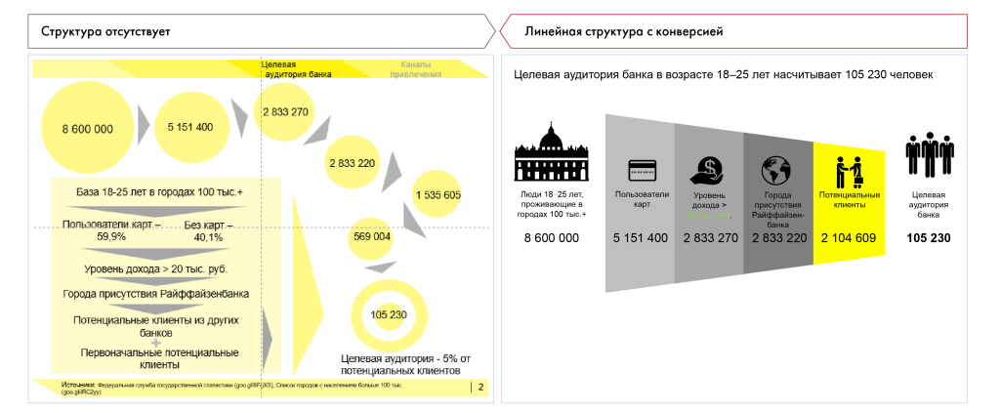
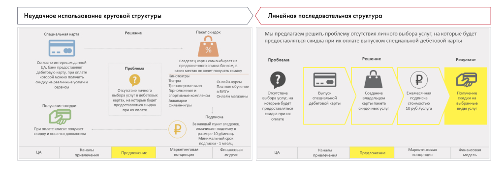

# Структура слайда. Часть 2

Сохранены типовые композиции слайдов и условия их выбора. Упражнение 11.5 и примеры показывают последствия отсутствия структуры.

**Источник:** физические страницы PDF 224–229. Печатные номера не установлены.

**Для последовательного чтения:** [Структура слайда. Часть 1](06-slide-structure.md).

**Навигация:** [Индекс главы](INDEX.md) · [Маршрутизатор](../../ROUTER.md) · [Проблемы источника](../../meta/issues.md).

---

## Источник: [PDF 224](../../SOURCE.md#pdf-224)

### Неделя 11. Презентация решения

### СТРУКТУРА СЛАЙДА. ЧАСТЬ 2

— Придерживайтесь минимализма. Проверяйте каждую деталь шаблона на ценность для слайда. Не добавляйте элементы просто для того, чтобы его украсить. По возможности сокращайте текст и заменяйте его графиками, схемами, таблицами.

**Несколько примеров самых распространенных структур, которые вы**

можете включить в шаблон.

**Ссылки на этой странице исходника:** [Ссылка url-245](../../meta/source-links.md#url-245).

## Источник: [PDF 225](../../SOURCE.md#pdf-225)

Иллюстрация исходника: «Деление на два. Подходит, если вы хотите представить две идеи, которые». Подписи и числовые значения вынесены в расшифровку; порядок и связи элементов проверяются по сохранённому изображению.

[Подробная текстовая расшифровка рисунка](../../assets/transcripts/pdf-225-img-01.md).

Деление на два. Подходит, если вы хотите представить две идеи, которые обобщаются единым месседжем, или сделать сравнение. По сути, у вас получается 2 слайда на одном, каждый со своим собственным месседжем.

Иллюстрация исходника: «Деление на четыре. Подходит для визуализации четырех идей, объединенных». Подписи и числовые значения вынесены в расшифровку; порядок и связи элементов проверяются по сохранённому изображению.

[Подробная текстовая расшифровка рисунка](../../assets/transcripts/pdf-225-img-02.md).

Деление на четыре. Подходит для визуализации четырех идей, объединенных единым месседжем: четыре аспекта решения, четыре компонента целого. Так можно оформлять, например, Executive Summary: контекст — развитие ситуации —ваши меры — финансы и риски. Аналогично можно разбить слайд на 6, 8 или 9 блоков, но чем их больше, тем меньше информации уместится в каждом.

## Источник: [PDF 226](../../SOURCE.md#pdf-226)

На рисунке приведены элементы: Месседж; Текст; 1 Предложения:; Текст; 2 Мероприятия:. Полная текстовая расшифровка приведена отдельно; геометрия и цветовые обозначения сохранены на изображении.

[Подробная текстовая расшифровка рисунка](../../assets/transcripts/pdf-226-img-01.md).

Вертикальное следствие. Если вы хотите показать несколько следствий из одного или нескольких фактов, лучше всего использовать горизонтальное следствие.

На рисунке приведены элементы: Месседж; ] Подмесседж; Текст; 2 Подмесседж; TekcT. Полная текстовая расшифровка приведена отдельно; геометрия и цветовые обозначения сохранены на изображении.

[Подробная текстовая расшифровка рисунка](../../assets/transcripts/pdf-226-img-02.md).

Горизонтальное следствие. Подойдет для визуализации связи между двумя событиями или фактами. Его можно также использовать для трех или четырех связей, разбив слайд на соответствующее количество блоков.

## Источник: [PDF 227](../../SOURCE.md#pdf-227)

Иллюстрация исходника: «Круговое расположение элементов. Эта структура подходит для отображения». Подписи и числовые значения вынесены в расшифровку; порядок и связи элементов проверяются по сохранённому изображению.

[Подробная текстовая расшифровка рисунка](../../assets/transcripts/pdf-227-img-01.md).

Круговое расположение элементов. Эта структура подходит для отображения большого числа одноуровневых фактов или характеристик. Они относятся к одному и тому же элементу, но не связаны друг с другом.

Иллюстрация исходника: «Таймлайн. Подходит для отображения плана действий, перечисления». Подписи и числовые значения вынесены в расшифровку; порядок и связи элементов проверяются по сохранённому изображению.

[Подробная текстовая расшифровка рисунка](../../assets/transcripts/pdf-227-img-02.md).

Таймлайн. Подходит для отображения плана действий, перечисления небольшого числа фактов или характеристик.

## Источник: [PDF 228](../../SOURCE.md#pdf-228)

Набор графических шаблонов расположения блоков на слайде; текста на рисунке нет. Изображения показывают, как визуально разделять рабочую область и согласовывать размеры элементов.

[Подробная текстовая расшифровка рисунка](../../assets/transcripts/pdf-228-img-01.md).

Макет презентации

Когда шаблон будет готов, каждый участник заполняет его контентом, оговоренным в Storyboard: рисует диаграммы и графики, вставляет поясняющий текст. Лучше с самого начала работать аккуратно, но итоговым оформлением презентации и сбором слайдов в один документ займется отдельный человек — слайдмейкер. Участники передают ему слайды. Тот, сверяясь с раскадровкой, соединяет их в презентацию и оформляет ее в едином стиле.

**Практическое задание № 11.5**

Перед вами четыре утверждения. Какая структура слайда из перечисленных выше подходит для визуализации каждого из них?

1. В 2010 году объем добычи никеля в стране упал на 25 %. Это повлекло за собой резкий рост цен на изделия из никеля.

2. Компания придерживается следующих ценностей: высокие стандарты качества, честность, равенство, уважение, фокус на результат, командная работа и инновации во всем.

3. Наше решение основано на анализе экономической ситуации в Китае. Оно предполагает ряд мер по проникновению на рынок Китая, включает в себя оценку рисков и обойдется в 100 млн рублей.

4. Мы планируем запустить продукт в продажу в 2018 году. В январе мы устроим презентацию в Crocus City Hall, в феврале — марте предоставим

**Ссылки на этой странице исходника:** [Ссылка url-246](../../meta/source-links.md#url-246).

## Источник: [PDF 229](../../SOURCE.md#pdf-229)

скидки 30 %, в мае начнем сотрудничество с блогерами, а в сентябре снимем мини-фильм о нашем товаре.

Вам потребуется практика, чтобы научиться правильно выбирать структуру для слайда. Ниже только несколько примеров того, как удачная структура может изменить слайд. Структура должна быть простой и понятной.

На рисунке приведены элементы: Структура отсутствует; Линейная структура с конверсией; Целевая; аудитория банка; Каналы. Полная текстовая расшифровка приведена отдельно; геометрия и цветовые обозначения сохранены на изображении.

[Подробная текстовая расшифровка рисунка](../../assets/transcripts/pdf-229-img-01.md).

На рисунке приведены элементы: Неудачное использование круговой структуры; Специальная карта; Пакет скидок; Согласно интересам данной; ца, банк предоставлет. Полная текстовая расшифровка приведена отдельно; геометрия и цветовые обозначения сохранены на изображении.

[Подробная текстовая расшифровка рисунка](../../assets/transcripts/pdf-229-img-02.md).

Как можно преобразовать структуру слайда

**Задание по кейсу**

Итак, у вас есть представление о структуре презентации и каждого отдельного слайда по вашему решению кейса Coca-Cola HBC Россия. Создайте шаблон для презентации.

## Связанные разделы

- [Все темы главы](INDEX.md)
- [Термины и сокращения](../../GLOSSARY.md)
- [Предыдущая тема: Структура слайда. Часть 1](06-slide-structure.md)
- [Следующая тема: Средства визуализации: схемы, карты, таблицы и списки](08-visual-tools.md)
- [Авторские ответы по этой неделе](../13-answers/10-week-11.md)

> Редакторское примечание SRC-02: здесь сохранено сквозное задание, но полное условие кейса Coca-Cola из приложения 1 отсутствует в предоставленном PDF. См. [реестр проблем](../../meta/issues.md).
