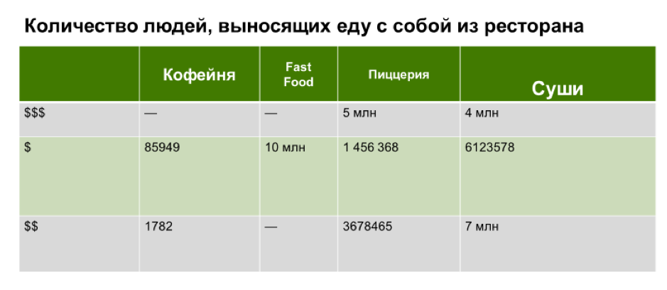
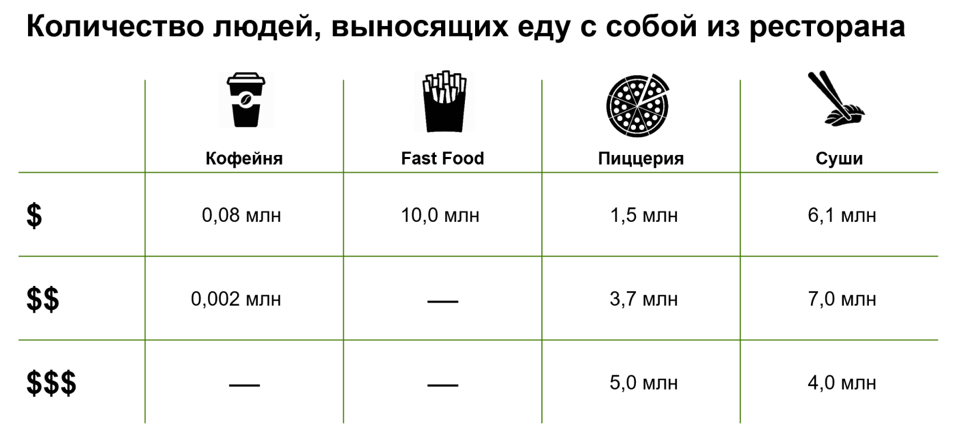
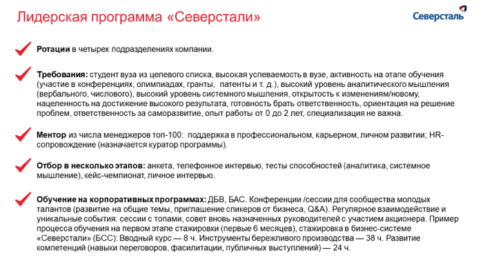
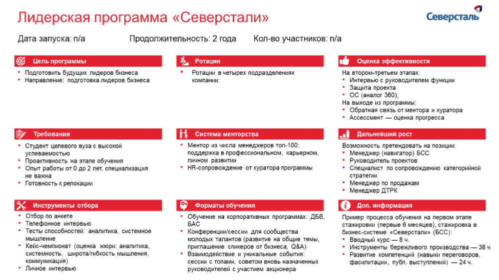

# Средства визуализации: схемы, карты, таблицы и списки

Разбираются визуальные формы для процессов, сравнений и географии. Примеры таблиц и списков объясняют, как сократить сложность без потери смысла.

**Источник:** физические страницы PDF 229–237. Печатные номера не установлены.

**Для последовательного чтения:** [Структура слайда. Часть 2](07-slide-layouts.md).

**Навигация:** [Индекс главы](INDEX.md) · [Маршрутизатор](../../ROUTER.md) · [Проблемы источника](../../meta/issues.md).

---

## Источник: [PDF 229](../../SOURCE.md#pdf-229)

### Неделя 11. Презентация решения

## Источник: [PDF 230](../../SOURCE.md#pdf-230)

### Средства визуализации

Итак, у вас есть представление о структуре презентации и каждого отдельного слайда. Теперь поговорим о том, как визуализировать информацию, которую вы хотите показать аудитории. Есть три группы средств визуализации данных: диаграммы и графики, схемы и визуализация текста.

Диаграммы и графики используются, чтобы наглядно отразить числовые данные: рост прибыли, распределение ответов на заданный вопрос, количественную структуру, корреляцию и многое другое.

Схемы подходят для отображения концепций, процессов, иерархий и структур.

Визуализация текста (таблицы, колонки и списки) помогают более наглядно передать перечисления, сравнения и описания.

Процессы, концепции и качественные взаимосвязи нужно показывать с помощью схем и структур. Приведем примеры наиболее распространенных:

## Источник: [PDF 231](../../SOURCE.md#pdf-231)

Редакторское представление двух колонок исходной таблицы; графические элементы приведены рядом.

| Левая колонка | Правая колонка |
| --- | --- |
| Схема подхода (Approach Slide) показывает стадии запланированного процесса или проекта: определить проблему, выдвинуть предположение, провести исследование и т. д. Выделяйте цветом текущую стадию, а дополнительной линией можно обозначить временные интервалы каждого этапа Пирамида –– хороший вариант для изображения иерархической структуры. Например, компании. Кроме того, отлично отображает, что один элемент базируется на другом | Перевернутая пирамида идеально подходит для изображения конверсии[1]. Может быть как вертикальной, так и горизонтальной. Используется для визуализации иерархических систем Структура отлично подходит для представления логики размышлений или дерева гипотез. Следите за тем, чтобы соответствующие ветви дерева визуально располагались на одном уровне и были равноудалены друг от друга. Не нужно расписывать дальше 4–5 ступеней, чтобы не перегружать слайд информацией. Выделяйте уровни разными цветами, это облегчит восприятие. Структуру можно использовать как вертикально, так и горизонтально |

**Ссылки на этой странице исходника:** [Ссылка url-247](../../meta/source-links.md#url-247).

## Источник: [PDF 232](../../SOURCE.md#pdf-232)

Редакторское представление двух колонок исходной таблицы; графические элементы приведены рядом.

| Левая колонка | Правая колонка |
| --- | --- |
| Колонны и фронтон — это более подробная альтернатива пирамиде. Подходит, если ваши идеи базируются не на одном факторе, а на нескольких равнозначных Весы демонстрируют одного варианта в сравнении с другими. Приведите несколько аргументов к двум альтернативам. К предпочтительному варианту нужно подобрать более весомые аргументы. Кроме того, их визуально должно быть больше | Циклическая диаграмма отражает взаимное влияние элементов или стадий процесса. Подчеркивает повторяемость, поэтому лучше всего подходит для визуализации производственных процессов Драйверы и выводы собирают воедино отдельные аспекты решения. Стрелка может быть вертикальной или горизонтальной, а факторы — быть заключенными в фигуры или приводиться в виде списка с буллитами. Используйте не более пяти драйверов. Вывод выносите в отдельную область |

## Источник: [PDF 233](../../SOURCE.md#pdf-233)

Карта подойдет, если вам нужно показать, в каких городах вы предлагаете открыть новые точки продаж, распределение каких-либо показателей по географическому принципу и т. д. Вы можете изобразить на слайде часть страны или конкретный регион

Предположим, ваш текст не укладывается ни в одну из этих схем. Это не значит, что нужно помещать его на слайд большим абзацем — визуализируйте его в виде таблиц, списков и колонок.

Таблицы подходят для упорядочения качественной информации. Это средство визуализации — ахиллесова пята начинающих слайдмейкеров. Чаще всего они выглядят неаккуратно и трудно читаются.

## Источник: [PDF 234](../../SOURCE.md#pdf-234)

Иллюстрация исходника: «Неудачное оформление таблицы». Подписи и числовые значения вынесены в расшифровку; порядок и связи элементов проверяются по сохранённому изображению.

[Подробная текстовая расшифровка рисунка](../../assets/transcripts/pdf-234-img-01.md).

Неудачное оформление таблицы

Сделать таблицу более аккуратной можно в два шага:

1. Поработать, над смысловой составляющей.

2. Поработать над дизайном.

Первый шаг. Чтобы информация считывалась легко, приведите все числа внутри таблицы к одному формату. Для больших чисел используйте текстовые аббревиатуры: «тыс.», «млн». Если использовать текстовые сокращения невозможно, отделяйте разряды у чисел — «10 000» вместо «10000». Сортируйте строки или ячейке по смыслу. Например, в данном примере можно выстроить строки по возрастанию ценового сегмента ресторана.

Второй шаг. Улучшите дизайн. Уменьшите количество линий, уберите излишнюю заливку. Если это возможно, выровняйте высоту строк таким образом, чтобы они стали одинаковыми. Сделайте одинаковый тип шрифта у заголовков и основного текста соответственно. Выровняйте числа в таблице по левому краю друг относительно друга, чтобы их было легче сравнивать. Добавьте иллюстрации для лучшего понимания материала.

**Ссылки на этой странице исходника:** [Ссылка url-248](../../meta/source-links.md#url-248).

## Источник: [PDF 235](../../SOURCE.md#pdf-235)

Иллюстрация исходника: «Удачное оформление таблицы». Подписи и числовые значения вынесены в расшифровку; порядок и связи элементов проверяются по сохранённому изображению.

[Подробная текстовая расшифровка рисунка](../../assets/transcripts/pdf-235-img-01.md).

Удачное оформление таблицы

Обратите внимание на то, насколько легче стала выглядеть таблица.

Еще один способ обобщить текстовую информацию — колонки. Он подходит для описания нескольких объектов по небольшому числу параметров.

Иллюстрация исходника: «Пример использования колонок». Подписи и числовые значения вынесены в расшифровку; порядок и связи элементов проверяются по сохранённому изображению.

[Подробная текстовая расшифровка рисунка](../../assets/transcripts/pdf-235-img-02.md).

Пример использования колонок

Чтобы колонки выглядели профессионально, унифицируйте их структуру, насколько это возможно. Добавьте иконки, используйте короткие слова, чтобы избежать переносов. Располагайте колонки на равном расстоянии друг от друга — в этом вам поможет инструмент «Распределить по горизонтали/вертикали».

**Ссылки на этой странице исходника:** [Ссылка url-249](../../meta/source-links.md#url-249); [Ссылка url-250](../../meta/source-links.md#url-250).

## Источник: [PDF 236](../../SOURCE.md#pdf-236)

Наконец, для перечисления элементов, формулировки выводов и рекомендаций вы можете использовать списки (буллиты). Для лучшей передачи информации через списки следуйте правилам: группируйте пункты по смыслу, типу или времени, разбивайте их на несколько уровней, формулируйте пункты одного уровня единообразно.

Иллюстрация исходника: «Пример списка». Подписи и числовые значения вынесены в расшифровку; порядок и связи элементов проверяются по сохранённому изображению.

[Подробная текстовая расшифровка рисунка](../../assets/transcripts/pdf-236-img-01.md).

Пример списка

Списки — самый распространенный инструмент, который PowerPoint предлагает по умолчанию. Но часто можно найти более удачные способы отображения текстовой информации.

На рисунке приведены элементы: Лидерская программа «Северстали»; Северсталь; У Ротации в четырех подразделениях компании.; Требования: студент вуза из целевого списка, высокая успеваемость в вузе, активность на этапе обучения; (участие в конференциях, олимпиадах, гранты, патенты и т. д.), высокий уровень аналитического мышления. Полная текстовая расшифровка приведена отдельно; геометрия и цветовые обозначения сохранены на изображении.

[Подробная текстовая расшифровка рисунка](../../assets/transcripts/pdf-236-img-02.md).

Содержимое этого слайда целиком оформлено списком

**Ссылки на этой странице исходника:** [Ссылка url-251](../../meta/source-links.md#url-251); [Ссылка url-252](../../meta/source-links.md#url-252).

## Источник: [PDF 237](../../SOURCE.md#pdf-237)

На рисунке приведены элементы: Лидерская программа «Северстали»; Дата запуска: п/а; Продолжительность: 2 года; © Цель программы; • Подготовить будущих лидеров бизнеса. Полная текстовая расшифровка приведена отдельно; геометрия и цветовые обозначения сохранены на изображении.

[Подробная текстовая расшифровка рисунка](../../assets/transcripts/pdf-237-img-01.md).

Здесь списки используются как внутренний элемент структуры. Основная структура слайда — «Деление на 9». Заголовки списков проиллюстрированы иконками, которые улучшают наглядность.

## Связанные разделы

- [Все темы главы](INDEX.md)
- [Термины и сокращения](../../GLOSSARY.md)
- [Предыдущая тема: Структура слайда. Часть 2](07-slide-layouts.md)
- [Следующая тема: Практическое задание 11.6: структура отдела R&D](exercises/01-rd-slides.md)
- [Авторские ответы по этой неделе](../13-answers/10-week-11.md)

> Редакторское примечание SRC-03: часть ячеек с графическими примерами на PDF 230–233 и 238–240 пуста уже в исходном PDF. Доступные подписи сохранены, отсутствующие картинки не реконструированы.

