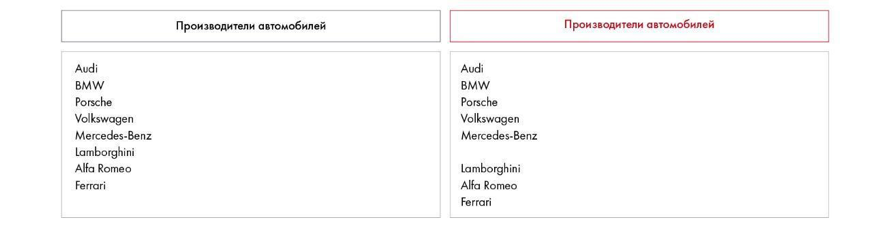
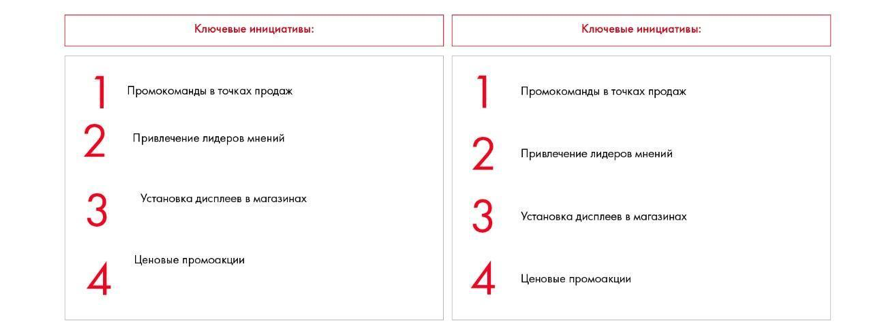
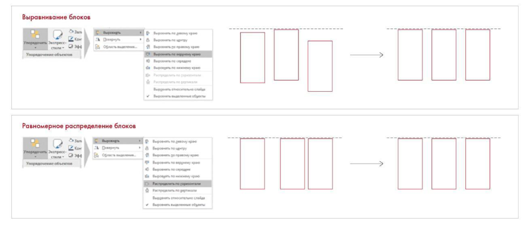
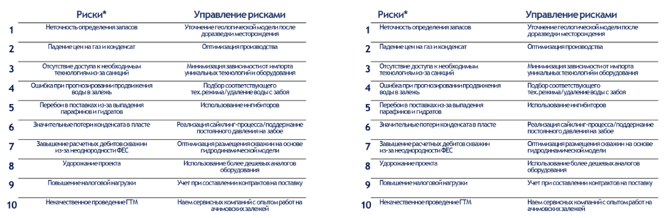
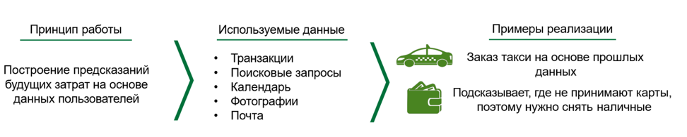
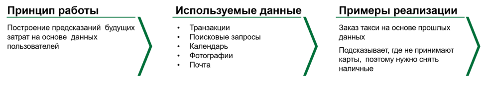

# Дизайн. Часть 1

Объясняются иерархия, контраст, повторы, близость и выравнивание. Сохранены примеры до и после оформления и работа с расположением блоков.

**Источник:** физические страницы PDF 240–247. Печатные номера не установлены.

**Для последовательного чтения:** [Практическое задание 11.6: структура отдела R&D](exercises/01-rd-slides.md).

**Навигация:** [Индекс главы](INDEX.md) · [Маршрутизатор](../../ROUTER.md) · [Проблемы источника](../../meta/issues.md).

---

## Источник: [PDF 240](../../SOURCE.md#pdf-240)

### Неделя 11. Презентация решения

### ДИЗАЙН. ЧАСТЬ 1

Мы уже дали несколько советов, как лучше оформлять отдельные элементы слайда. Важно, например, придерживаться единой цветовой гаммы и типографики.

Чтобы отшлифовать уже готовую презентацию, нужно проверить ее на соответствие базовым принципам дизайна.

Возможно, вы думаете, что дизайн — это фишки, которые сделают вашу презентацию красивой. Это не так. Дизайн в современном понимании появился в 1910–1920-е годы прошлого века. В отличие от классической типографской верстки, его цель — не добавить эстетики, а максимально просто донести мысль до читателя.

До XIX века дизайна в современном понимании не существовало. Красивая архитектура и рисунки в книгах служили скорее для эстетического удовольствия, чем для удобства восприятия. Однако все изменилось, когда начало активно развиваться промышленное производство: предприниматели хотели создавать товары, которые не просто были красивыми, а которые было приятно держать в руках. С ростом компаний появился запрос на создание фирменного стиля предприятий, например логотипов, которые запоминались бы потребителю и ассоциировались с брендом. На XIX век пришлось появление первых логотипов таких компаний, как PepsiCo, Procter & Gamble, Coca-Cola и многих других. Кстати, логотип Coca-Cola за 100 лет почти не изменился, настолько он оказался удачным.

**Ссылки на этой странице исходника:** [Ссылка url-253](../../meta/source-links.md#url-253).

## Источник: [PDF 241](../../SOURCE.md#pdf-241)

Волна революционных настроений в начале XX века нашла дизайну новое применение: теперь он стал воздействовать на восприятие агиткампаний. Яркие и красочные плакаты, рекламы, оформление шествий и уличных торжеств — это сфера графического дизайна, новое направление художественного конструирования. Строгая простота и функциональность — вот девиз дизайнеров 1910–1920-х.

В середине XX века появился термин «городской дизайн», который изменил облик городов мира: Лондона, Стокгольма, Торонто, Нью-Йорка и многих других. В промышленности развился осознанный подход к дизайну товаров: бюро исследовали рынок и проводили сравнительный анализ функций товаров.

В конце XX века особое внимание стали уделять созданию персонализированных товаров. С помощью индивидуального маркетинга разрабатывались предложения, от которых нельзя отказаться, — конечно, при использовании дизайна как главного инструмента. Начала расти конкуренция предприятий в России, а реклама — использоваться для продвижения бизнеса. Популярность вновь обрел графический дизайн — без него немыслим выпуск популярных каталогов продукции, landing page или телевизионной рекламы.

Существуют четыре принципа дизайна, которые нужно соблюдать при создании слайдов:

- Принцип приближенности.

- Принцип выравнивания.

- Принцип повторения.

- Принцип контраста.

Принцип приближенности. Элементы, близкие по смыслу, должны находиться рядом друг с другом. Чтобы разделить отдаленные по смыслу элементы, их нужно расположить подальше друг от друга. Этот эффект основан на особенностях человеческого восприятия: «То, что расположено рядом, как-то связано; то, что расположено далеко, не связано». Пример: если люди идут рядом, мы подозреваем, что они знакомы. Работа с приближенностью позволяет избавиться от перегружающих слайд элементов: разделителей, рамок и пр. Документы становятся более лаконичными и читаемыми.

## Источник: [PDF 242](../../SOURCE.md#pdf-242)

На рисунке приведены элементы: Производители автомобилей; Производители автомобилей; Audi; BMW; Porsche. Полная текстовая расшифровка приведена отдельно; геометрия и цветовые обозначения сохранены на изображении.

[Подробная текстовая расшифровка рисунка](../../assets/transcripts/pdf-242-img-01.md).

Образец принципа приближенности. На левой картинке все марки автомобилей идут одним списком. На правой читатель понимает, что автомобили разделены на две группы: немецкие и итальянские.

Этот принцип при использовании заголовков часто не соблюдается. Посмотрите на пример. Как быстро вы сможете понять структуру этих столбцов, не читая текст?

**Ссылки на этой странице исходника:** [Ссылка url-254](../../meta/source-links.md#url-254).

## Источник: [PDF 243](../../SOURCE.md#pdf-243)

**От Антарктиды откололся еще один От Антарктиды откололся еще один**

огромный айсберг огромный айсберг

Таяние Антарктики продолжает Таяние Антарктики продолжает ускоряться: в море Амундсена выплыл ускоряться: в море Амундсена выплыл один из крупнейших айсбергов, один из крупнейших айсбергов, отколовшихся от ледника Пайн-Айленд. отколовшихся от ледника Пайн-Айленд.

**На Соломоновых островах нашли На Соломоновых островах нашли**

гигантскую крысу, упоминаемую в гигантскую крысу, упоминаемую в легендах легендах

Американские ученые описали новый вид Американские ученые описали новый вид крыс, обнаруженный ими на Соломоновых крыс, обнаруженный ими на Соломоновых островах после многих десятилетий островах после многих десятилетий безуспешных поисков. Новый вид назвали безуспешных поисков. Новый вид назвали Uromys vika. Длина без хвоста достигала Uromys vika. Длина без хвоста достигала 46 см, а весило животное от 500 граммов 46 см, а весило животное от 500 граммов до одного килограмма. до одного килограмма.

**Илон Маск предложил использовать Илон Маск предложил использовать**

межпланетные ракеты для путешествий межпланетные ракеты для путешествий по Земле по Земле

Генеральный директор SpaceX Илон Маск Генеральный директор SpaceX Илон Маск представил обновленные планы по представил обновленные планы по путешествиям на Луну и Марс на путешествиям на Луну и Марс на конференции по космической отрасли и конференции по космической отрасли и закончил свое выступление невероятным закончил свое выступление невероятным обещанием — использовать ту же самую обещанием — использовать ту же самую межпланетную ракетную систему для межпланетную ракетную систему для дальних путешествий по нашей планете. дальних путешествий по нашей планете Слева заголовки оторваны от текста, и, не читая, сложно понять, что они представляют собой по смыслу. Их можно принять и за врезки с важными мыслями внутри текста. С правой стороны заголовки прилеплены к тексту, и читатель с первого взгляда понимает, что это именно заголовки. Принцип приближенности соблюдается.

Чтобы аккуратно распределять разные по смыслу элементы на слайде, используйте инструменты «Распределить по горизонтали» и «Распределить по вертикали».

## Источник: [PDF 244](../../SOURCE.md#pdf-244)

Принцип выравнивания. Все элементы на слайде должны быть выровнены относительно друг друга. Отсутствие выравнивания нарушает восприятие информации и отвлекает аудиторию. Сравните два фрагмента слайда:

На рисунке приведены элементы: 1; 2; 3; 4; Ключевые инициативы:. Полная текстовая расшифровка приведена отдельно; геометрия и цветовые обозначения сохранены на изображении.

[Подробная текстовая расшифровка рисунка](../../assets/transcripts/pdf-244-img-01.md).

Применение принципа выравнивания

Слева — пример того, как обычно оформляют презентацию новички. Элементы располагаются как попало и скачут по слайду. Когда вы видите такой текст впервые, вам может понадобиться время, чтобы понять его структуру. Справа эти элементы выровнены относительно друг друга. Взгляду легче ориентироваться в тексте, слайд выглядит аккуратнее.

Выравнивание в PowerPoint делается автоматически с помощью инструмента «Выровнять».

На рисунке приведены элементы: Выравнивание блокоя; Равномерное распределение блоков; О 3е. Полная текстовая расшифровка приведена отдельно; геометрия и цветовые обозначения сохранены на изображении.

[Подробная текстовая расшифровка рисунка](../../assets/transcripts/pdf-244-img-02.md).

**Ссылки на этой странице исходника:** [Ссылка url-255](../../meta/source-links.md#url-255); [Ссылка url-256](../../meta/source-links.md#url-256).

## Источник: [PDF 245](../../SOURCE.md#pdf-245)

Автоматическое выравнивание объектов в PowerPoint

Есть четыре вида выравнивания: по левому краю, по правому краю, по центру и по ширине. Частая ошибка в презентациях — выравнивание больших текстов по центру. Например, в таблицах. Проблема такого выравнивания в том, что слова скачут в разные стороны. Человеческому глазу приятнее единообразие текста. Если выровнять текст по ширине, между словами будут возникать пробелы, нарушающие ритм чтения. Если выровнять текст по левому или правому краю, то слова будут скакать только с одной стороны. Но так как большинство людей читает слева направо, мы рекомендуем выравнивать текст по левому краю.

Иллюстрация исходника: «В таблице слева выравнивание текста настроено по центру. В этом случае оба края». Подписи и числовые значения вынесены в расшифровку; порядок и связи элементов проверяются по сохранённому изображению.

[Подробная текстовая расшифровка рисунка](../../assets/transcripts/pdf-245-img-01.md).

Применение принципа выравнивания текста по середине и по левому краю

В таблице слева выравнивание текста настроено по центру. В этом случае оба края текста получаются рваными. Аудитории приходится напрягаться, чтобы каждый раз найти начало следующей строки.

В таблице справа установлено выравнивание текста по левому краю. Рваным получается только правый край текста, начало следующей строки закреплено по одной вертикальной линии. При чтении такого текста глаза напрягаются меньше.

Принцип повторения. Часто при создании презентаций возникает соблазн сделать все слайды разнообразными по структуре. Но чтобы читатель легче ориентировался в содержании презентации, нужно делать слайды одного типа похожими друг на друга:

- Все списки должны быть оформлены в едином стиле по всей презентации; буллиты одного уровня всегда должны быть отмечены одинаковым символом.

- Заголовки и подзаголовки набираются одинаковым шрифтом и кеглем.

## Источник: [PDF 246](../../SOURCE.md#pdf-246)

- Иконки — одного размера и цвета.

- В дробных числах должно быть одинаковое число знаков после запятой (не более двух).

- Во всех длинных числах тысячи должны отделяться пробелами, запятыми или точками (например, 1 928 722, не 1928722).

- Однообразные элементы (например, иконки) должны располагаться в одном и том же месте слайда.

Если вы примените принцип повторения в презентации, то читатели и зрители, увидев слайд того же типа, быстро поймут его суть, будь это слайд со списком, схемой процесса или таймлайном. Это объясняется тем, что человек мыслит шаблонами и, закрепив какой-то темплейт один раз, быстро узнает его впоследствии. Если же каждый новый слайд будет выглядеть по-другому, зрителям понадобится больше времени, чтобы разобраться в его наполнении. Кроме того, если заголовки при листании слайдов скачут то вверх, то вниз, это раздражает зрителей. Единство цветовой гаммы и шрифтов в презентации также обусловлены именно этим принципом.

Лучший способ применить принцип повторения в PowerPoint — создать шаблон презентации. Если вы уже сделали шаблон, проверьте его еще раз на соответствие принципу повторения.

Принцип контраста. Нужен для того, чтобы визуально отделять друг от друга важные и второстепенные мысли. Самое главное можно выделить более крупным шрифтом (14-й и 24-й кегль), сильно отличающимся цветом и т. д. При этом важно не переборщить с выделением: принцип контраста должен применяться к минимуму элементов. Если вы выделите весь текст в презентации желтым, это не принцип контраста.

Рассмотрим на рисунке ниже часть слайда без применения принципа контраста. В первую очередь привлекают взгляд иконки, так как они выделяются из однотипного текста. Затем внимание переходит на структуру, состоящую из трех столбцов. И только после этого читатель доходит до смысла слайда. Вместо того чтобы мгновенно понять суть написанного, аудитория теряет драгоценные секунды на более яркие, но не несущие смысла объекты на слайде.

## Источник: [PDF 247](../../SOURCE.md#pdf-247)

На рисунке приведены элементы: Принцип работы; Построение предсказаний; будущих затрат на основе; данных пользователей; Используемые данные. Полная текстовая расшифровка приведена отдельно; геометрия и цветовые обозначения сохранены на изображении.

[Подробная текстовая расшифровка рисунка](../../assets/transcripts/pdf-247-img-01.md).

Несоблюдение принципа контраста

Давайте исправим это и внесем небольшие изменения. Увеличим размер заголовков колонок и уменьшим иконки. Теперь в первую очередь видна структура следствия от принципа работы до примера реализации. А уже потом зритель обращает внимание на пояснительный текст каждого из этих пунктов.

На рисунке приведены элементы: Принцип работы; Построение предсказаний будущих; затрат на основе данных; пользователей; Используемые данные. Полная текстовая расшифровка приведена отдельно; геометрия и цветовые обозначения сохранены на изображении.

[Подробная текстовая расшифровка рисунка](../../assets/transcripts/pdf-247-img-02.md).

Применение принципа контраста

## Связанные разделы

- [Все темы главы](INDEX.md)
- [Термины и сокращения](../../GLOSSARY.md)
- [Предыдущая тема: Практическое задание 11.6: структура отдела R&D](exercises/01-rd-slides.md)
- [Следующая тема: Дизайн. Часть 2](10-design-practice.md)
- [Авторские ответы по этой неделе](../13-answers/10-week-11.md)

> Редакторское примечание SRC-02: здесь сохранено сквозное задание, но полное условие кейса Coca-Cola из приложения 1 отсутствует в предоставленном PDF. См. [реестр проблем](../../meta/issues.md).
