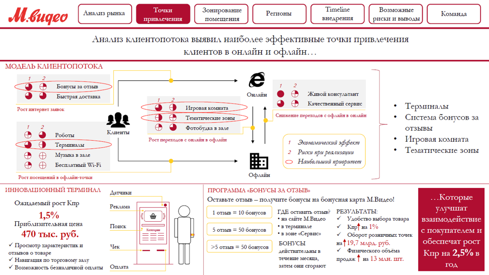
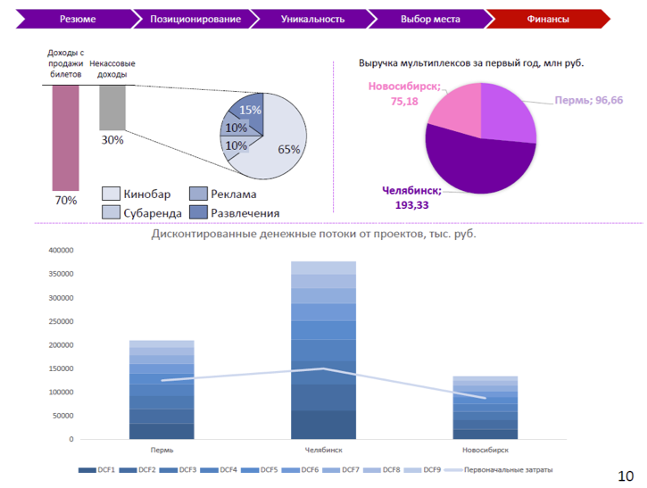
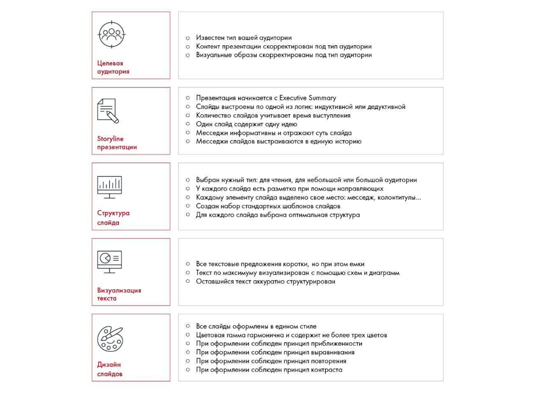

# Дизайн. Часть 2

Практическое задание 11.7 предлагает исправить примеры слайдов. Разобраны последние проверки презентации и подготовка к показу.

**Источник:** физические страницы PDF 247–251. Печатные номера не установлены.

**Для последовательного чтения:** [Дизайн. Часть 1](09-design.md).

**Навигация:** [Индекс главы](INDEX.md) · [Маршрутизатор](../../ROUTER.md) · [Проблемы источника](../../meta/issues.md).

---

## Источник: [PDF 247](../../SOURCE.md#pdf-247)

### Неделя 11. Презентация решения

### ДИЗАЙН. ЧАСТЬ 2

**Практическое задание № 11.7**

Посмотрите на следующих слайдах структуру, средства оформления, визуализации и принципы дизайна. Что в них хорошо? Что можно улучшить? Перечислите как минимум пять положительных аспектов и пять аспектов, которые можно улучшить.

## Источник: [PDF 248](../../SOURCE.md#pdf-248)

На рисунке приведены элементы: М.видео; Анализ рынка; Точки; привлечения; Зонирование. Полная текстовая расшифровка приведена отдельно; геометрия и цветовые обозначения сохранены на изображении.

[Подробная текстовая расшифровка рисунка](../../assets/transcripts/pdf-248-img-01.md).

Слайд для чтения

На рисунке приведены элементы: Резюме; Позиционирование; Уникальность; Выбор места; Финансы. Полная текстовая расшифровка приведена отдельно; геометрия и цветовые обозначения сохранены на изображении.

[Подробная текстовая расшифровка рисунка](../../assets/transcripts/pdf-248-img-02.md).

**Ссылки на этой странице исходника:** [Ссылка url-257](../../meta/source-links.md#url-257); [Ссылка url-258](../../meta/source-links.md#url-258).

## Источник: [PDF 249](../../SOURCE.md#pdf-249)

Слайд для выступления перед небольшой аудиторией.

Помните о главном правиле презентации: вы должны представить информацию максимально наглядно. Исходя из этого, подбирайте структуру, средства визуализации и ориентируйтесь на правила дизайна.

**Напоследок еще несколько советов:**

— Уделите особое внимание приложениям к презентации: объемным графикам, таблицам и иллюстрациям, которые подкрепляют ваш анализ. Если у коллег возникнет вопрос, откуда взялась та или иная цифра или предположение, вы должны знать ответ. В идеале на каждом слайде должны быть указаны источники, в том числе и на приложения. Приложения убедят судей, что ваши идеи обоснованны.

— Используйте в презентации только качественную графику: фотографии высокого разрешения, векторные иконки. В конце этой главы вы найдете список сайтов, на которых их можно найти.

— Используйте слова «мы», «нас», «наш» вместо названия компании и пассивного залога, чтобы презентация была живой.

— Нарисуйте и добавьте в шаблон логотип команды — это будет уместно и придаст индивидуальности. Конечно, он не должен мешать отображению основной информации на слайде.

— Перед отправкой презентации проверьте ее на опечатки, орфографические и пунктуационные ошибки. Проверьте все цифры — одна ошибка в данных может испортить впечатление от всего проекта.

— Если в вашей презентации много текста, проверьте его на предмет лишних слов и стилистических ошибок на сайте glvrd.ru.

— Подготовьте презентацию в разных форматах: ppt, pptx и pdf. Проверьте ее на разных устройствах — она везде должна запускаться и одинаково отображаться.

— Мы не рекомендуем использовать анимацию. Вы потратите время на ее создание, а во время выступления она может некорректно запуститься или

## Источник: [PDF 250](../../SOURCE.md#pdf-250)

вовсе не сработать. Кроме того, анимация отвлекает внимание от содержания. Единственный вариант, когда ее можно использовать, — постепенное появление элементов на слайде для лучшего отражения хода ваших мыслей. Для этого можно не использовать анимацию в PowerPoint, а сделать несколько слайдов, на каждом из которых к содержанию будет добавляться новая часть.

— Не пренебрегайте созданием резервных копий. Сохраняйте их под новым именем, скидывайте на флешки, пересылайте друг другу. Обязательно заливайте на облачные хранилища, чтобы в случае чего иметь возможность поработать на любом компьютере. Каждый, кто хоть раз из-за сбоев компьютера терял свои наработки, знает, как это мучительно и больно.

— Проверяйте готовность вашей презентации по чек-листу. Распечатайте его и положите перед собой. Вычеркивайте пункты, которые уже выполнили.

На рисунке приведены элементы: Целевая; аудитория; Storyline; презентации; Структура. Полная текстовая расшифровка приведена отдельно; геометрия и цветовые обозначения сохранены на изображении.

[Подробная текстовая расшифровка рисунка](../../assets/transcripts/pdf-250-img-01.md).

Чек-лист по проверке качества презентации

## Источник: [PDF 251](../../SOURCE.md#pdf-251)

## Связанные разделы

- [Все темы главы](INDEX.md)
- [Термины и сокращения](../../GLOSSARY.md)
- [Предыдущая тема: Дизайн. Часть 1](09-design.md)
- [Следующая тема: Чек-лист одиннадцатой недели и источники](11-checklist-resources.md)
- [Авторские ответы по этой неделе](../13-answers/10-week-11.md)
