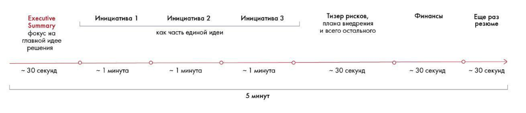
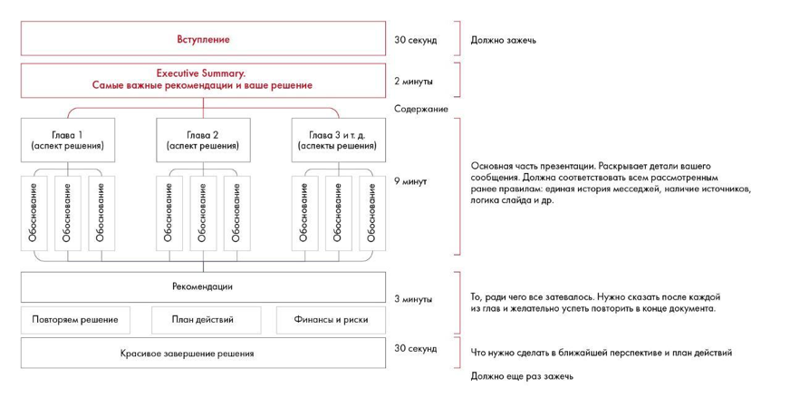

# Подготовка к выступлению: структура

Рассматриваются адаптация решения под время и Elevator Pitch. Сохранены примеры структуры пяти- и пятнадцатиминутного выступления.

**Источник:** физические страницы PDF 253–257. Печатные номера не установлены.

**Предварительно:** [Этапы решения кейса](../01-case-method/04-solution-stages.md).

**Навигация:** [Индекс главы](INDEX.md) · [Маршрутизатор](../../ROUTER.md) · [Проблемы источника](../../meta/issues.md).

---

## Источник: [PDF 253](../../SOURCE.md#pdf-253)

### Неделя 12. Публичное выступление

Вы почти у цели! Осталась последняя и очень важная задача — подготовиться к публичному выступлению. Вы узнаете, из чего складывается общее впечатление от презентации, научитесь привлекать и удерживать внимание аудитории и справляться с волнением. На занятиях в университете, защите проектов на работе и кейс-чемпионатах вам придется не только решать кейсы, но и презентовать полученные результаты перед аудиторией: рекрутерами, преподавателями, судьями. Если вас ожидает публичное выступление, отнеситесь к нему серьезно: половина успеха зависит от качества выступления и того, какое впечатление вы произведете на слушателей.

Публичные презентации делятся на два типа. В первом случае вы выступаете без использования мультимедийных средств, презентуя решение в раздаточных материалах или на флипчарте. Этот способ презентации используется в бизнес-играх и на ассессментах, где на решение дается несколько часов. Второй вид — выступление с полноценной презентацией на экране. Он используется на защитах курсовых в университетах, питчингах проектов, кейс-чемпионатах и, по сути, в реальной жизни на работе.

Обязательно напишите план речи заранее. Учитывайте интересы аудитории, которая будет вас слушать, и формат выступления. Отрепетируйте презентацию вместе, если работаете в команде, и подготовьте раздаточные материалы. При выступлении помните о важности невербальных сигналов и эмоций — именно на их основе слушатели будут принимать решение. Наибольшее внимание к вам будет приковано в самые первые и последние минуты выступления, поэтому в начале кратко расскажите суть, а в конце еще раз закрепите выводы. Начинать и заканчивать выступление нужно эффектно, чтобы запомниться. Подготовьтесь к возможным вопросам оценщиков — их часто можно предугадать заранее. Продумайте ответы, которые позволят продемонстрировать прекрасную эрудицию и знание материала.

### ПОДГОТОВКА К ВЫСТУПЛЕНИЮ

### Структура

Чтобы логично выстроить выступление и правильно расставить акценты, определите его целевую аудиторию. Встаньте на место заказчика, клиента или компании, о которой написан кейс. Определите, что важно слушателям.

**Ссылки на этой странице исходника:** [Ссылка url-004](../../meta/source-links.md#url-004).

## Источник: [PDF 254](../../SOURCE.md#pdf-254)

Например, если вы решаете кейс, в котором один из героев настаивает на проработанности плана внедрения, то, скорее всего, судьи будут обращать особое внимание на этот аспект решения.

В зависимости от типа выступления его структура будет отличаться.

Если у вас всего 5 минут на презентацию, углубиться в детали вы не успеете. Постройте свое выступление в формате Elevator Pitch[1].

Это короткий рассказ о концепции вашего решения. Название было выбрано неспроста. Продолжительность презентации должна быть такой, чтобы ее можно было полностью рассказать потенциальному инвестору или партнеру за время поездки в лифте. Это один из самых эффективных способов продать свою идею. Суть Elevator Pitch не в том, чтобы досконально представить идею, а рассказать о том, что может заинтересовать слушателя. Начните с «крючка», цепляющего внимание зрителей, затем вкратце расскажите об основных идеях. После вашего рассказа зритель должен захотеть задать дополнительные вопросы, обсудить с вами идеи более детально.

Если вы выступаете, например, на кейс-чемпионате, за 5 минут вам нужно будет как минимум ответить на поставленные в кейсе вопросы, показать, что решение глубоко проработано, и дать общие очертания финансовой модели (если необходимо).

Сосредоточьтесь на четыре основных вопросах:

1. Что конкретно вы предлагаете?

2. Что для этого нужно сделать?

3. Какой это даст эффект?

4. Сколько это будет стоить?

Вы не сможете продать много идей за короткий промежуток времени — сосредоточьтесь на 2–3 основных. Обязательно подчеркните, что ваши идеи релевантны для целевой аудитории, объясните, почему они важны. Краткую суть решения — Executive Summary — важно рассказать в самом начале. Бывает, что слушают только его.

Вы не успеете за 5 минут показать всю логику анализа: сравнение инициатив по критериям, финансовые расчеты и прочие составляющие. Но вы сможете рассказать, как пришли к своим выводам. Например, вы принимаете решение,

**Ссылки на этой странице исходника:** [Ссылка url-269](../../meta/source-links.md#url-269); [Ссылка url-004](../../meta/source-links.md#url-004).

## Источник: [PDF 255](../../SOURCE.md#pdf-255)

в каком городе Южного федерального округа России необходимо открыть новый завод по производству мороженого. Необходим целый слайд или пара минут речи для описания всех учтенных факторов. В рамках Elevator Pitch вы говорите: «Мы выбрали город на основе математической модели, которая учитывает 15 различных экономических, политических и социальных факторов. Выбор пал на Ростов». Эта фраза займет 15 секунд выступления и убедит, что вы проделали большую работу. С деталями судьи смогут ознакомиться в раздаточных материалах, а также если зададут вопросы.

Иллюстрация исходника: «Примерная структура 5-минутного выступления». Подписи и числовые значения вынесены в расшифровку; порядок и связи элементов проверяются по сохранённому изображению.

[Подробная текстовая расшифровка рисунка](../../assets/transcripts/pdf-255-img-01.md).

Примерная структура 5-минутного выступления

Если у вас есть 10 минут или больше, вы успеете обсудить все детали. Последовательно опишите ваши инициативы, подробно расскажите о проведенном анализе, покажите временной и финансовый план и не забудьте рассказать о рисках.

Иллюстрация исходника: «Примерная структура 15-минутного выступления». Подписи и числовые значения вынесены в расшифровку; порядок и связи элементов проверяются по сохранённому изображению.

[Подробная текстовая расшифровка рисунка](../../assets/transcripts/pdf-255-img-02.md).

Примерная структура 15-минутного выступления

Чтобы у слушателей осталось цельное впечатление о вашем предложении, постарайтесь связать ваши идеи друг с другом. Например, вы предлагаете

**Ссылки на этой странице исходника:** [Ссылка url-270](../../meta/source-links.md#url-270).

## Источник: [PDF 256](../../SOURCE.md#pdf-256)

ритейлеру пакет инициатив, которые привлекут новых покупателей, улучшат Customer Experience во время покупок и реализуют ряд сервисов, которые будут поддерживать лояльность покупателей. Скажите, что ваш проект называется Whirlpool[2] и его задача — создать водоворот, который притягивает новых клиентов, удерживает текущих и засасывает их в непрерывный поток очередных покупок! Вас обязательно запомнят: вы не только объединили разрозненные сервисы общей идеей, но и создали в воображении клиента эффектный образ того, как все это будет работать.

Если вы готовите выступление заранее, можете включить необычный элемент, например видеовступление или модель, сделанную своими руками. Но будьте осторожны: ваш креатив должен быть уместным (все-таки это бизнес-презентация), существенным для решения и очень качественным визуально. Если сроки сдачи кейса поджимают, не рекомендуем тратить время на лишнее творчество. Лучше еще раз проверьте свое решение на реализуемость, структурность и соответствие всем критериям оценки.

«Важно максимально просто сформулировать мысль, которую хочешь рассказать, чтобы ее можно было понять сразу, не обдумывая. Иногда, пытаясь донести что-то важное, мы перегружаем речь терминами, деепричастными оборотами. Из-за этого ваша мысль становится слишком громоздкой и сложной для понимания. Меньше слов — больше сути».

**Александр Денисов, победитель консалтингового проекта Changellenge**

>> Winter School

Разумеется, за вашим выступлением перед судьями в финале кейс-чемпионата стоит, скорее всего, много часов работы над заданием, а именно: изучения пожеланий компании-клиента, поиска информации во всевозможных источниках и анализа этой информации с целью подтверждения или опровержения первоначальных гипотез, структурирования конечного решения, оформления презентации и написания речи. Поверьте, так скажет большинство финалистов кейс-чемпионатов. Однако чтобы занимать призовые места или становиться победителями, подобной работы мало. На последнем кейс-чемпионате, в котором мне удалось поучаствовать, мы с командой решили сделать упор не только на соответствующее исходному заданию качественное решение целью которого было, несомненно, увеличение стоимости компании, но и на то, на что, как правило, не обращают внимания другие команды: на ценности компании и ответственное, близкое клиенту позиционирование. Возможно, именно пара предложений о том, что ценность предложенного решения заключается не только в деньгах, вырученных компанией, но и в

**Ссылки на этой странице исходника:** [Ссылка url-271](../../meta/source-links.md#url-271); [Ссылка url-007](../../meta/source-links.md#url-007); [Ссылка url-004](../../meta/source-links.md#url-004).

## Источник: [PDF 257](../../SOURCE.md#pdf-257)

“огне в глазах клиентов”, позволила нам занять высокое призовое место, выделившись на фоне остальных команд с похожими решениями.

**Антон Коровяков, призер Changellenge ≫ Cup Moscow**

**Ссылки на этой странице исходника:** [Ссылка url-012](../../meta/source-links.md#url-012); [Ссылка url-272](../../meta/source-links.md#url-272); [Ссылка url-273](../../meta/source-links.md#url-273).

## Связанные разделы

- [Все темы главы](INDEX.md)
- [Термины и сокращения](../../GLOSSARY.md)
- [Предыдущая тема: Чек-лист одиннадцатой недели и источники](../11-presentation/11-checklist-resources.md)
- [Следующая тема: Репетиция и раздаточные материалы](02-rehearsal.md)
- [Авторские ответы по этой неделе](../13-answers/11-week-12.md)
