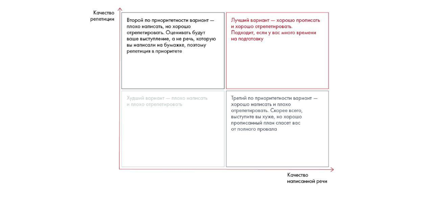
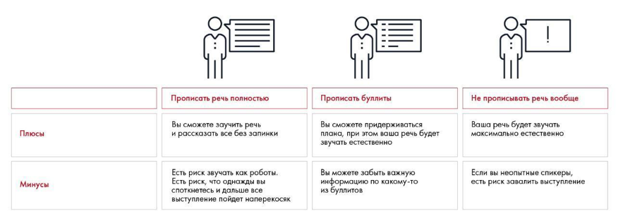
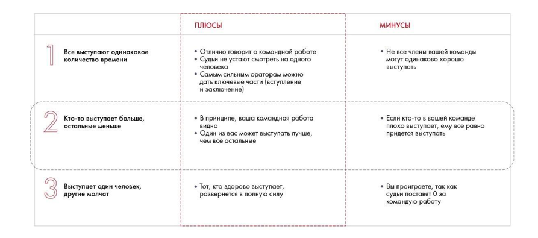
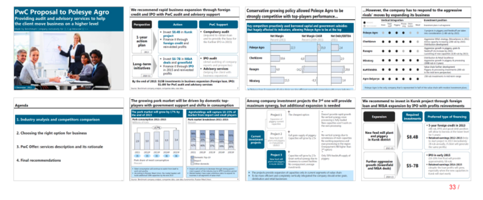
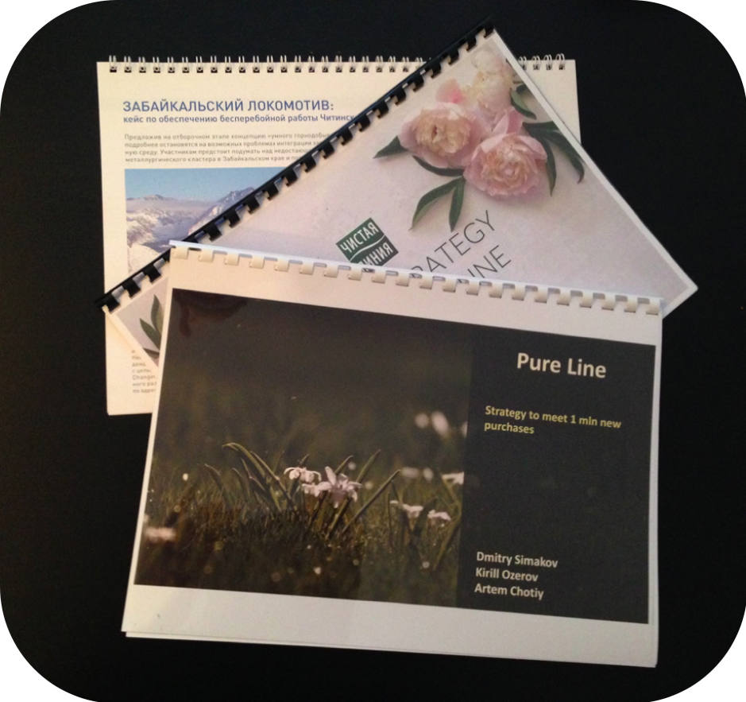

# Репетиция и раздаточные материалы

Показаны написание речи, распределение ролей и репетиции с таймером. Таблица объёма текста и примеры раздаточных материалов сохранены вместе с ограничениями источника.

**Источник:** физические страницы PDF 257–262. Печатные номера не установлены.

**Для последовательного чтения:** [Подготовка к выступлению: структура](01-speech.md).

**Навигация:** [Индекс главы](INDEX.md) · [Маршрутизатор](../../ROUTER.md) · [Проблемы источника](../../meta/issues.md).

---

## Источник: [PDF 257](../../SOURCE.md#pdf-257)

### Репетиция и раздаточные материалы

Обязательно уделите время написанию плана и репетиции речи. Если у вас нет огромного опыта выступлений, вряд ли вы сможете понятно и без запинок изложить суть своего решения, даже если отлично ориентируетесь в материалах и знаете каждый нюанс.

На рисунке приведены элементы: Качество; репетиции; Второй по приоритетности вариант -; плохо написать, но хорошо; отрепетировать. Оценивать будут. Полная текстовая расшифровка приведена отдельно; геометрия и цветовые обозначения сохранены на изображении.

[Подробная текстовая расшифровка рисунка](../../assets/transcripts/pdf-257-img-01.md).

Варианты подготовки к презентации

На рисунке приведены элементы: Плюсы; Минусы; Прописать речь полностью; Вы сможете заучить речь; и рассказать все без запинки. Полная текстовая расшифровка приведена отдельно; геометрия и цветовые обозначения сохранены на изображении.

[Подробная текстовая расшифровка рисунка](../../assets/transcripts/pdf-257-img-02.md).

Варианты подготовки речи

**Ссылки на этой странице исходника:** [Ссылка url-012](../../meta/source-links.md#url-012); [Ссылка url-272](../../meta/source-links.md#url-272); [Ссылка url-273](../../meta/source-links.md#url-273).

## Источник: [PDF 258](../../SOURCE.md#pdf-258)

Чтобы понять, укладываетесь ли вы в тайминг, посчитайте слова в Word.

| Время выступления | Количество слов |
| --- | --- |
| 30 секунд (Elevator Pitch) | 100–150 слов |
| 5 минут | 500–700 слов |
| 15 минут | 1700 слов |

Соответствие тайминга и объема текста

Если вы выступаете с командой, заранее определите, кто о чем говорит. Обычно каждый рассказывает ту часть решения, которая ему наиболее знакома. Самые ответственные моменты презентации — начало, конец и эмоциональные моменты — отдайте сильным ораторам.

На рисунке приведены элементы: 2; Все выступают одинаковое; количество времени; Кто-то выступает больше,; остальные меньше. Полная текстовая расшифровка приведена отдельно; геометрия и цветовые обозначения сохранены на изображении.

[Подробная текстовая расшифровка рисунка](../../assets/transcripts/pdf-258-img-01.md).

Как распределить роли в команде на выступлении

Написав речь, расскажите ее без слайдов. Если смысл вашей презентации понятен, выступление будет успешным. Если нет, нужно переписать. Проведите «тест бабушки»: позовите друзей, родственников или других людей, не имеющих отношения к теме. Расскажите им вкратце суть задачи и ваше решение. Убедитесь, что они все поняли.

Когда качество речи вас устроит, начинайте репетиции с таймером. Вам потребуется не менее 15 репетиций, если вы новичок, и 3–5, если у вас есть опыт серьезных публичных выступлений.

**Ссылки на этой странице исходника:** [Ссылка url-274](../../meta/source-links.md#url-274).

## Источник: [PDF 259](../../SOURCE.md#pdf-259)

В идеале речь должна быть живой, близкой к тексту. Повторяйте дословно только ключевые метафоры. Верх мастерства — отрепетировать выступление так, чтобы оно казалось импровизацией. Попробуйте уложиться в отведенное вам время. На всякий случай заложите 10 % времени выступления про запас. Репетируйте перед зеркалом, чтобы видеть себя. А лучше запишите выступление на камеру и посмотрите, какие есть недочеты.

Несколько способов помогут вам лучше запомнить текст презентации. Первый

— использование карточек. Запишите на них основные мысли и используйте как шпаргалки. Минус этого подхода в том, что на очном выступлении вы можете потеряться в карточках и забыть текст. Второй способ — выучить текст наизусть. Плюс этого способа в том, что вам не нужны будут никакие дополнительные материалы на выступлении и после многочисленных репетиций ваша речь будет выглядеть естественно.

Самый эффективный способ запомнить текст — использовать зрительные образы на раздаточных материалах. Создавая зрительный образ, вы будете мысленно рисовать картинки, которые сложно забыть. Они прочно врежутся в память, и вы обнаружите, что можете без труда вспомнить все выступление, не прибегая к подручным материалам.

А вот читать текст с планшета не рекомендуем. Это заставит зрителей усомниться в том, что вы знаете свой проект. Даже если вы боитесь все забыть от волнения, придется взять себя в руки. В бизнес-среде нужно уметь преподносить информацию четко и харизматично. Кроме того, планшет мешает визуальному контакту с аудиторией и затрудняет жестикуляцию.

Если у вас нет возможности использовать мультимедийные средства, обязательно подготовьте раздаточные материалы — отдельные листы с существенной информацией о решении кейса. Сюда можно отнести ваши выводы, предложения, схему решения и ключевые расчеты. Лучше всего оформлять раздаточные материалы в цельную презентацию. Поскольку вы будете сопровождать свое выступления комментариями, вам подойдет формат презентации для небольшой аудитории.

## Источник: [PDF 260](../../SOURCE.md#pdf-260)

Иллюстрация исходника: «Пример раздаточных материалов победителей кейс-чемпионата.». Подписи и числовые значения вынесены в расшифровку; порядок и связи элементов проверяются по сохранённому изображению.

[Подробная текстовая расшифровка рисунка](../../assets/transcripts/pdf-260-img-01.md).

Пример раздаточных материалов победителей кейс-чемпионата. Источник: Changellenge ≫ Cup Moscow, решение команды Benchmark Company

Даже если выступаете с проектором, раздаточные материалы сыграют вам на руку. Вы продемонстрируете свой профессионализм, если предложите судьям ознакомиться с более подробными расчетами в стильно оформленной брошюре, которую раздадите им до начала выступления. Еще один плюс раздаточных материалов: слушатели смогут по ним освежить в памяти ваше выступление. Первый вариант оформления раздаточных материалов — вынести туда графики и таблицы, которые не поместились на слайдах. Второй вариант — распечатать вашу презентацию с приложениями и раздать судьям. Третий — оформить раздаточные материалы в виде отдельной презентации. Мы рекомендуем второй подход: так судьи не будут разрываться между вашей презентацией и раздаточными материалами и всегда смогут вернуться к заинтересовавшему их моменту.

Постарайтесь не заваливать слушателей кипами бумаги — им это не понравится. Обязательно скрепите листы, желательно сшить их заранее пружинами с прозрачной обложкой и твердым последним листом. Ни в коем случае нельзя вкладывать листы в папку для курсовых — это выглядит ужасно. Если нет времени или бюджета, просто распечатайте в формате А4 и скрепите степлером в левом верхнем углу.

**Ссылки на этой странице исходника:** [Ссылка url-275](../../meta/source-links.md#url-275); [Ссылка url-012](../../meta/source-links.md#url-012).

## Источник: [PDF 261](../../SOURCE.md#pdf-261)

На рисунке приведены элементы: ЗАБАЙКАЛЬСКИЙ ЛОКОМОТИВ:; кейс по обеспечению бесперебойной работы Чити; Предложив на отборочном зіале к01; ЧИСТАЯ; PATEGY. Полная текстовая расшифровка приведена отдельно; геометрия и цветовые обозначения сохранены на изображении.

[Подробная текстовая расшифровка рисунка](../../assets/transcripts/pdf-261-img-01.md).

Рекомендуемый вариант оформления раздаточных материалов

По возможности заранее придите в аудиторию, в которой будете выступать. Так вы сможете немного освоиться в новой обстановке или даже отрепетировать выступление на месте.

[1] Презентация в лифте (англ.) Понятие пришло из стартап-сообщества: предприниматели презентовали в таком формате свои бизнес-идеи представителям венчурных фондов, которые стремились как можно быстрее оценить перспективность проекта, для получения инвестиций. Это именно Pitch, а не Speech, как путают многие.

**Ссылки на этой странице исходника:** [Ссылка url-276](../../meta/source-links.md#url-276); [Ссылка url-277](../../meta/source-links.md#url-277).

## Источник: [PDF 262](../../SOURCE.md#pdf-262)

[2] От англ. «водоворот».

**Ссылки на этой странице исходника:** [Ссылка url-278](../../meta/source-links.md#url-278); [Ссылка url-004](../../meta/source-links.md#url-004).

## Связанные разделы

- [Все темы главы](INDEX.md)
- [Термины и сокращения](../../GLOSSARY.md)
- [Предыдущая тема: Подготовка к выступлению: структура](01-speech.md)
- [Следующая тема: Выступление: внимание, голос и невербальные приёмы](03-delivery.md)
- [Авторские ответы по этой неделе](../13-answers/11-week-12.md)
