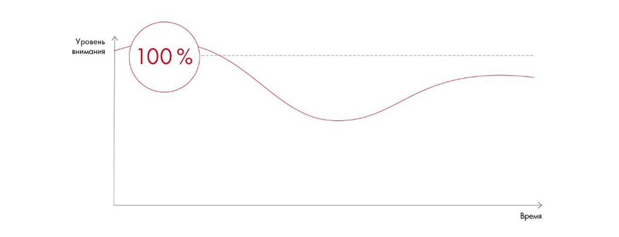
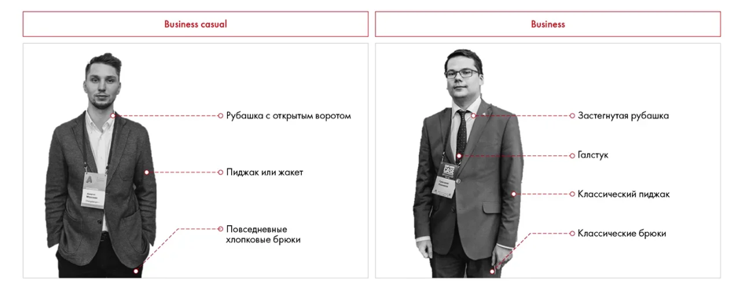
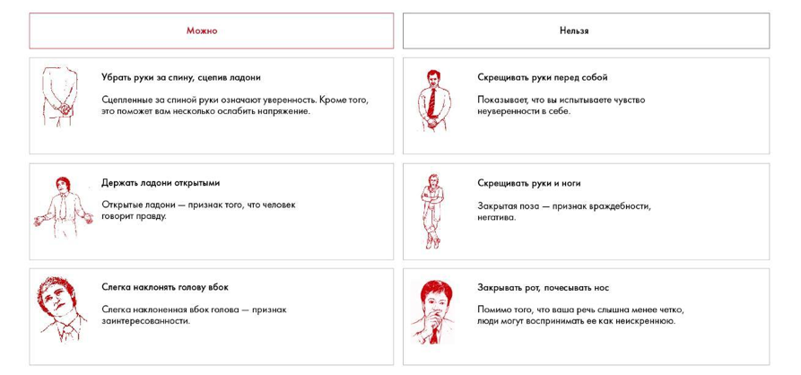
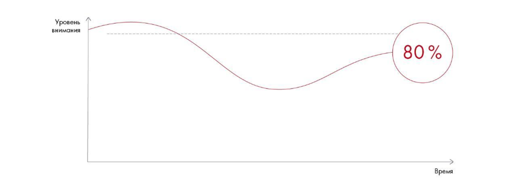

# Выступление: внимание, голос и невербальные приёмы

Разбираются внешний вид, способы привлечения внимания и поведение перед аудиторией. Практическое задание 12.1 предлагает разобрать публичную речь.

**Источник:** физические страницы PDF 262–268. Печатные номера не установлены.

**Для последовательного чтения:** [Репетиция и раздаточные материалы](02-rehearsal.md).

**Навигация:** [Индекс главы](INDEX.md) · [Маршрутизатор](../../ROUTER.md) · [Проблемы источника](../../meta/issues.md).

---

## Источник: [PDF 262](../../SOURCE.md#pdf-262)

### Неделя 12. Публичное выступление

### Выступление

Если вы выступаете перед незнакомыми людьми, начните с представления команды, пусть слушатели запомнят вас по имени. Расскажите о роли, которую каждый из вас выполнял во время решения. Во время выступления на кейс-чемпионате благодарите коллег по команде и передавайте слово Маше, Вите или Кате. Это покажет вас как сплоченную команду.

Самую важную информацию расскажите в начале. Это важно, поскольку аудитория лучше всего воспринимает информацию в первые минуты. Именно тогда у вас будет шанс описать ситуацию, заинтересовать людей и создать основу для дальнейшего взаимодействия. Помните: первое впечатление может стать залогом вашей победы. Если же все с самого начала пойдет наперекосяк, исправить ситуацию и завоевать расположение жюри будет гораздо сложнее. Особенно это важно, если ваша команда презентует свое решение одной из последних — уже после пяти выступлений оценщикам обычно трудно концентрироваться.

Кривая внимания аудитории: высокая вовлечённость в начале, снижение в середине и подъём к завершению. Рисунок объясняет значение вступления, смысловых акцентов и финала.

[Подробная текстовая расшифровка рисунка](../../assets/transcripts/pdf-262-img-01.md).

Как меняется уровень внимания аудитории по ходу выступления

**Ссылки на этой странице исходника:** [Ссылка url-278](../../meta/source-links.md#url-278); [Ссылка url-004](../../meta/source-links.md#url-004).

## Источник: [PDF 263](../../SOURCE.md#pdf-263)

Как создать положительное первое впечатление?

**Следите за внешним видом.**

Тут все просто. Волосы чистые, ухоженные и аккуратные. Мужчины — гладко выбриты, девушки — с неброским макияжем, маникюр и ювелирные украшения

— скромно и в меру. Придерживайтесь бизнес-стиля в одежде, наденьте удобную чистую обувь. Экстремальные варианты не приветствуются. Если решаете кейс для японской компании, не надо наряжаться в кимоно. Избегайте неопрятных деталей: оторванная пуговица, неряшливая прическа, ключи или монеты, звенящие в кармане, слишком яркий макияж, пятна на одежде — любая мелочь может испортить впечатление.

Иллюстрация исходника: «Примеры дресс-кода». Подписи и числовые значения вынесены в расшифровку; порядок и связи элементов проверяются по сохранённому изображению.

[Подробная текстовая расшифровка рисунка](../../assets/transcripts/pdf-263-img-01.md).

Примеры дресс-кода

Следите за настроением, позой и выражением лица. Невербальные сигналы говорят больше, чем слова. Уверенно зайдите в комнату, улыбайтесь, держите осанку. Смотрите на судей, когда будете здороваться и представляться им. Говорите громко — это очень важно.

Ваше вступление должно быть ярким и запоминающимся. Есть множество проверенных способов начать выступление эффектно.

Таблица на PDF 263–265.

| Приём | Описание | Пример |
| --- | --- | --- |
| Новость | Что-то интересное и неожиданное для зрителей, чтобы они начали следить за развитием ситуации | Коллеги, только сегодня за завтраком я узнал, что курс новой криптовалюты превысил 30 тыс долларов. Мог ли кто-то подумать о таком три года назад? Давайте разберемся, почему это случилось и какие еще сюрпризы нас ждут |
| Вопрос к аудитории | Прием вовлекает людей в тему обсуждения, они начинают внутренне соглашаться или спорить с вами | Кто из вас сомневается в том, что фастфуд — это вредно? |
| Цитата | Это может быть цитата из книги, фильма или просто слова известного человека. Конечно, она должна быть уместной. Вы можете с ней согласиться, а можете и поспорить | Стив Джобс однажды сказал: «Для меня не важно стать самым богатым человеком на кладбище. Ложиться спать и думать, что сегодня ты совершил настоящее чудо, — вот что для меня важно». Можно ли назвать iPhone чудом? В каком-то смысле да |
| История или факт | Ничего не приковывает внимание слушателя так, как стандартное «Жили-были». Это может быть и ваша личная история — откровенность подкупает и сильнее акцентирует внимание на рассматриваемой проблеме | Когда я был маленьким, поход в кино был для меня настоящим праздником. Кинотеатр находился далеко от дома, мы выделяли целый день на то, чтобы собраться и поехать туда. Сейчас кинотеатров стало больше, и я хожу туда почти каждую неделю. И вот что я заметил: большинство из них совершенно одинаковые, и поход в кино не оставляет тех впечатлений, что раньше |
| Драма | Нагнетание интриги или эмоций. Сильный прием, но не переборщите, иначе это будет выглядеть комично | Следующие четыре минуты изменят ваш взгляд на то, как должна составляться маркетинговая стратегия |
| Шутка | Если вы хорошо и уместно пошутите, вы разрядите атмосферу и расположите аудиторию к себе | Понимаю, что вы уже послушали 9 команд, но нам все еще есть что сказать! |
| Действие | Главное — не показаться нелепым, если действие не соответствует обстановке | Небольшой танец, хлопок в ладоши, слоган, произнесенный командой одновременно, и так далее |
| Тишина | Взяв паузу на 10–20 секунд, вы покажете уверенность и сможете переключить внимание публики на себя |  |
| Список основных вопросов | Повестка дня подойдет, если выступление долгое. Не углубляйтесь в детали, иначе слушатели сочтут вас занудой | 5 моментов, о которых я бы хотел сегодня поговорить: блокчейн, big data, machine learning, deep machine learning, agile |

**Ссылки на этой странице исходника:** [Ссылка url-279](../../meta/source-links.md#url-279).

## Источник: [PDF 264](../../SOURCE.md#pdf-264)

Продолжение таблицы PDF 263–265 перенесено целиком на PDF 263 выше.

## Источник: [PDF 265](../../SOURCE.md#pdf-265)

Окончание таблицы PDF 263–265 включено в общую таблицу выше.

Чтобы эффективно построить выступление, надо понимать, как люди воспринимают информацию. Правда в том, что почти две трети восприятия приходится на невербальные сигналы и язык тела, еще треть — на интонации и тембр голоса. В большей степени людей подкупают эмоции, а не логика и слова. Поэтому делайте упор на зрительное восприятие и невербальные сигналы, фокусируйтесь на эмоциональной стороне выступления:

Используйте в презентациях яркие визуальные образы.

Говорите с энтузиазмом, улыбайтесь.

Искренне выражайте чувства и эмоции, делайте честные признания.

Вовлекайте аудиторию в дискуссию.

**Если выступаете с командой, говорите «мы», а не «я» — это подчеркнет**

ваш командный дух.

Избегайте негативных невербальных сигналов. Не скрещивайте руки и ноги

— эти позы говорят о неуверенности в себе и закрытости. Не закрывайте рот

## Источник: [PDF 266](../../SOURCE.md#pdf-266)

рукой, не почесывайте нос — подобные жесты показывают неискренность. Следите за тем, чтобы ваше лицо выражало заинтересованность.

Иллюстрация исходника: «Примеры закрытых и открытых поз». Подписи и числовые значения вынесены в расшифровку; порядок и связи элементов проверяются по сохранённому изображению.

[Подробная текстовая расшифровка рисунка](../../assets/transcripts/pdf-266-img-01.md).

Примеры закрытых и открытых поз

Публичное выступление — всегда стресс. И зачастую непонятно, куда деть руки, как стоять, какую позу выбрать. Лайфхак: возьмите на выступление обычную шариковую ручку. Этот аксессуар незаменим, если вы хотите указать на какую-либо часть презентации, и позволит вам чувствовать себя более комфортно, не принимая закрытую позу.

**Александр Денисов, победитель консалтингового проекта Зимней**

школы Changellenge >>

Используйте позитивные сигналы. Например, если вы будете держать руки сцепленными за спиной, это покажет уверенность и поможет ослабить напряжение. Держите ладони открытыми — это признак того, что вы говорите правду. По возможности не прячьте руки, учитесь понемногу сопровождать речь жестами.

**Ссылки на этой странице исходника:** [Ссылка url-280](../../meta/source-links.md#url-280); [Ссылка url-007](../../meta/source-links.md#url-007).

## Источник: [PDF 267](../../SOURCE.md#pdf-267)

Избегайте слов-паразитов и звуков наподобие «э-э-э» и «м-м-м». Если вы что-то забыли, сделайте паузу, это нормально.

Не говорите слишком быстро. Не все умеют воспринимать информацию в режиме ускоренной перемотки. Лучше не так сильно углубляться в содержание презентации, но зато спокойно осветить все необходимые пункты. Если останется время, в конце сможете добавить больше подробностей.

Не говорите монотонно. Старайтесь интонацией акцентировать внимание на важных моментах.

Держите зрительный контакт с аудиторией — это полезный прием, который располагает к вам зрителей. Не стесняйтесь смотреть людям в глаза, будьте уверены в себе.

Передавайте слово коллегам, благодарите слушателей за внимание.

«Важное правило: всегда использовать микрофон. Даже если кажется, что все слышно, бери микрофон».

**Александр Денисов, победитель консалтингового проекта Зимней**

школы Changellenge >>

**Практическое задание № 12.1**

Посмотрите видеозаписи выступлений известных ораторов, например Стива Джобса или спикеров TED. Какие невербальные сигналы и приемы они используют? Как держат эмоциональный контакт с аудиторией? Запишите список приемов, которые вы заметили.

Не дайте страху испортить ваше выступление. Боязнь публичных выступлений

— частая проблема, тем более если вы выступаете впервые. Но если вы будете слишком нервничать, это будет заметно. Побеждают уверенные в себе ораторы.

**Ссылки на этой странице исходника:** [Ссылка url-007](../../meta/source-links.md#url-007).

## Источник: [PDF 268](../../SOURCE.md#pdf-268)

Как преодолеть страх? Во-первых, помните, что ошибки совершают все, и это нормально. Если вы оговорились или что-то забыли, не смущайтесь. Судьи, как правило, относятся к таким вещам с пониманием. Во-вторых, не говорите вслух о своем волнении — не привлекайте к этому внимание слушателей. Просто спокойно продолжайте говорить и представляйте себе результат, которого вы хотите достичь (например, победить в чемпионате). Фокусируйтесь на дружелюбных заинтересованных лицах. Это придаст уверенности.

Ближе к середине выступления внимание публики неизбежно рассеивается. Чтобы поддерживать интерес, стоит регулярно устраивать встряску: задайте вопрос, расскажите историю, активно пользуйтесь визуальными материалами (презентацией, флипчартом или доской). Существует правило 15 минут: каждые 15 минут выступления нужно делать смену активности. Как правило, в рамках кейс-чемпионата выступление короче, поэтому мы бы сделали правило 5 минут. Что может быть сменой активности? Смена выступающего, интерактив с аудиторией, риторический вопрос, какой-либо прием из перечисленных выше.

Когда время подойдет к концу, поставьте красивую точку в вашем выступлении. Стоит подчеркнуть, что вы завершаете презентацию: «А сейчас еще два момента перед тем, как мы закончим». Это вновь сфокусирует внимание зрителей, которые могли отвлечься. Кратко резюмируйте все сказанное, чтобы у жюри осталось впечатление законченной цельной истории. Также полезно будет выделить три преимущества вашего решения (только не надо сравнивать с конкурентами). В самом конце представьте команду еще раз и обязательно поблагодарите слушателей. Совет: последним слайдом в вашей презентации лучше поставить краткое резюме команды, чтобы судьи могли запомнить вас и соотнести ваш бэкграунд с тем, как вы выступали.

Кривая внимания с дополнительными пиками после приёмов активизации аудитории. График иллюстрирует необходимость периодически возвращать внимание слушателей.

[Подробная текстовая расшифровка рисунка](../../assets/transcripts/pdf-268-img-01.md).

Концентрация внимания к концу выступления

**Ссылки на этой странице исходника:** [Ссылка url-004](../../meta/source-links.md#url-004); [Ссылка url-281](../../meta/source-links.md#url-281).

## Связанные разделы

- [Все темы главы](INDEX.md)
- [Термины и сокращения](../../GLOSSARY.md)
- [Предыдущая тема: Репетиция и раздаточные материалы](02-rehearsal.md)
- [Следующая тема: Ответы на вопросы, чек-лист и литература](04-questions.md)
- [Авторские ответы по этой неделе](../13-answers/11-week-12.md)
