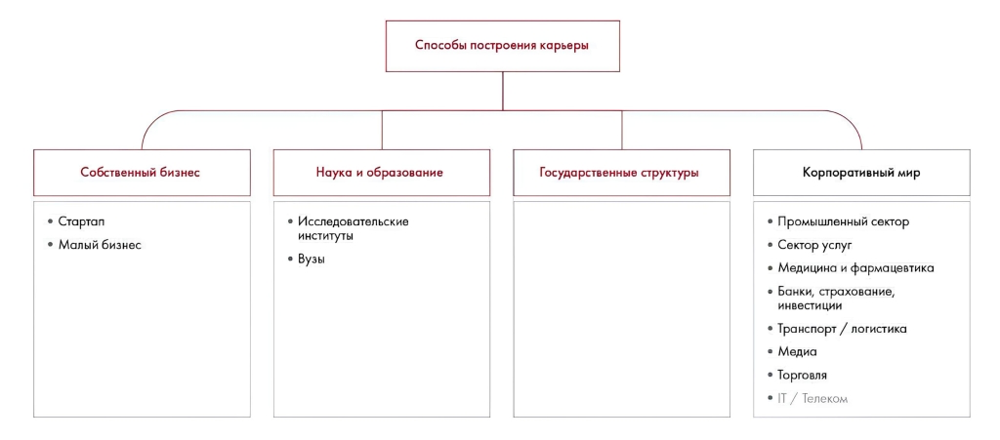
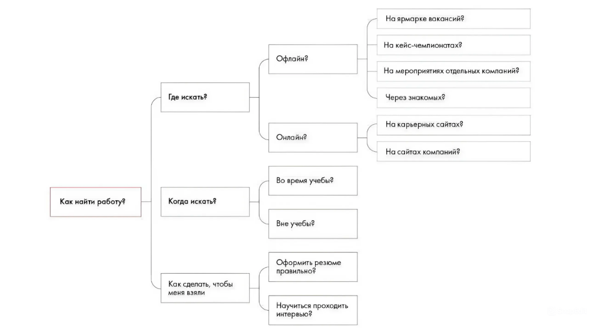
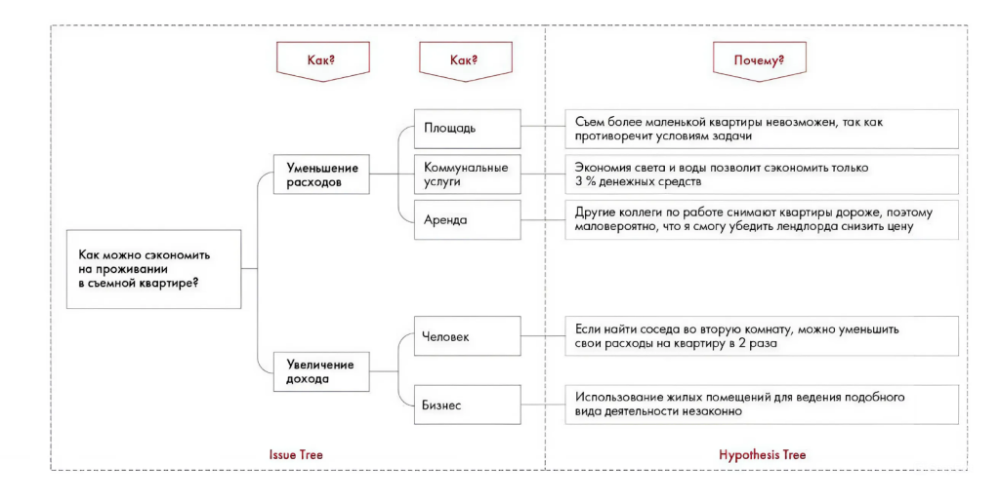

# Ответы: неделя 5

Сохранены схемы и ответы к заданиям 5.1–5.6. Включены примеры пяти сил Портера, PEST, SWOT и выбора гипотез.

**Источник:** физические страницы PDF 274–279. Печатные номера не установлены.

**Для последовательного чтения:** [Ответы: неделя 3](02-week-03.md).

**Навигация:** [Индекс главы](INDEX.md) · [Маршрутизатор](../../ROUTER.md) · [Проблемы источника](../../meta/issues.md).

---

## Источник: [PDF 274](../../SOURCE.md#pdf-274)

### Неделя 5. Структурирование идей

**Практическое задание 5.1**

Добавленные элементы выделены серым.

## Источник: [PDF 275](../../SOURCE.md#pdf-275)

На рисунке приведены элементы: Собственный бизнес; • Стартап; • Малый бизнес; Способы построения карьеры; Наука и образование. Полная текстовая расшифровка приведена отдельно; геометрия и цветовые обозначения сохранены на изображении.

[Подробная текстовая расшифровка рисунка](../../assets/transcripts/pdf-275-img-01.md).

**Практическое задание 5.2**

У этого дерева сразу несколько проблем: оно не соответствует ни правилу MECE, ни правилу соразмерных элементов. Один из возможных вариантов переделки:

На рисунке приведены элементы: Как найти работу?; Где искать?; Когда искать?; Как сделать, чтобы; меня взяли. Полная текстовая расшифровка приведена отдельно; геометрия и цветовые обозначения сохранены на изображении.

[Подробная текстовая расшифровка рисунка](../../assets/transcripts/pdf-275-img-02.md).

**Практическое задание 5.3**

**Рынок авиалиний в России с точки зрения пяти сил Портера:**

Заменители: угроза появления — высокая.

- Существует много других видов транспорта, например: o Поезда. o Автобусы.

## Источник: [PDF 276](../../SOURCE.md#pdf-276)

o Автомобили. o Паромы.

Новые игроки: угроза появления — низкая.

- Низкая вероятность, высокие барьеры входа.

- Значительные инвестиции и госрегулирование.

- Высокая стоимость самолетов и заключения контрактов на предоставление воздушного пространства и мест в аэропортах.

Потребители: рыночная власть — низкая.

- У авиалиний на данный момент наилучшее соотношение цены и времени по сравнению с другими видами транспорта.

Поставщики: рыночная власть — высокая.

- В индустрии действуют всего несколько производителей самолетов с явным преимуществом: Boeing и Airbus. Данные поставщики имеют очень большое влияние на цены, устанавливаемые в отрасли.

Конкуренты: уровень конкурентной борьбы — средний.

- Компании кооперируются в рамках международных альянсов и различных соглашений.

- Основа рынка — крупные монополисты с госучастием.

**Рынок высшего образования в Великобритании по PEST:**

Политические:

- Социально значимая отрасль для развития страны – регулируется государством.

- Законодательно утвержденные программы обучения.

Экономические:

- Рост стоимости образования, а следовательно, уменьшение количества платежеспособного населения.

- Снижение дохода от интернациональных студентов из-за растущей стоимости образования.

Социальные:

- Образование считается престижным.

- Снижение спроса со стороны интернациональных студентов из-за сложности получения документов, трудоустройства по окончании вуза.

## Источник: [PDF 277](../../SOURCE.md#pdf-277)

Технологические:

- Онлайн-образование приобретает популярность, но пока не заменяет офлайн-программы, а дополняет их

**Компания Danone в России по SWOT**

Сильные стороны. Danone владеет 16 предприятиями в России. Имеет налаженное партнерство с поставщиками молока и оптимальное распределение производственных площадок благодаря слиянию с «Юнимилк». В портфеле есть много узнаваемых брендов.

Слабые стороны. Компания имеет сильную зависимость от поставщиков молока и вынуждена часто пересматривать многие инвестиционные решения исходя из изменения цен на сырье.

Возможности. Из-за нехватки сырого молока в России крупные игроки молокоперерабатывающей отрасли могут инвестировать в развитие ферм-производителей. Поскольку производители испытывают острую потребность в инвестициях, подобное использование ресурсов Danone позволяет получать эксклюзивные контракты на поставку молока.

Угрозы. Потребители в России переориентировались на более дешевые молочные продукты с низкой добавленной стоимостью.

**Практическое задание 5.4**

1. Компания — производитель косметики хочет понять, как распределить инвестиции между своими брендами в ближайшие 5 лет.

Подходящие фреймворки: матрица BCG.

2. Нефтегазовый гигант планирует открыть новое месторождение и хочет узнать, насколько это целесообразно.

Подходящие фреймворки: Profitability.

3. Компания, производящая автомобили, столкнулась с тем, что ее продажи перестали расти. При этом рост рынка продолжается.

Подходящие фреймворки: Profitability, модель 3С, Business Situation Framework.

## Источник: [PDF 278](../../SOURCE.md#pdf-278)

4. Компания — стартап по производству компактных кондиционеров собирается вывести свой товар на рынок США и думает, как лучше это сделать.

Подходящие фреймворки: Marketing Mix, SPECIAL-T.

5. Фирма — производитель ноутбуков выбирает, на какой рынок ей выйти: смартфонов, принтеров или телевизоров.

Подходящие фреймворки: Пять сил Портера, SPECIAL-T.

**Практическое задание 5.5**

1. Если провести сокращение персонала, можно добиться более высокой маржинальности.

У компании нет задачи повысить маржинальность.

**2. Верный ответ: нужно перейти на гибкие тарифы, так как остальные**

конкуренты уже перешли на эту модель.

Конкретно, можно измерить и протестировать.

3. Более активные маркетинговые меры помогут увеличить выручку.

Неконкретно.

4. Увеличение доли рынка требует затрат.

Очевидно и неконкретно.

## Источник: [PDF 279](../../SOURCE.md#pdf-279)

**Практическое задание 5.6**

На рисунке приведены элементы: Как?; Уменьшение; расходов; Как можно сэкономить; на проживании. Полная текстовая расшифровка приведена отдельно; геометрия и цветовые обозначения сохранены на изображении.

[Подробная текстовая расшифровка рисунка](../../assets/transcripts/pdf-279-img-01.md).

## Связанные разделы

- [Все темы главы](INDEX.md)
- [Термины и сокращения](../../GLOSSARY.md)
- [Предыдущая тема: Ответы: неделя 3](02-week-03.md)
- [Следующая тема: Ответы: неделя 7](04-week-07.md)
