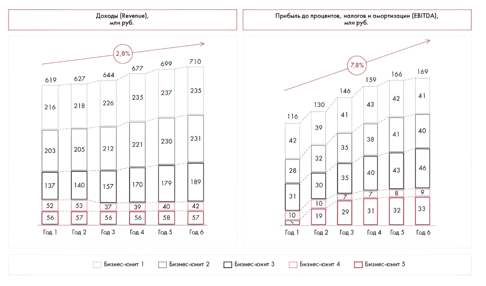
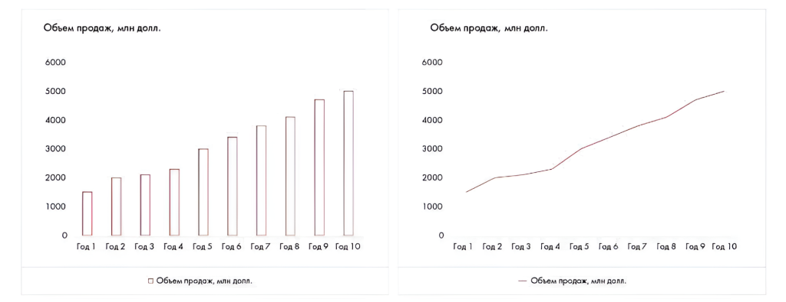
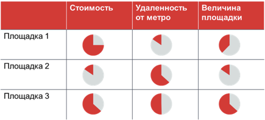
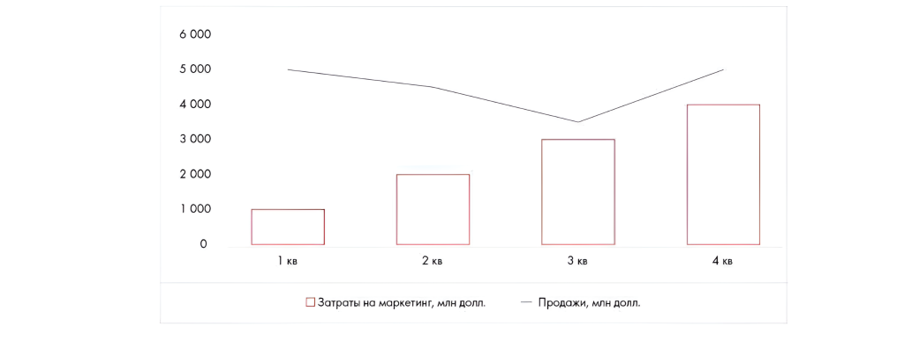
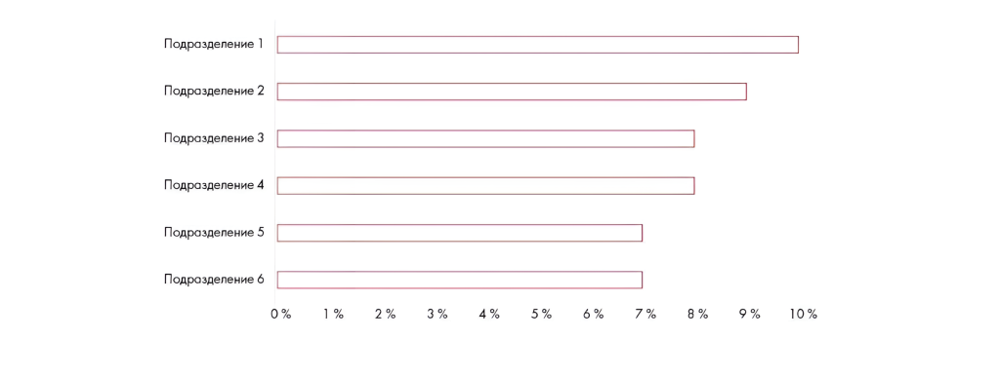
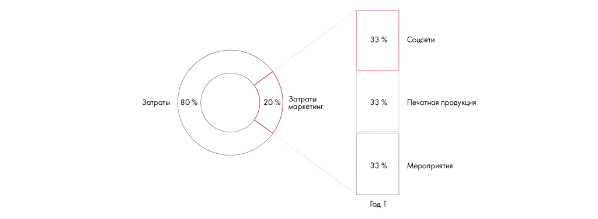

# Ответы: неделя 8

Сохранены результаты расчётов, сегментации и выбора диаграмм к заданиям 8.1–8.4. Числовые значения и изображения позволяют сопоставить ответ с условием.

**Источник:** физические страницы PDF 280–285. Печатные номера не установлены.

**Для последовательного чтения:** [Ответы: неделя 7](04-week-07.md).

**Навигация:** [Индекс главы](INDEX.md) · [Маршрутизатор](../../ROUTER.md) · [Проблемы источника](../../meta/issues.md).

---

## Источник: [PDF 280](../../SOURCE.md#pdf-280)

### Неделя 8. Работа с информацией

На рисунке приведены элементы: 627; 218; 205; 140; 53. Полная текстовая расшифровка приведена отдельно; геометрия и цветовые обозначения сохранены на изображении.

[Подробная текстовая расшифровка рисунка](../../assets/transcripts/pdf-280-img-01.md).

**Ссылки на этой странице исходника:** [Ссылка url-282](../../meta/source-links.md#url-282).

## Источник: [PDF 281](../../SOURCE.md#pdf-281)

Возможные варианты ответа:

- EBITDA клиента растет быстрее его доходов на 5 %.

- Рост EBITDA клиента осуществляется в основном за счет бизнес-юнита 5.

- EBITDA бизнес-юнита 5 выросла на 28 % за 5 лет, несмотря на то, что доход от этого бизнеса все это время оставался постоянным.

- С точки зрения доходов на юниты 1–3 приходится большая часть бизнеса-клиента, с точки зрения EBITDA ключевыми являются сегменты 1–3 и 5.

- Каждый год клиент в среднем отдает 515 млн рублей на издержки (себестоимость материалов на продукты/услуги, з/п работникам).

- В году 6 по сравнению с предыдущим годом прибыль упала только у бизнес-юнитов 1 и 2.

- Затраты (себестоимость) в целом по компании снизились.

- Бизнес-юнит 3 генерирует наибольшую EBITDA при не самых больших объемах выручки — наиболее рентабелен.

**Практическое задание 8.2**

Компании Arwee стоит выходить на рынок Диметрии с самой дешевой модификацией своего флагмана по четырем причинам:

- Этот рынок самый большой по количеству населения (70 млн человек).

- Уровень пенетрации смартфонов на этом рынке самый низкий (60 %), что говорит о потенциале роста продаж смартфонов.

- Характеристики нашей модели полностью соответствуют наиболее важным характеристикам смартфонов на данном рынке.

- У данного региона самая благоприятная конкурентная среда.

**Практическое задание 8.3**

## Источник: [PDF 282](../../SOURCE.md#pdf-282)

Возможный вариант ответа:

## Источник: [PDF 284](../../SOURCE.md#pdf-284)

* Оранжевым цветом изображены Harvey’s Balls, данные для которых нужно было найти дополнительно.

Источник: анализ команды Beautiful Minds на Changellenge >> Cup Russia.

**Практическое задание 8.4**

1. В течение следующих 10 лет прогнозируется увеличение объема продаж косметики сегмента люкс. График/колонки.

Динамика объема продаж косметики сегмента люкс, год 1 — год 10.

Иллюстрация исходника: «удаленность от метро и величина площадки. Рейтинговая диаграмма.». Подписи и числовые значения вынесены в расшифровку; порядок и связи элементов проверяются по сохранённому изображению.

[Подробная текстовая расшифровка рисунка](../../assets/transcripts/pdf-284-img-01.md).

2. На выбор места проведения мероприятия влияют три фактора: стоимость, удаленность от метро и величина площадки. Рейтинговая диаграмма.

Иллюстрация исходника: «продаж. Комбинированная диаграмма.». Подписи и числовые значения вынесены в расшифровку; порядок и связи элементов проверяются по сохранённому изображению.

[Подробная текстовая расшифровка рисунка](../../assets/transcripts/pdf-284-img-02.md).

**3. Более высокие затраты на маркетинг не отражаются на объеме**

продаж. Комбинированная диаграмма.

**Ссылки на этой странице исходника:** [Ссылка url-014](../../meta/source-links.md#url-014).

## Источник: [PDF 285](../../SOURCE.md#pdf-285)

Иллюстрация исходника: «примерно одинаков.Линейчатая диаграмма.». Подписи и числовые значения вынесены в расшифровку; порядок и связи элементов проверяются по сохранённому изображению.

[Подробная текстовая расшифровка рисунка](../../assets/transcripts/pdf-285-img-01.md).

**4. В сентябре уровень текучести кадров в шести отделах компании был**

примерно одинаков.Линейчатая диаграмма.

На рисунке приведены элементы: Подразделение 1; Подразделение 2; Подразделение 3; Подразделение 4; Подразделение 5. Полная текстовая расшифровка приведена отдельно; геометрия и цветовые обозначения сохранены на изображении.

[Подробная текстовая расшифровка рисунка](../../assets/transcripts/pdf-285-img-02.md).

**5. 20 % всех затрат относятся к маркетингу и включают в себя затраты на**

рекламу в социальных сетях, печатную продукцию и мероприятия в равных долях. Комбинация круга и колонки.

На рисунке приведены элементы: Затраты; 80%; | 20 %; Затраты; маркетинг. Полная текстовая расшифровка приведена отдельно; геометрия и цветовые обозначения сохранены на изображении.

[Подробная текстовая расшифровка рисунка](../../assets/transcripts/pdf-285-img-03.md).

## Связанные разделы

- [Все темы главы](INDEX.md)
- [Термины и сокращения](../../GLOSSARY.md)
- [Предыдущая тема: Ответы: неделя 7](04-week-07.md)
- [Следующая тема: Ответы: неделя 9](06-week-09.md)
