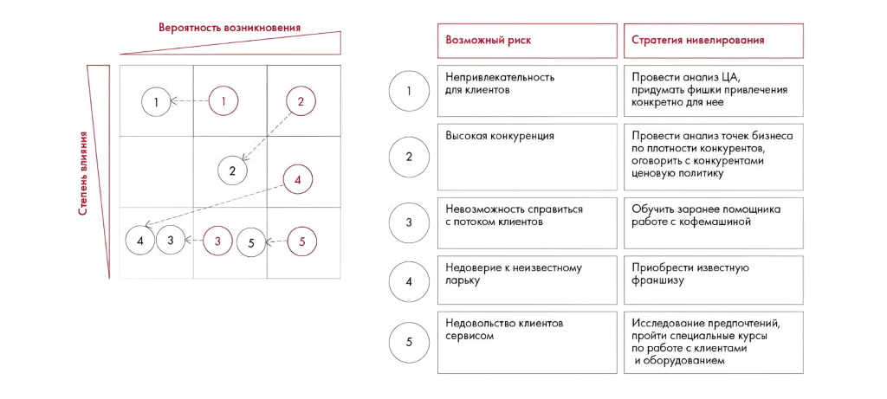

# Ответы: неделя 10, задания 10.1–10.3

Сохранены матрица рисков, финансовые вычисления и объяснения различий показателей компаний. Авторские рассуждения отделены от замечаний к качеству источника.

**Источник:** физические страницы PDF 286–288. Печатные номера не установлены.

**Для последовательного чтения:** [Ответы: неделя 9](06-week-09.md).

**Навигация:** [Индекс главы](INDEX.md) · [Маршрутизатор](../../ROUTER.md) · [Проблемы источника](../../meta/issues.md).

---

## Источник: [PDF 286](../../SOURCE.md#pdf-286)

### Неделя 10. Подготовка решения

**Практическое задание 10.1**

На рисунке приведены элементы: Вероятность возникновения; Степень влияния; 2; 4; 5. Полная текстовая расшифровка приведена отдельно; геометрия и цветовые обозначения сохранены на изображении.

[Подробная текстовая расшифровка рисунка](../../assets/transcripts/pdf-286-img-01.md).

**Практическое задание 10.2**

1. EBITDA = прибыль до налогообложения + амортизация + проценты по займам = 500 + 120 + 20 = 640 тыс. руб.

## Источник: [PDF 287](../../SOURCE.md#pdf-287)

2. EBITDA – амортизация + косвенные расходы = валовая прибыль = 230 – 10 + 90 = 310 тыс. руб.

3. Проценты по займам = EBIT – (чистая прибыль / (1-ставка налога)) = 720

– 560 / 0,8 = 720 – 700 = 20 тыс. руб.

4. Количество проданной продукции = (EBITDA – амортизация + прямые расходы + косвенные расходы) / цена товара = (120 – 10 + 20 + 40) / 200 = 0,85 тыс. шт. = 850 шт.

**Практическое задание 10.3**

1. Переменные издержки зависят от количества и стоимости ресурсов, используемых при производстве продукции. Обычно это сырье и материалы, а также человеческий труд. Для того чтобы понять, из-за чего выросли переменные издержки, нужно проанализировать:

**- Соответствует ли производство технологии. Например, при**

производстве пирожков могли использовать больше мяса и меньше муки, чем должно быть по рецепту, а это влияет на себестоимость пирожков, так как мясо дороже. Если так действительно происходит, то необходимо понять причины и нивелировать их. Частые причины — недостаточная квалификация персонала (провести обучение), нехватка какого-то сырья, из-за чего приходится замещать его другим (наладить логистику), замещение более дешевым сырьем, из-за чего может увеличиться расход (понять, почему такое замещение произошло).

- Объем брака при производстве. Может оказаться, что потери во время производства оказались выше запланированных, из-за чего было затрачено больше ресурсов для того же объема производства. В таком случае нужно понять причины потерь и принять соответствующие меры. Например, такое может происходить из-за устаревшего оборудования, из-за сбоев которого может увеличиваться расход материалов (например, незаметная утечка воды).

- Изменение стоимости сырья, материалов и труда. Если изменение было не в нашу сторону, то следует найти более дешевых поставщиков (при этом обязательно стоит обращать внимание на качество сырья и материалов у нового поставщика).

2. Если валовая прибыль меньше, чем у конкурентов, значит, или выручка меньше, что говорит о меньшем размере компании, или COGS выше, что может говорить о низкой эффективности производства и бизнес-процессов.

Осуществляя подобный анализ, надо принимать во внимание то, что эффективность или неэффективность компании всегда зависит от множества разных факторов, поэтому, будет ошибкой, например, сравнивать два

## Источник: [PDF 288](../../SOURCE.md#pdf-288)

показателя разных компаний напрямую без учета совокупности факторов и особенностей компании.

Пример: возьмем компанию Apple и компанию X, которая производит продукцию в дешевом сегменте. У Apple доля рынка выше, хотя и у компании X она большая тоже. Если мы сравним COGS напрямую, то увидим, что COGS Apple выше, что может говорить нам о неэффективности производства. Однако, COGS этих двух компаний - не сравнимые показатели, потому что у Apple дорогие телефоны и качественные, поэтому комплектующие дорогие и COGS высокий как на единицу, так и в целом, а у компании X дешевые комплектующие и, следовательно, ниже COGS как абсолютный, так и относительный.

Вместо сравнения показателя COGS напрямую, нам следует пойти в пояснения к отчетности\годовой отчет, взять оттуда объем продаж и выяснить, какой COGS на единицу продукции у обеих компаний, а потом сравнить одинаковую ли они продукцию производят. Если видно, что COGS выше в целом и на единицу продукции и производят все примерно одинаково по продукции, то только тогда можно говорить об неэффективности.

3. Отношение выручки к EBITDA слабо зависит от размера бизнеса и характеризует эффективность производства. Если этот показатель высок, значит, EBITDA сильно меньше выручки, следовательно, мы имеем дело с высокими затратами и низкой маржинальностью. Компания, у которой это отношение больше, находится в проигрышном положении. Ей необходимо повысить свою маржинальность. Это можно сделать, сфокусировавшись на продаже высокомаржинальных продуктов или уменьшив стоимость производства продукции.

## Связанные разделы

- [Все темы главы](INDEX.md)
- [Термины и сокращения](../../GLOSSARY.md)
- [Предыдущая тема: Ответы: неделя 9](06-week-09.md)
- [Следующая тема: Ответ: задание 10.4, прогноз P&L](08-week-10-pnl.md)
