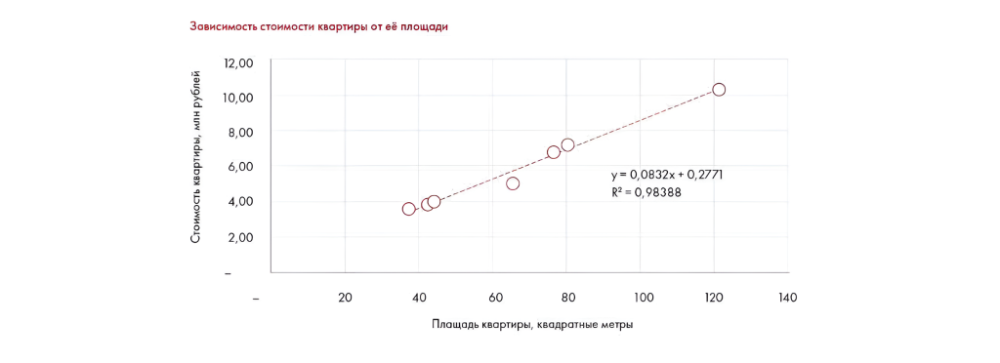
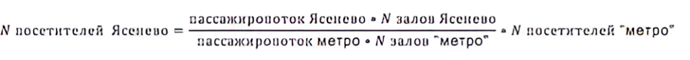

# Ответы: задания 10.5–10.7

Сохранены сравнение NPV, регрессионный прогноз цены квартиры и оценка посещаемости. Указаны исходные ставки, стратегии и числовые результаты.

**Источник:** физические страницы PDF 291–293. Печатные номера не установлены.

**Для последовательного чтения:** [Ответ: задание 10.4, прогноз P&L](08-week-10-pnl.md).

**Навигация:** [Индекс главы](INDEX.md) · [Маршрутизатор](../../ROUTER.md) · [Проблемы источника](../../meta/issues.md).

---

## Источник: [PDF 291](../../SOURCE.md#pdf-291)

**Практическое задание 10.5**

NPV рассчитываем по формуле:

Иллюстрация исходника: «В таблице ниже указаны NPV, посчитанные для различных стратегий при». Подписи и числовые значения вынесены в расшифровку; порядок и связи элементов проверяются по сохранённому изображению.

$$NPV=\sum_{t=0}^{n}\frac{\text{Положительный денежный поток}_t-\text{Отрицательный денежный поток}_t}{(1+\text{ставка дисконтирования})^t}.$$

[Подробная текстовая расшифровка рисунка](../../assets/transcripts/pdf-291-img-01.md).

В таблице ниже указаны NPV, посчитанные для различных стратегий при различных ставках дисконтирования:

| Стратегия / ставка | 10 % | 3 % | 25 % |
| --- | --- | --- | --- |
| Стратегия 1 | 1 699 519,16 ₽ | 1 948 859,78 ₽ | 1 312 032,00 ₽ |
| Стратегия 2 | 1 679 015,78 ₽ | 1 906 850,75 ₽ | 1 321 760,00 ₽ |
| Стратегия 3 | 1 695 567,24 ₽ | 1 967 376,11 ₽ | 1 278 784,00 ₽ |

Видно, что для ставки дисконтирования 10 % наиболее выгодной оказалась стратегия 1, для ставки дисконтирования 3 % — стратегия 3, для ставки дисконтирования 25 % — стратегия 2.

## Источник: [PDF 292](../../SOURCE.md#pdf-292)

**Практическое задание 10.6**

На рисунке приведены элементы: Зависимость стоимости квартиры отвёлощади; Стоимость квартиры, млн рублей; 12,00; 10,00; 8,00. Полная текстовая расшифровка приведена отдельно; геометрия и цветовые обозначения сохранены на изображении.

[Подробная текстовая расшифровка рисунка](../../assets/transcripts/pdf-292-img-01.md).

Восстанавливаем зависимость стоимости квартиры от ее площади при помощи линейной регрессии (пунктирная прямая на графике). Зная аналитический вид прямой, находим стоимость (y) при площади квартиры (x) 40 кв. метров и 65 кв. метров. Получаем ответ: для 40 кв. метров — 3,61 млн рублей, для 65 кв. метров — 5,69 млн рублей. Табличное значение для квартиры площадью 65 кв. метров — 5,02 млн рублей, что на 13,4 % меньше, чем рассчитанная цена. Это можно объяснить тем, что цена квартиры зависит не только от площади, но и от города, удаленности от центра, типа дома, этажа, качества ремонта и других характеристик. У модели несколько недостатков. Во-первых, она учитывает только один фактор — площадь. Во-вторых, реальная зависимость может и не быть линейной — в таком случае линейная модель будет хорошо подходить только для конкретного диапазона значений площади.

**Практическое задание 10.7**

**Подход 1**

Количество посетителей = количество залов × количество сеансов в день в одном зале × количество мест в одном зале × заполняемость одного зала × количество дней в месяце.

- Количество залов — 2.

- Количество сеансов в день в одном зале — 6 (согласно афишам кинотеатров).

- Количество мест в одном зале — ~200 (предположение и данные кинотеатров).

- Количество дней в месяце — 30.

- Заполняемость одного зала — ~15 %.

Итого, количество посетителей в месяц: 2 × 6 × 200 × 30 × 0,15 = 10 800 человек.

## Источник: [PDF 293](../../SOURCE.md#pdf-293)

**Подход 2**

Аналогичную логику можно провести, сравнив пассажиропотоки в метро «Ясенево» с пассажиропотоком на других станциях метро и посмотрев на посещаемость кинотеатров рядом с этими станциями.

На рисунке приведены элементы: пассажиропоток Ясенево • N залов Ясенево; N посетителей Яселево = .; - • N посетителей "метро"; пассажиропоток метро • N залов "метро". Полная текстовая расшифровка приведена отдельно; геометрия и цветовые обозначения сохранены на изображении.

$$N_{\text{посетителей Ясенево}}=\frac{\text{пассажиропоток Ясенево}\cdot N_{\text{залов Ясенево}}}{\text{пассажиропоток метро}\cdot N_{\text{залов метро}}}\cdot N_{\text{посетителей метро}}.$$

Это запись подхода 2 из авторского ответа; необходимые числовые подстановки находятся в окружающем тексте.

[Подробная текстовая расшифровка рисунка](../../assets/transcripts/pdf-293-img-01.md).

Для примера возьмем кинотеатр «Алмаз» у метро «Шаболовская». Согласно brand-metro.ru, пассажиропоток «Ясенево» составляет примерно 70 000 человек, «Шаболовской» — примерно 45 000 человек. В «Алмазе» 5 залов, в нашем кинотеатре — 2. Согласно данным Monas Media, среднемесячная посещаемость кинотеатра «Алмаз» составляет 26 000 человек.

По формуле получаем: 70 000 × 2 / (45 000 × 5) × 26 000 = 16 178 человек.

Заметьте, что, используя совершенно разные подходы, мы получили сопоставимый результат.

**Ссылки на этой странице исходника:** [Ссылка url-283](../../meta/source-links.md#url-283).

## Связанные разделы

- [Все темы главы](INDEX.md)
- [Термины и сокращения](../../GLOSSARY.md)
- [Предыдущая тема: Ответ: задание 10.4, прогноз P&L](08-week-10-pnl.md)
- [Следующая тема: Ответы: неделя 11](10-week-11.md)
