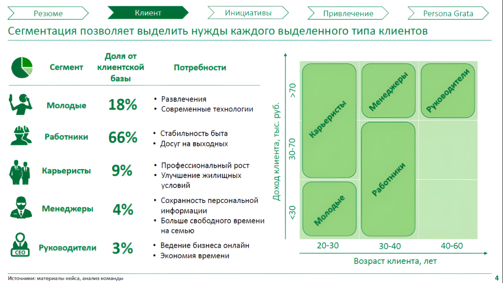
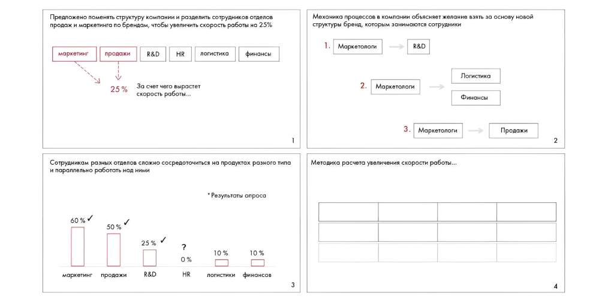
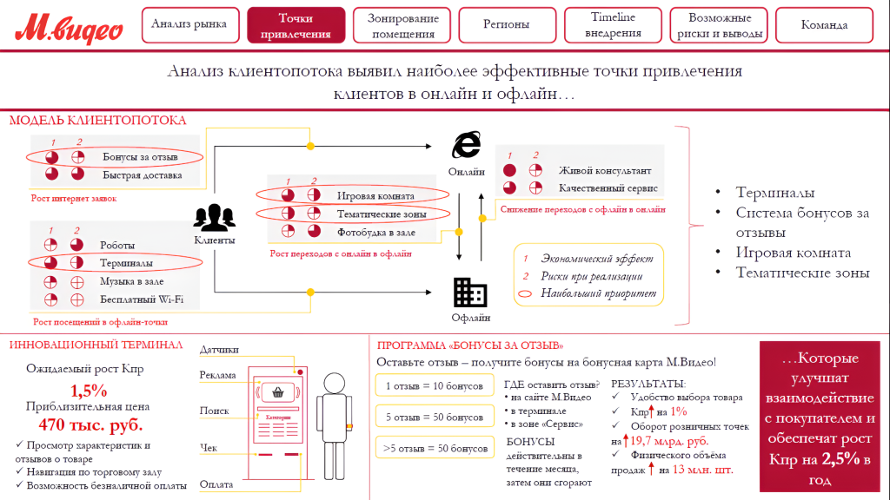
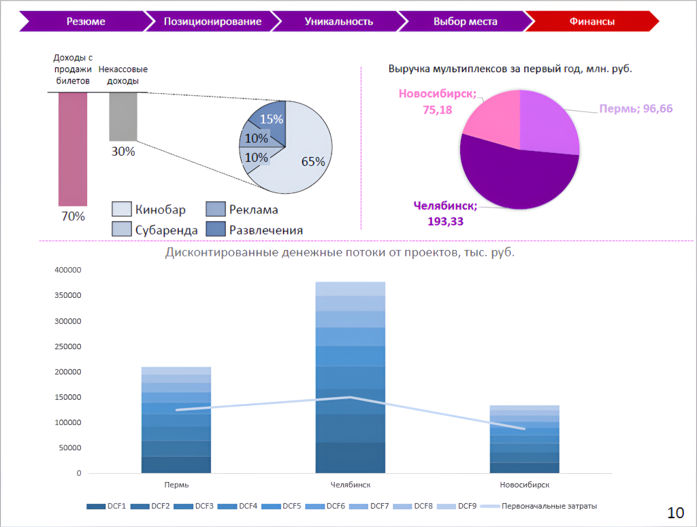

# Ответы: неделя 11

Приведены авторские рекомендации к заданиям 11.1–11.7 и примеры исправленных слайдов. Иллюстрации сохранены с текстовыми расшифровками.

**Источник:** физические страницы PDF 293–299. Печатные номера не установлены.

**Для последовательного чтения:** [Ответы: задания 10.5–10.7](09-week-10-valuation.md).

**Навигация:** [Индекс главы](INDEX.md) · [Маршрутизатор](../../ROUTER.md) · [Проблемы источника](../../meta/issues.md).

---

## Источник: [PDF 293](../../SOURCE.md#pdf-293)

### Неделя 11. Презентация решения

**Практическое задание 11.1**

https://www.youtube.com/watch?v=Y21xzVH8NGY

В этом видео мы наблюдаем двух слушателей: мистера Баттерфилда и его молодого коллегу. Можно заметить, что молодой человек хочет показать свою компетентность и придирается к цифрам, которые показали консультанты, — пример перфекционизма. Его старший коллега похож на математика или визуала: он спокойнее относится к происходящему и явно доверяет мнению консультантов, которые стоят перед ним.

**Практическое задание 11.2**

1. В Китай в этом году хлынет поток инвестиций: русские, американские и японские бизнесмены планируют проникнуть на китайский рынок. Дедукция.

2. Я работал в креативном агентстве много лет и привык к гибкому графику, который предоставлял мне работодатель. Поэтому когда я перешел на работу в госструктуру с режимом работы с 9:00 до 18:00, мне там не понравилось. Дедукция.

**Ссылки на этой странице исходника:** [Ссылка url-283](../../meta/source-links.md#url-283).

## Источник: [PDF 294](../../SOURCE.md#pdf-294)

3. Я думал, что жену можно найти в университете. Искал на старших курсах, на младших и на своем курсе. Когда не нашел, стал искать на работе. Потом стал искать в интернете. Индукция.

4. Рынок подгузников в Австралии вырос в 2017 году на 5 %. Это обусловлено новой демографической политикой и, как следствие, ростом рождаемости. Дедукция.

5. У компании падает прибыль. Это можно объяснить двумя факторами: падением выручки и увеличением расходов. Выручка, в свою очередь, может падать из-за снижения цены или уменьшения количества проданного продукта. Расходы могут расти из-за увеличения переменных либо постоянных расходов. Индукция.

**Практическое задание 11.3**

1. MacBook лучше, чем Lenovo.

Аргументы за:

- Apple — премиальный бренд, который ассоциируется с успехом.

- MacBook почти не зависает, его нужно ремонтировать значительно реже.

- MacBook синхронизируется с iPhone.

Аргументы против:

- MacBook не синхронизируется с другими смартфонами.

- Lenovo дешевле.

- Windows более привычна для работы, так как ее использует большинство компаний.

2. Чтобы привлечь молодую аудиторию, нужно использовать digital-каналы.

Аргументы за:

- 94 % молодых людей используют смартфоны.

- Социальные сети являются самым распространенным каналом.

- Digital-каналы дешевле многих видов офлайн-рекламы (например, ТВ).

Аргументы против:

- Охват аудитории в digital меньше, чем охват ТВ.

- Digital-каналы перегружены информацией, из-за этого возникают сложности при анализе и интерпретации метрик эффективности.

- Работа с digital-каналами требует грамотного обращения, иначе деньги будут потрачены зря.

3. Работа в маркетинге не подходит интровертам.

Аргументы за:

## Источник: [PDF 295](../../SOURCE.md#pdf-295)

- Маркетинг предполагает общение с большим количеством людей.

- В маркетинге необходимо быть открытым для новых идей.

- Работа в маркетинге сосредоточена на внешнем мире.

Аргументы против:

- Интроверты бывают гениальными генераторами идей.

- Интроверты мыслят оригинально.

- Интроверты способны сосредоточиться лучше, чем экстраверты.

4. Чтобы много зарабатывать, нужно работать больше, чем 40 часов в неделю, а иногда и по выходным.

Аргументы за:

- Высокооплачиваемые должности и профессии всегда предполагают ненормированный график.

- Заработать можно только благодаря упорному труду.

- Все великие и богатые люди много работают.

Аргументы против:

- Можно удачно инвестировать, ничего не делать и получать большой доход.

- Переработки приводят к проблемам со здоровьем, что требует дополнительных расходов на лечение.

- Переработки убивают продуктивность и не позволят долго работать эффективно, а соответственно, и зарабатывать.

**Практическое задание 11.4**

На самом деле эти месседжи были такими:

## Источник: [PDF 296](../../SOURCE.md#pdf-296)

На рисунке приведены элементы: > Резюме Клиент> Инициативы; Привлечение; Сегментация позволяет выделить нужды каждого выделенного типа клиентов; Persona Grata; • Сегмент. Полная текстовая расшифровка приведена отдельно; геометрия и цветовые обозначения сохранены на изображении.

[Подробная текстовая расшифровка рисунка](../../assets/transcripts/pdf-296-img-01.md).

В зависимости от того, на чем нужно сделать акцент, месседжи могут быть другими. Например:

1. Реализация стратегии в 16 новых городах позволит Райффайзенбанку увеличить охват малых предприятий на 19 %.

2. Самый многочисленный сегмент клиентской базы — «работники», их доля 66 %, и они имеют высокую вариацию доходов.

3. Инфраструктура — основной драйвер роста числа электромобилей во всех странах.

**Практическое задание 11.5**

1. В 2010 году объем добычи никеля в стране упал на 25 %. Это повлекло за собой резкий рост цен на изделия из никеля. Вертикальное следствие.

2. Компания придерживается следующих ценностей: высокие стандарты качества, честность, равенство, уважение, фокус на результат, командная работа, инновации во всем. Круговое расположение элементов.

3. Наше решение основано на анализе экономической ситуации в Китае, предполагает ряд мер по проникновению на рынок Китая, включает в себя оценку рисков и обойдется в 100 млн рублей. Деление на 4.

4. Мы планируем запустить продукт в продажу в 2018 году. В январе мы устроим презентацию в Crocus City Hall, в феврале — марте представим скидки 30 %, в мае начнем сотрудничество с блогерами, а в сентябре снимем мини-фильм о нашем товаре. Таймлайн.

**Практическое задание 11.6**

## Источник: [PDF 297](../../SOURCE.md#pdf-297)

На рисунке приведены элементы: едложено поменять структуру компании и разделить сотрудников отдел; одаж и маркетинга по брендам, чтобы увеличить скорость работы на 2:; маркетинг; продажи; R&D. Полная текстовая расшифровка приведена отдельно; геометрия и цветовые обозначения сохранены на изображении.

[Подробная текстовая расшифровка рисунка](../../assets/transcripts/pdf-297-img-01.md).

**Практическое задание 11.7**

На рисунке приведены элементы: М. видео; Анализ рынка; Точки; привлечения; Зонирование. Полная текстовая расшифровка приведена отдельно; геометрия и цветовые обозначения сохранены на изображении.

[Подробная текстовая расшифровка рисунка](../../assets/transcripts/pdf-297-img-02.md).

Положительные стороны:

- Слайд структурирован, соблюдается правило расположения элементов слева направо и сверху вниз.

- Презентация выдержана в нескольких цветовых оттенках, соблюден принцип контраста.

- Хорошее соотношение текста и инфографики.

- Используется панель навигации.

- Использован подходящий инструмент визуализации — Harvey’s balls.

## Источник: [PDF 298](../../SOURCE.md#pdf-298)

Что можно улучшить:

- Заменить шрифт с засечками на более читаемый.

- Объединить месседж и вывод, доработать его.

- Добавить отдельные месседжи для каждого блока слайда.

- Использовать визуальные элементы единой стилистики, цвета.

- Добавить расшифровку «1,2» к Harvey’s balls.

- Сделать везде выравнивание текста по левому краю.

На рисунке приведены элементы: Резюме; Позиционирование; Уникальность; Выбор места; Финансы. Полная текстовая расшифровка приведена отдельно; геометрия и цветовые обозначения сохранены на изображении.

[Подробная текстовая расшифровка рисунка](../../assets/transcripts/pdf-298-img-01.md).

Положительные стороны:

- Использование инфографики.

- Совокупно на слайде отражено много информации.

- У двух графиков есть заголовки.

- Спокойные цвета.

- Хорошо читаемый шрифт без засечек.

- Используется панель навигации.

Что можно улучшить:

- Добавить заголовок слайда.

- Логика размещения элементов на слайде непонятна.

- Добавить месседжи к диаграммам, доработать заголовки.

- Оформить графики: цвета, цифры (округлять до целых), подписи, ориентация.

## Источник: [PDF 299](../../SOURCE.md#pdf-299)

- Изменить вид графика дисконтированных денежных потоков — уменьшить детализацию или более подробно описать DCF1-9

**Ссылки на этой странице исходника:** [Ссылка url-284](../../meta/source-links.md#url-284).

## Связанные разделы

- [Все темы главы](INDEX.md)
- [Термины и сокращения](../../GLOSSARY.md)
- [Предыдущая тема: Ответы: задания 10.5–10.7](09-week-10-valuation.md)
- [Следующая тема: Ответ: неделя 12](11-week-12.md)
